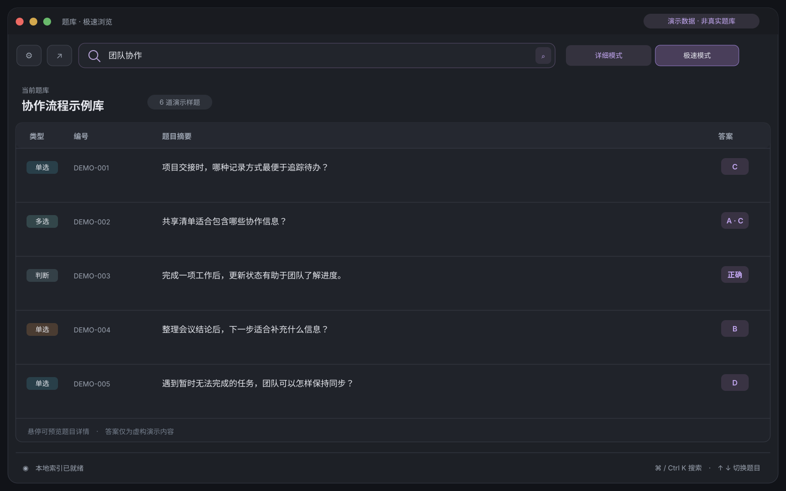
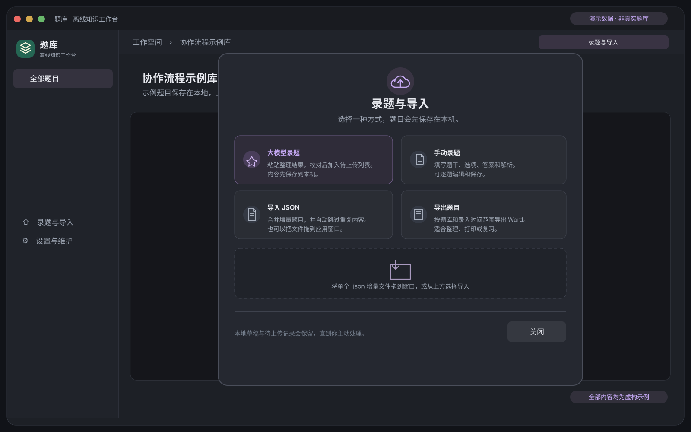

# 题库

<div align="center">
  
  <p><strong>本地优先的题目检索、整理与复习工具</strong></p>
  <p>macOS · Windows · 微信小程序</p>
</div>

题库把常用题库保存在本机，支持快速搜索题干与选项、查看答案和解析、整理自己的题目，并按需同步获授权的云端题库。桌面端提供详细与极速两种浏览方式；微信小程序可以随时检索、阅读和录题。

## 界面预览

以下界面图只使用虚构的演示题库与示例题目，不包含项目当前题库内容。

| 桌面端：搜索与题目详情 | 桌面端：极速浏览 |
| --- | --- |
|  |  |

| 桌面端：录题与导入 | 微信小程序：选择申请维护的题库 |
| --- | --- |
|  |  |

## 功能

- **本机检索**：按题干、选项、标签、章节或编号搜索；答案与解析在详情面板中查看。
- **两种浏览方式**：详细模式适合阅读题目内容，极速模式适合连续刷题。
- **本地录题**：支持手动录入、粘贴大模型整理结果、草稿自动保存，以及 JSON 增量合并。
- **图片识题**：桌面端可截图或粘贴图片，识别后匹配本机已有题目。
- **多端使用**：桌面端适用于 macOS 与 Windows；微信小程序提供搜索、详情和录题流程。
- **按需云端协作**：小程序注册维护者时可选择申请维护的题库；登录并获得对应题库授权后，可提交待上传题目。桌面维护者还可管理云端题库与历史版本。
- **本地维护**：桌面端支持题库导出、数据库备份恢复、主题与托盘图标设置。

普通搜索和本地录题无需登录。云端同步与上传按账号、题库和权限分别控制；题库内容默认保存在本机。

## 本地开发

桌面端使用 React、TypeScript、Vite、Tauri 2、Rust 与 SQLite；微信小程序使用原生页面和 TypeScript。桌面开发环境需要 Node.js 22.18 或更新版本、pnpm 11。

```sh
pnpm install
pnpm tauri dev
```

macOS `.app` 构建：

```sh
sh mac/scripts/env.sh pnpm tauri build --bundles app
```

更多模块说明、数据格式和开发命令见[开发文档](开发文档.md)。
