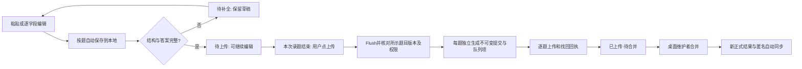

# 代码审计与录题重构方案 · 待审核

审核日期：2026-10-18。代码基线：`b307cf38b44a7789c179d9eb4cb7f65e948e2b35`，分支 `codex/compact-bank-experiment`。

**本文件是现状审计和改写提案，不代表功能已经改好。** 本轮只新增审核文档、独立交互原型；生产代码、数据库、云权限和真实题库均未修改。原有[开发文档](../开发文档.md)保留为旧实现记录，审批后再同步修订。

配套：[桌面 / 小程序交互原型](review/intake-redesign-2026-10-18.html)。原型使用虚构题目、权限和传输结果，不访问真实题库或云端。

原型右上角可切换桌面与小程序；桌面的“题库管理”可切换演示身份，查看最高权限的“设为云端题库”流程。原型中的保存、上传、权限验证均为内存模拟，刷新会重置。

## 1. 本轮最后确认的产品边界

以下约束优先于旧文档中的“连续录完后整批上传”。

1. **已有题库：逐题录入，自动保存到本地。** 录入期间不自动上传；整个录题过程结束，用户主动点击“上传”。
2. 这次点击可处理此题库多条待上传记录。日常界面不再暴露批次、拆包或“整批上传”，不得把“逐题录入”误解为每录一道就联网发送。**实现建议：每题独立提交、独立回执、独立重试**，以下技术方案按这一建议展开，等待本次审核。
3. 未上传题目统一保留在“录题记录”中，标记“待上传”；没有保存完整的显示“待补全”。跨录入时段保留，上传按钮明确显示本次将发送的题数。已确认正在传输但尚无回执的记录仍可在此表查看。
4. **只有桌面端、最高权限账号，才能新建自动同步云端题库。** 入口在题库管理：选一个已有本地题库 → “设为云端题库”。确认后，自动执行建库、首版整库上传及启用同步，不要求用户手动导出、上传 COS 或配置目录。
5. 小程序没有“设为云端题库”入口。普通本地建库仍属于离线能力；新建本地库不会自动获得云端创建或上传权限。
6. 创建云库的最高权限与“向已有库上传”“合并发布”分开。拥有某库 `upload` 或 `merge` 权限不能创建云库。最高权限指**应用内权限**，不是把腾讯云主账号密钥发给桌面软件。
7. 日常搜题、下载已公开题库、录题和本地自动保存免登录。上传时才要求该库的开发者授权；桌面合并仍要求该库的合并权限。
8. 新题在上传前由录入者核实，上传成功直接“待合并”，所有用户同步后可搜。不新增上传后的审核流程。旧的未核对历史数据走兼容入口。
9. 每题保留首次录入时间，修改另记更新时间。云库的正式合并结果名使用时间与标识字符串；稳定的 `bank_id` 不随名称或版本改变。
10. 传输继续采用 `gzip + Base64`。Base64 是编码，压缩由 gzip 完成。断网、关闭与重开都围绕已落盘记录恢复；不承诺小程序被系统关闭后还能完成网络任务。

**交互主线：** 粘贴 / 手工输入 → 自动保存 → 下一题 → 录题结束 → 上传 → 逐题回执。只有“本地库设为云端库”使用整库初始化。

## 2. 审计范围与验证层级

### 2.1 本轮做了什么

- 检查桌面 React / Tauri、共享协议、小程序页面与服务、云函数、导入导出、数据库、搜索、OCR、平台脚本及现有测试的模块边界。
- 对录题从入口、解析、编辑、持久化、导出、授权、传输、回执到合并分发逐段追踪。
- 主应用链路的统计口径包含 83 个手写代码 / 样式 / 脚本文件、11,623 行；不含测试、依赖、数据、生成文件，以及另外检查的 `tools/` 运维工具和平台原生适配。行数用于定位维护热点，不代表复杂度或质量评分。
- 对高风险组合操作做独立复现，使用临时 SQLite 数据库和合成题目。没有操作用户数据库、真实 COS 或真实提交。
- 重新运行 95 项 JavaScript 测试、41 项 Rust 集成测试，以及桌面和小程序 TypeScript 检查，均通过。小程序生成资源一致性检查通过。
- 独立原型通过 14 项 Chrome 交互检查，覆盖答案切换、自动保存演示、记录移除与撤销、上传任务、移动布局和云库转换权限；已查看桌面、手机布局与转换流程截图。它验证的是原型，不是正式应用。

### 2.2 不能据此声称的结果

测试通过不意味着没有缺陷，本次新增复现已经证明现有测试遗漏了组合场景。本轮没有重新进行 Android / iOS / Windows 真机测试，没有验证真实云权限或生产域名，也不是完整的安全渗透、负载或依赖供应链审计。

本轮本地证据在 `artifacts/intake-audit-20261018/`：`js-tests.log`、`rust-all-tests.log`、`probe.rs`、`probe.log`、`prototype-checks.json` 和 `prototype-*.png`。该目录按项目规则忽略，不随 Git 提交。下文保留了可读复现步骤和结果。

## 3. 主要发现：先修状态与数据问题，再换界面

标记：**已复现**＝运行现有代码得到结果；**静态确认**＝代码路径明确；**风险**＝尚未用真实故障验证。P1 优先修复数据变化或阻塞提交；P2 为流程、恢复或维护问题。

### F01 · P1 · 草稿识别静默丢掉第 9 个及后续选项【已复现】

- 位置：[shared/intake.ts](../shared/intake.ts)，`parseDraft` 第 104 行起、`editedReplyText` 第 166 行起。
- `parseDraft` 对选项执行 `slice(0,8)`。保存时校验的是已经截断、重新生成的 JSON，不再是原始输入。
- 复现：给九选项单选题、答案 A、完整模型字段；原始 JSON 被严格校验拒绝，进入编辑器后仅八选项，再保存却通过，`warnings` 仍为空。
- 影响：题目内容被改变，用户没有收到丢失提示；桌面、小程序共享同一规则。
- 改写：解析器保留原始内容并返回字段诊断；超限不截断。编辑区显示全部识别内容并阻止提交，用户明确修改后才解除。不可用“自动修复”掩盖数据损失。

### F02 · P1 · 取消导出会冻结记录，还可能堵住后续上传【已复现】

- 位置：[src/intake-panel.tsx](../src/intake-panel.tsx) 第 49 行；[src-tauri/src/cloud.rs](../src-tauri/src/cloud.rs) `transfer` 第 251 行、`prepare_batches` 第 54 行；[src-tauri/src/intake.rs](../src-tauri/src/intake.rs) `edit_entry` 第 348 行。
- 桌面为生成文件名，在打开保存对话框之前就调用 `cloud_transfer`；该函数写入冻结记录。取消对话框也不会撤销冻结。
- 复现：同组录入 101 题 → 执行导出前置的 `transfer(endpoint="")` → 模拟取消，不写文件 → 编辑被拒绝；`prepare_batches` 返回 1 个未拆分包，上传报“上传批次最多 100 题”。
- 输出：`edit=本批次已冻结；prepared_parts=1；upload=上传批次最多100题`。
- 小程序也在文件成功写出前持久化 `sealedText`，因此存在导出失败但记录已经冻结的同类风险，尚未做磁盘故障复现。
- 改写：导出只创建独立的只读快照，不把编辑记录变成上传任务。取消导出无业务状态变化。已经发出、结果未知的旧任务不能直接解冻，需要先核对原回执。

### F03 · P1 · 删除新题后，批次计数与实际内容不一致【已复现】

- 位置：[src-tauri/src/intake.rs](../src-tauri/src/intake.rs) `batches` 第 429 行、`entries_conn` 第 449 行；[src-tauri/src/db.rs](../src-tauri/src/db.rs) `delete` 第 441 行。
- `batches` 统计 `intake_entries`，关联已删除题目时没有把它排除；读取题目内容时却排除了删除项。
- 复现：录入一题 → 从题库移入回收站 → 批次仍返回 `count=1,pending=1`，实际可见条目为 0，准备上传报“本批次没有新题”。
- 影响：出现空的待上传分组；若与正常分组一起准备，可能中断整次入队。
- 改写：待上传计数、列表、提交集合使用同一个查询条件；移除、恢复与可提交状态在同一事务中更新。

### F04 · P2 · 页面本身承担了大部分业务编排【静态确认】

- 桌面 `IntakePanel` 同时管理原文、解析计时器、两份草稿、题库切换、列表聚合、签名确认、导出、登录与队列。
- 小程序 `pages/intake/intake.ts` 同时保留 `reply`、`editOptions`、`boolSelected`、`typeIndex`、`warningsText` 等相互可推导状态，字段改动后要手工同步多份表示。
- 改写：页面只负责展示、输入事件和导航；解析、保存、提交、恢复分别由领域函数与用例服务负责。视图模型由单一编辑状态生成。

### F05 · P2 · 一个全页 busy 锁覆盖了本地录题和整个网络队列【静态确认】

- 位置：桌面 `task` / `upload`，小程序 `run` / `onUpload`。
- 两端都等待整个队列执行完才释放 busy，期间录题或局部导航被一起禁用。桌面还显示“关闭窗口后继续”，但录题对话框的关闭按钮被禁用，表达与交互不一致。
- 改写：区分解析、保存、提交准备、单题传输四种状态。已确认题目冻结传输快照，新的题目继续编辑。网络队列独立于录题页生命周期。

### F06 · P2 · 桌面“冻结内容”和“队列落盘”分成多次写入【静态确认，故障风险】

- 位置：[src/cloud-client.ts](../src/cloud-client.ts) `enqueueDesktop`；Rust `prepare_batches` / `transfer` / `client_state`。
- 原生准备可以成功，之后队列 JSON 写入失败，留下有冻结包、没有任务的记录。代码已明确保留这个中间态，但恢复入口不够清楚。
- 小程序当前入队使用同一次 `updateLocal`，这一点比桌面完整；重构时应保留。
- 改写：桌面单个 Rust 用例事务写入提交快照、身份绑定与队列项。启动扫描旧孤立冻结包，先分类，不盲目重发或解冻。

### F07 · P2 · 错误分型不足，非网络错误可能被反复当作断网重试【静态确认】

- 位置：[shared/queue.ts](../shared/queue.ts) `failedJob`。
- 没有 `status` 的普通 `Error` 被归为可重试；回执格式异常、本地损坏等错误也可能进入这一路径。`failed` 状态又被“恢复任务”跳过，页面没有针对失败原因的修复路径。
- 改写：错误明确分为网络暂时失败、身份失效、内容错误、存储失败、回执待找回、版本冲突。每类有不同下一步，保留不可变请求用于找回结果。

### F08 · P2 · 自动保存写入粒度过大，失败提示不稳定【静态确认，性能风险】

- 位置：[miniprogram/miniprogram/services/intake-store.ts](../miniprogram/miniprogram/services/intake-store.ts)，`updateLocal`；录题页 `persistDraft`。
- 每次字段变化会克隆、序列化、校验并写整个本地录题文件，文件还包含历史题和上传内容；某些输入路径重复触发保存。历史增长后成本随文件增长。
- 桌面也按字段变化排队保存整个草稿，没有合并中间版本。两端已有串行写、错误保留或临时文件保护，这些不能在“简化”时删掉。
- 改写：草稿按库 / 题分离；只合并尚未开始的草稿写入，建议 400ms 防抖，失焦 / 下一题 / 切库 / 上传前 flush。明确显示“保存中 / 已存本机 / 保存失败”。失败不丢输入，也不上传旧版本。

### F09 · P2 · “收起草稿”和保存完整记录的关系不清楚【静态确认】

- 当前“收起草稿”把当前题移到唯一的 previous 槽，然后清空当前题。用户必须理解草稿与入库的差别才能结束录入。
- 且真正写入题库仍需手动“保存本题”，并不满足本轮新增的“自动保存到本地”。当前自动保存的是草稿，不能把它写成已自动完成题目录入。
- 改写：每一题有稳定的本地记录 ID，输入自动保存；“下一题”仅切换焦点 / 新建草稿。未完整题目也保留在记录列表，以“待补全”定位，不能退到单个恢复槽里。

### F10 · P2 · 通用建题与录题是两条不同的持久化路径【静态确认】

- 桌面 `save_question` / `Store::save` 可以新增普通本地题，但不会为新题自动创建 `intake_entries`；`intake_save` 才创建录题记录。
- 修改已有录题会尝试同步 `intake_originals`，所以不能笼统说两条路径完全独立。
- 改写：明确“已有云库新增题”统一调用录题用例；“私人本地题库维护”保留本地语义。转换为云库时从选定本地库形成首版快照，不能猜测遗漏哪些记录应该提交。

### F11 · P2 · 全量状态与历史持续累积，存在容量天花板【静态确认】

- 云端 `workflow.cjs` 每次保存包含正式题、候选、已处理记录和操作历史的完整状态，硬上限 4 MiB；记录持续累积，当前没有自动归档界面。
- 小程序本地文件也同时保存题目、原包和历史。尚未做长时间录题容量压测，不把它宣称为当前已经发生的故障。
- 改写：近期先显示可用容量、限制和失败位置；中期独立归档操作记录。超过上限必须明确拒绝并保留本地数据，不通过取消限制来“修复”。

### F12 · P2 · 缺少本轮要求的“最高权限转换云库”模型【静态确认】

- 云目录由 `QBANK_BANKS` 配置提供；目前没有注册新云库的产品接口，也没有单独的全局创建权限。
- 现有 `/seed` 允许该库 `merge` 或兼容 `publish` 权限初始化**已经配置好的云库**，不是“选本地库后自动创建云库”。不能将现有实现标成满足新需求。
- 改写：新增全局 `cloud_bank:create` 能力与桌面转换用例；首版初始化必须校验该能力。服务端还要限制只有桌面身份可调用；小程序不能通过直接请求绕过隐藏按钮。

### F13 · P2 · 全局结构与文档需要同步整理【静态确认】

- `App`、录题页和维护页把服务调用与展示混在一起；许多逻辑挤在极长单行里，行数低不代表函数简单。
- `styles.css` 1,188 行，录题选择器在文件末尾多次覆盖；目前虽有折叠区，但编辑、列表、导出、任务与上传核实仍在同一个滚动对话框内。
- `Question` / `IntakeQuestion` / Rust 模型 / 云端校验有重复协议定义，时间字段及选项 ID 的严格程度不一致，需要契约样例约束。
- `shared` 到小程序 `core` 的三个副本由脚本生成，**属于有意生成，不应当作手工重复代码删除**。
- 开发文档已有“源码完成”和“剩余工作仍列同一功能”的混合描述；下一次按“已实现 / 已验证 / 未验收 / 计划”分别记录，并替换本轮失效的日常整批上传说明。

## 4. 新题录入相关逻辑状态清单

“已有”仅表示代码存在，验证层级见第 2 节和各项说明；“待改”均未在本轮实现。

### 4.1 入口、解析与编辑

| 功能 | 当前实现及状态 | 按最新要求的处理 |
| --- | --- | --- |
| 桌面录题入口 | `main.tsx` 打开 `IntakePanel` 对话框；全局粘贴识别模型 JSON | 改为独立录题工作区，保留来源跳转 |
| 小程序入口 | `pages/intake/intake`；首页高级入口默认关闭 | 保留高级入口边界，内部改录题工作区 |
| 提示词复制 | 桌面组件、小程序服务，共用生成模板 | 保留；短按钮，不占整块编辑高度 |
| 桌面原文即时解析 | 300ms 防抖、组合输入保护、过期结果隔离 | 保留，抽成解析控制器 |
| 小程序粘贴 | 按钮读剪贴板；没有原文框 | 保留；解析失败保留原文、提示重新粘贴或手工补齐 |
| 单题 JSON / 围栏 | 严格解析与宽松草稿解析并存 | 统一返回带诊断的结果，不静默截断或默认未知题型 |
| 一次多题文本解析 | 目前不支持，每次一个 JSON 对象 | 日常仍逐题；不加隐式多题粘贴 |
| 手工录题 | 两端都有空题模板 | 保留，首次修改即建稳定本地记录 |
| 题干、选项、解析 | 可编辑 | 保留；长文本自适应高度 |
| 答案圆点 | 单选互斥、多选切换、再次点击取消 | 保留，同时提供文字 / 屏幕阅读状态 |
| 判断题 | 正确 / 错误，可清空答案 | 保留，不以空数组伪装已选答案 |
| 选项增删排序 | 2～8 个；答案按选项内容映射 | 使用稳定选项 ID；删除已选项明确要求重选 |
| 切换题型 | 清空答案，判断题移除选项 | 增加可撤销操作，避免误切丢内容 |
| 模型来源与警告 | 有名称、版本、来源、修改提示 | 信息折叠；未知模型不虚构，内容警告不冒充后置审核 |
| 补充字段 | 章节、标签、难度、适用版本、外部编号 | 桌面与小程序统一折叠成“更多信息” |
| 完整性校验 | 保存和服务端都有校验 | 自动保存允许不完整；上传必须通过严格校验 |
| 重复 / 答案冲突 | 按题干、类型、选项内容精确比对；拒绝覆盖 | 复用领域比较；就地说明哪道题冲突，不整页报泛化错误 |

### 4.2 本地保存、记录列表和文件交换

| 功能 | 当前实现及状态 | 按最新要求的处理 |
| --- | --- | --- |
| 草稿自动保存 | 已有，按库保留当前与上一份 | 拆分按题自动保存，不能只保留一份上次草稿 |
| 完整题自动入本地记录 | **尚无**；仍要点击保存本题 | 新增自动保存的本地题目记录与待补全状态 |
| 首次录入时间 | 保存时生成；编辑保留 | 首次本地记录持久化时生成，之后稳定；更新另记 |
| 切换题库 | 等待草稿写入后切换，恢复对应草稿 | 保留；禁止上一个库的异步结果写到新库 |
| 新题列表 | 按库聚合多个物理批次未上传题 | 改称“录题记录”，按题显示，批次不进入用户操作 |
| 编辑已存题 | 未冻结时可编辑 | 未提交记录持续可改；已提交快照不可变 |
| 移除 / 恢复 | 录题列表没有专用入口；桌面题库回收站另有 | 增加移除与撤销；同步修复 F03 |
| 本地索引更新 | 新题写入 / 缓存失效后可搜 | 不完整草稿不进正常搜题；完整有效记录才进本地层 |
| 通用题库新增 | 另走 `save_question`，不必然进入录题列表 | 云库新增收敛到录题用例，私人编辑语义明确区分 |
| 导出压缩增量 | 已有；副作用会冻结编辑，见 F02 | 导出独立快照，失败 / 取消不改变上传状态 |
| 微信文件转发 | `shareFileMessage`，记录分享时间 | 保留；分享不是上传回执 |
| 文件导入 | 桌面拖入、小程序从聊天选择；重复去重 | 保留；导入不自动向云端发送 |
| 本地新建题库 | 两端可新建私人本地库 | 保留免登录；云库转换仅桌面最高权限 |
| 导入记录冻结 | 小程序导入可带 `sealedText`，默认不可编辑 | 旧快照保留；本地工作记录与交换文件身份分离 |
| 备份恢复 | 桌面数据库备份、临时文件写入等已有 | 迁移前备份；小程序迁移失败保留旧文件 |

### 4.3 上传、权限、恢复与分发

| 功能 | 当前实现及状态 | 按最新要求的处理 |
| --- | --- | --- |
| 日常上传入口 | 录完后整批确认，两端多分组聚合 | 改为录题结束点击“上传”，按题独立提交 |
| 日常多次确认 | 桌面追加完整核实列表；小程序还加系统弹窗 | 用录题记录就地核对；点击上传即确认所示内容，不追加重复大表 |
| 本地保存触发网络 | 保存本题本身不上传 | 保留；自动保存也不上传 |
| 超 100 题拆包 | 已有分组拆包，单包最多 100 题 | 日常新协议每请求 1 题，无批次选择；旧队列原样恢复 |
| gzip + Base64 | 有大小、摘要、解压限制 | 保留并共享跨语言固定样例 |
| 开发者登录 | 微信 code 换身份、允许名单按库授权 | 保留，非腾讯云密钥；按需登录 |
| 桌面登录 | 独立高熵密钥、短会话、可选系统凭据 | 保留；界面不长期占据录题区 |
| 最高权限建云库 | **尚无独立模型 / 接口**，目录依赖环境配置 | 新增 `cloud_bank:create`，桌面身份与能力双重校验 |
| 首版初始化 | `/seed` 对已配置题库初始化，当前 merge 可调用 | 收紧权限并纳入“设为云端题库”自动流程 |
| 冻结与入队 | 两端都有；桌面有中间态，见 F06 | 原子记录每题提交快照及任务；不冻结整次录题工作区 |
| 重试 | 指数退避、同身份 / 地址 / 原包恢复 | 保留；区分内容错误、回执找回与网络重试 |
| 回执 | 核对题库、包 ID、内容摘要、题数后本地落盘 | 日常细化到每题；全部保存完才算成功 |
| 退出登录 | 暂停未完成任务，保留数据 | 保留，不自动迁移任务到另一个账号 |
| 应用关闭 | 桌面隐藏可保留进程；小程序有 onHide / onUnload 保存 | 日常编辑持续落盘；已确认任务重开续传，无关闭后执行承诺 |
| 上传后的同步 | 队列成功后触发，部分失败被吞掉 | 上传完成和同步失败分别显示，禁止误报整条链路完成 |
| 匿名目录 / 快照 | 公共读取、版本 / 摘要校验、保留旧快照 | 保留，下载调度独立于录题页面 |
| 待合并公开可搜 | 云投影保留 pending 层，两端组合层 | 保留“待合并”标记；待合并不是待审核 |
| 桌面合并 | 按库角色、冲突阻止、重复去重、幂等操作 | 保留；合并不等于有权创建新云库 |
| 旧未核对数据 | `pending_review` / `review` 兼容路径 | 仅历史入口保留，日常新题不再进入 |
| 结果命名 | 时间、库名、阶段、版本、ID / 摘要片段 | 保留，展示短库名，完整结果名放版本详情 |
| 正式生产接入 | 文档记录仍有域名 / 合法域名 / 真机事项 | 单列外部验收，不由本次原型宣称完成 |

## 5. 全局函数化与模块拆分

目标是让每个函数对应一个明确业务动作，区分纯计算与写库 / 联网；不是把长函数随意切成很多无意义的小函数。保留 React、Tauri、SQLite、原生小程序和 COS 架构。

| 现有模块 / 边界 | 审计判断 | 建议拆分和保留项 |
| --- | --- | --- |
| `src/main.tsx` | 路由、搜索、偏好、弹窗、文件导入、后台任务混合 | `AppShell`、`useBankNavigation`、`ImportController`、`ModalRouter`；主组件只组装 |
| `src/use-question-results.ts` | 已有请求隔离、翻页、过期结果防护 | 保留独立 hook；把查询类型移至契约层，不重写搜索算法 |
| `src/intake-panel.tsx` | 页面级责任最集中 | `IntakeWorkspace` + 草稿 / 列表 / 提交用例；详见下节 |
| `src/model-editor.tsx` | 已抽出编辑器，但混用草稿与有效题类型 | `QuestionEditor`、`ChoiceEditor`、`AnswerPicker`、`MetadataFields` |
| `src/cloud-client.ts` | 会话、凭据、上传、同步、发布队列在一个模块 | `session-service`、`submission-runner`、`sync-scheduler`、`publish-service` |
| `src/cloud-panel.tsx` | 维护、安装、登录、候选 JSON 编辑混合 | `CloudBankLibrary`、`MergeWorkspace`、`AuthDialog`；旧审核独立折叠 |
| `src/styles.css` | 全局样式与末尾覆盖堆叠 | 公共 tokens / 基础控件 + intake / search / cloud 样式；逐页迁移，不全局替换 |
| 小程序录题 Page | 业务逻辑和衍生展示数据混合 | 薄 Page 事件绑定 + `intake-controller` + `toIntakeViewModel` |
| 小程序 services | 已有 service 分层，但存储粒度大 | repository、draft-store、submission-store、cloud-client 各司其职 |
| `shared/intake.ts` | 解析、编辑、时间、去重、包协议、摘要混合 | `domain/draft`、`domain/question`、`domain/identity`、`protocol/package`、`time` |
| `src-tauri/src/lib.rs` | 560 行命令接线与部分业务编排 | `commands/{intake,cloud,library,exchange}`；业务在 services / repository |
| `db.rs` / `intake.rs` | 库与录题读写交织，存在不同查询口径 | `QuestionRepository`、`IntakeRepository`；统一 eligible 查询；保留事务和冲突检查 |
| `exchange.rs` | 1,155 行，多格式解析、打包、导出集中 | `formats/{jsonl,docx,xlsx,package}` + import-service；保留预览、取消、撤回和原子提交 |
| `backup.rs` / `import_jobs.rs` | 已有独立职责和回归覆盖 | 作为稳定边界保留，不为目录美观改数据库语义 |
| Rust `cloud.rs` | 请求、包、提交记录、快照落地集中 | HTTP adapter、submission repository、snapshot service |
| 云 `service.cjs` | 配置、认证、路由、上传混合 | `config`、`auth`、`routes`、`submission-service`；继续服务端独立校验 |
| 云 `workflow.cjs` | 读取投影、注册、初始化、旧审核、合并在一工厂 | `catalog`、`snapshot-projector`、`register-entry`、`seed-bank`、`merge-bank`、`legacy-review` |
| 云 `adapters.cjs` | 已经隔离微信和 COS，方向正确 | 保留接口；新增受限目录注册适配，不让 UI 直接使用 COS 管理密钥 |
| OCR / 平台代码 | 前端 OCR 面板较重，原生适配已分目录 | 将识别、裁剪、匹配、取消调度分开；保留答案映射、平台降级和隐私边界 |
| `tools/` / 构建脚本 | 运维、飞书历史工具、资源生成与平台验收各自存在 | 保持离线运维独立；明确生成物单一来源；不把发布工具混进录题页面 |

共享契约用 TS / Rust / 云端共同的 JSON fixtures 验证。同一规则跨语言实现不意味着可以删除服务端验证。小程序生成文件继续由同步脚本生成，禁止两边手改。

## 6. 录题逻辑怎么改写

### 6.1 分清六种对象

| 对象 | 作用与不变量 |
| --- | --- |
| `DraftRecord` | 每题本地编辑记录；稳定 recordId、bankId、首次录入时间、编辑 revision；允许不完整内容 |
| `ValidatedQuestion` | 通过严格校验的有效题；不是直接把任意草稿强制转型 |
| `Submission` | 用户点击上传后生成的一题提交快照；绑定题目 revision、账号、服务地址、内容摘要 |
| `UploadTask` | 传输与回执恢复状态；不保存明文登录密钥，不改变提交内容 |
| `CloudBankPromotion` | 最高权限在桌面把本地库设为云库的持久任务；整库快照、首版提交和目录激活 |
| `CloudRelease` | 服务端确认的正式结果；独立版本、合并时间、结果名与摘要 |

日常没有用户操作层面的 `Batch`。旧 `batch_id` 可以作为兼容协议里的单题提交 ID；一题一个新包。最高权限整库初始化是另一种用例，不能复用日常上传按钮来偷渡多题包。

### 6.2 纯函数与用例的拟定接口

```ts
// 不联网、不写文件：完整保留输入，输出可定位的诊断。
parseModelText(text): { draft, diagnostics, unconsumedFields }
reduceDraft(draft, editCommand): DraftRecord
validateDraft(draft): { question?: ValidatedQuestion, issues: FieldIssue[] }
compareQuestion(question, bankIndex): New | Duplicate | AnswerConflict
projectIntakeRecords(records, submissions, receipts): IntakeListView
classifyUploadError(error): Network | Auth | Content | Storage | ReceiptUnknown

// 平台用例：对外承诺明确的持久化与副作用边界。
saveDraftRevision(record, expectedRevision): Promise<SavedRevision>
flushDraft(recordId): Promise<SavedRevision>
startNextQuestion(bankId): Promise<DraftRecord>
removeLocalRecord(recordId, expectedRevision): Promise<UndoToken>
prepareEntrySubmissions(bankId, expectedRevisions): Promise<SubmissionPlan>
confirmEntrySubmissions(plan, actor): Promise<TaskIds>
runNextUploadTask(): Promise<Outcome>
applyReceipt(submissionId, receipt): Promise<AppliedReceipt>
exportSnapshot(recordIds): Promise<ExportArtifact>
promoteLocalBank(bankId, expectedBankRevision, admin): Promise<PromotionTask>
```

`saveDraftRevision` 是本地自动保存，绝不发送网络请求；`confirmEntrySubmissions` 只能由用户点“上传”触发。按钮触发前 flush，不能上传最后一次有效内容而忽略此刻的新修改。

`prepareEntrySubmissions` 一次处理所示的多条记录，但每条生成独立 `Submission`。对用户显示“上传 6 题”，不显示“第 1 批”。重复点击先查原任务，不能重新生成提交 ID。

### 6.3 状态转换



| 维度 | 内部状态 | 用户看到什么 |
| --- | --- | --- |
| 编辑 | empty / editing / invalid / valid | 空题 / 待补全 / 待上传 |
| 本地保存 | dirty / saving / saved / error | 保存中 / 已存本机 / 保存失败 |
| 提交 | unsubmitted / frozen / receipted | 待上传可改 / 已提交等待回执 / 已上传 |
| 任务 | queued / uploading / retry / paused / blocked / done | 等待 / 上传中 / 网络恢复后续传 / 需登录 / 需处理 / 完成 |
| 云端内容 | pending_merge / merged / removed | 待合并 / 已合并至某时间结果 / 已撤回 |

状态不能压成一个 `busy` 或一个 `uploaded`。已保存不等于已上传；已上传不等于已合并；已导出或已分享都不改变上传状态。

### 6.4 自动保存细节

- 输入时同步更新内存草稿，异步写本地。原文、完整编辑结构和诊断一并保留。
- 初次本地记录落盘生成 `recorded_at`；更新只改变 `updated_at`。题目尚未完成也有稳定记录 ID。
- 只有“最新草稿 revision 已落盘且校验通过”才可上传；之前通过、现在无效的题必须重新显示待补全，禁止用旧有效版本代替。
- “下一题”先 flush 当前题；不完整题也可留在列表中继续补录。写入失败时停留并提示重试，不悄悄跳走。
- 上传前若有待补全条目，定位到这些题，用户可补齐或明确移除；默认不静默漏掉部分题。
- 上传确认冻结的是具体 revision。确认后的网络处理不阻塞录下一题；新录入的题等待下一次主动点击上传。
- 已发出或结果未知的快照不修改。纠错应作为独立纠错提案后续设计，不伪装成“同题新答案”的新增题。

## 7. 本地题库设为自动同步云端题库

### 7.1 权限矩阵

| 能力 | 未登录用户 | 该库开发者 upload | 该库维护者 merge | 最高权限 cloud_bank:create |
| --- | --- | --- | --- | --- |
| 本地搜题、自动保存、私人建库 | 是 | 是 | 是 | 是 |
| 匿名下载公开云库 | 是 | 是 | 是 | 是 |
| 向已有云库上传新题 | 否 | 是 | 仍须显式 upload | 仍须显式该库 upload |
| 合并发布已有云库 | 否 | 否 | 是，仅桌面 | 仍须显式该库 merge |
| 桌面本地库设为云端库 | 否 | 否 | 否 | 是 |
| 小程序创建 / 转换云库 | 否 | 否 | 否 | **否，平台约束独立检查** |

新建云库后，可在服务端为创建者显式写入该库 `upload` / `merge` 授权，纳入创建结果；不能依赖客户端推断“最高权限所以绕过所有校验”。

服务端不能把客户端传入的 `platform: desktop`、User-Agent 或隐藏按钮当作授权依据。建议由独立的桌面管理授权流程签发受限凭证，校验最高权限、凭证用途和创建能力；普通小程序登录会话不得获得创建能力。具体签发与撤销机制在阶段 D 实施前落定，不承诺仅凭请求字段能证明真实运行平台。

### 7.2 建议交互

桌面“题库管理” → 某个本地库的更多菜单 → **设为云端题库**。

展示所选库名、题数、初始结果预览、公开可下载的范围和当前账号。通过最高权限校验后，一次确认启动自动流程。小程序和非最高权限账号不显示操作入口，服务端同时拒绝越权请求。

自动步骤：

1. 持久化任务 ID，检查权限、库 ID 冲突、内容有效性及大小限制。
2. 生成选定本地题库的完整快照、摘要和预期本地 revision。只对该库设置“正在启用云同步”的短期编辑保护，其他库继续可用。
3. 在云端建立尚未公开的初始化任务，以同一操作 ID 上传首版内容。现有单题 100 题限制不能套到首版整库上传；复用 / 调整受限的初始化接口，明确整库上限。
4. 服务端校验内容并写入不可变首版；首版可读且校验通过后才激活目录条目。客户端不能在空库壳创建成功时宣告完成。
5. 客户端核验目录、首版摘要和回执，再把本地题库转换为受管云库，启用原有版本检查与同步调度。保留转换前本地备份。
6. 显示“已启用云端同步”，今后新增走逐题录入流程，修改正式内容走维护路径。

题库注册需要新的持久目录来源。推荐专门的受限注册表和幂等任务记录；SCF 内完成授权与注册，不让桌面去修改环境变量或直接管理 COS。注册表激活和内容发布的失败恢复必须设计好，再迁移静态 `QBANK_BANKS`。

### 7.3 必须先实现的失败恢复

- 内容已上传、目录尚未激活：保留初始化任务，继续原任务激活；不要创建第二个云库。
- 客户端超时：按原操作 ID 查询结果，不能用新 ID 再上传一次。
- 云端成功、本地转换失败：保留本地备份和任务，下次核对云端结果后完成本地标记。
- 同一 `bank_id` 已有云库：明确显示已存在；不覆盖，不自动换 ID 复制发布。
- 转换开始前本地题库已变：重新生成预览。任务快照锁定后不混入后续编辑。
- 初始化失败时，未转换成功的原本地库仍可恢复使用；结果未知时先核对，不直接删除云对象。

## 8. 前端重设计

### 8.1 信息结构

日常录题只保留三个一级区域：**录题、录题记录、上传记录**。题库转换位于独立的题库管理，最高权限才可操作。账号 / 服务地址 / 导出工具不再常驻题目编辑区域。

### 8.2 桌面录题工作区

- 使用可返回的工作区代替长弹窗。顶部固定短库名、云同步状态；完整时间结果名在版本详情查看。
- 录题页左侧约 36% 原文，右侧约 64% 编辑。左侧只有复制提示词、粘贴、原文与解析诊断；右侧是题型、题干、选项与正确答案、解析。
- 正确答案以圆点 + 选中颜色 + 文字状态表示。圆点点击可选 / 取消；不能仅靠颜色。判断题只有原题干、正确 / 错误和解析。
- “更多信息”折叠模型来源、章节、标签等；有内容警告时在题目顶部摘要提示，错误贴近对应字段。
- 底部常驻“已存本机”状态、**下一题**、**上传 N 题**。没有“保存本题”按钮；录题期不产生上传。
- 从“录题记录”点一题在同一编辑器修改。支持搜索、状态筛选、移除与撤销。列表显示题干、题型、答案、录入时间、保存 / 上传状态。
- 上传时只锁定该题提交快照，进度显示在上传记录；不会使原文框、全部导航和其他题库一起变灰。

### 8.3 小程序录题页

- 维持只有“复制提示词”“粘贴题目”按钮，没有原文粘贴框。粘贴后直接出现结构化整题。
- 手机顶部选择题库，题型控件紧凑，选项内容充分留宽；增删排序收进选项菜单，避免每个选项下都堆三按钮。
- 元数据默认折叠；答案选择与正文编辑始终可见。底部操作考虑安全区与键盘，不遮挡最后一个输入字段。
- “下一题”与“上传 N 题”常驻；题目自动存本地。录题记录单独查看，不在编辑器下追加整份题目长列表。
- 上传前按需微信认证；认证成功返回原位置。无授权也可录题和导出，不清空数据。
- 小程序无题库转云入口，即使登录的是最高权限账号。

### 8.4 上传体验与减少手工操作

| 当前手工操作 | 建议自动化 | 仍需用户主动决定 |
| --- | --- | --- |
| 每题点保存、收起草稿 | 字段自动保存，下一题直接切换 | 何时结束录题 |
| 找内部批次、选择批次 | 所有记录按题库与题目管理 | 点击上传时确认当前题目集合 |
| 手工重试超时 | 同一题、同一摘要、同一身份自动退避找回回执 | 内容错误修正、账号重新认证 |
| 上传后手动刷新 | 回执后自动同步；区分上传成功和同步失败 | 无需每题手动刷新 |
| 首次建云库需控制台多步 | 桌面“设为云端题库”自动创建与初始化 | 最高权限的一次明确操作 |
| 手动比较版本下载 | 启动、切库、恢复网络时合并触发同步 | 首次安装哪些公开题库 |

自动化不能扩大权限，也不能因保存草稿、返回页面或关闭小程序而偷偷发出尚未确认的题目。

## 9. 存量迁移与兼容边界

1. 先备份，识别旧数据类别：可编辑草稿、未冻结待上传、仅导出冻结包、已确认未回执、已回执、已合并。不得统一清空队列或“全部重录”。
2. 未提交的有效旧题可迁入独立 `DraftRecord`，保留 question_id、录入时间和来源；新单题提交分配新的传输 ID，但不改变题目身份。
3. 已经发出或结果未知的旧多题包保持字节、摘要、batch_id 与账号绑定原样重试。历史兼容路径仅用于恢复，不能继续作为普通录题的新建整批入口。
4. 仅导出但尚未发出的包保留为交换快照；工作记录可迁为独立草稿。修改后的内容不能继续使用原快照 ID / 摘要冒充同一个包；也不能自动把已发出的文件当作被撤回。
5. `uploaded_manual` 仅表示历史人工标记，不能转为真实上传成功；需要回执或明确的历史状态提示。
6. 改服务地址、改用户或撤权时暂停原任务。新账号不接管旧任务，不复制旧凭据。
7. 新日常提交协议在服务端强制一题；旧格式兼容能力、客户端最低版本和历史恢复窗口需随发布设计。仅把前端按钮改成逐题不足以落实边界。
8. 云目录迁移先读取已有静态目录，保留既有 bank_id、首版和发布状态；不能把已有云库重新当新库初始化。正常 merge 权限收紧 seed 后仍保留既有合并能力。
9. 新结构写入完成、校验成功后才切换读取入口；失败恢复旧结构。迁移不改变正式题内容，不改写合并结果时间。

## 10. 实施顺序与验收

### 阶段 A：数据保护与契约

补 F01～F03 回归；引入草稿与有效题的独立类型；统一计数 / 可提交查询；完成单题提交、回执、错误分型契约。此阶段先解决会改变内容或卡住流程的问题。

### 阶段 B：自动保存与逐题队列

按题持久化草稿；下一题 flush；单题提交原子入队；断网与回执找回；旧包兼容恢复。移除日常新建整批的代码入口，保留历史解码和重试。

### 阶段 C：桌面 / 小程序界面

实现本审核稿的工作区、编辑器、记录列表、上传记录与按需登录。先用相同业务样例验证双端，再进行真实键盘、滚动、窄屏、长题和无障碍操作验收。

### 阶段 D：最高权限设置云库

实现创建能力、桌面身份校验、注册表、首版任务和本地转换。小程序越权请求必须被后端拒绝；已有维护者不能靠 merge 权限初始化新云库。

### 阶段 E：其余全局模块拆分

按第 5 节拆 App、云服务、导入导出、样式和 OCR 编排。每次只改变一个边界，用原有测试及契约 fixtures 保证行为，避免把重构、协议变更和大范围视觉替换混为一个巨大提交。

### 验收清单

- [ ] 九选项、未知题型、缺答案、重复选项、未知字段：不静默丢失；字段诊断可定位。
- [ ] 判断题选中后再次点击可清空；选项调序不换正确内容；删已选项明确要求补答案。
- [ ] 输入自动保存，下一题 / 切库 / 返回 / 重开恢复；保存失败不丢输入、不上传旧 revision。
- [ ] 录 20 道题期间上传请求为 0；点上传后每个新日常请求题数为 1。
- [ ] 未完成题目可见且定位；默认不静默跳过后显示“全部成功”。
- [ ] 一题成功、一题超时、一题鉴权失败，各自状态独立；重试不重复创建题目。
- [ ] 上传期间继续录题，新题不会混入已确认集合，不全页锁定。
- [ ] 取消导出 / 导出写入失败不冻结记录；旧 101 题冻结案例有明确恢复路径。
- [ ] 移除后列表数、可上传数和实际包内容一致，撤销恢复同一题 ID 与时间。
- [ ] 回执落盘失败按原提交找回；损坏回执不算已上传。
- [ ] 云库转换仅桌面最高权限；小程序 / merge-only / upload-only 直接请求均拒绝。
- [ ] 设置本地库为云库时无需手工控制台操作；首版验证前不出现在公开目录。
- [ ] 转换超时、目录激活失败、本地标记失败均能以原任务恢复，无重复云库、无本地内容丢失。
- [ ] 上传即待合并、匿名用户能同步搜到；合并只改变正式版本 / 结果时间，不改首次录入时间。
- [ ] Mac、Windows、小程序 Android / iOS 分开记录设备验收，不用开发者工具成功替代真机。

## 11. 本轮完成与等待审核

| 项目 | 状态 |
| --- | --- |
| 整体模块审计与录题全链路清单 | 本轮完成 |
| 三个数据 / 状态缺陷的独立复现 | 本轮完成，尚未修改生产实现 |
| 现有 95 JS + 41 Rust 测试、双端类型与生成资源检查 | 本轮通过 |
| 新交互与权限边界设计 | 按本轮最新补充形成提案 |
| 桌面 / 小程序独立可点击原型 | 14 项交互检查通过，已检查布局截图；配套审核用，不是正式页面 |
| 函数化、单题自动保存、日常逐题提交 | 待审核后实施 |
| 桌面最高权限“本地题库设为云端题库” | 待审核后实施，涉及服务端与存量迁移 |
| 生产部署和真实设备验收 | 本轮未执行 |

建议审核重点：工作区布局是否合意；“自动保存 → 下一题 → 结束后点上传”的节奏；桌面题库管理中“设为云端题库”的入口与自动执行范围。审批后按 A → B → C → D → E 推进，并以本文件更新原开发文档的现行设计。
