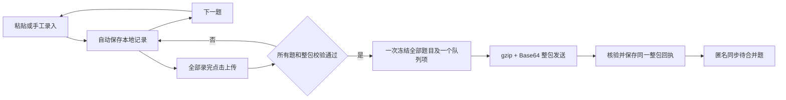

# 代码审计与录题重构方案 · 已批准并实施

> **2026-10-18 最新决议（优先于下文旧审计记录）：方案已批准实施。日常逐题录入、自动保存；点击上传后将当前题库全部待上传题目形成同一个不可变快照，统一 gzip 压缩、Base64 编码，以一次请求上传。禁止逐题请求、隐式拆包或每题自动上传。超限时保留所有本地记录并提示。本次同时补齐云端文件压缩编码，以及以原“超大”为新“标准”的全尺寸字体适配。下面的历史复现仍是修改前证据，验收状态在实施记录中更新。**

审核日期：2026-10-18。代码基线：`b307cf38b44a7789c179d9eb4cb7f65e948e2b35`，分支 `codex/compact-bank-experiment`。

**本文件保留修改前审计证据，并记录审批后的源码实现。** 第 2—3 节是旧基线的审计结果，不代表新版仍有相同缺陷；第 4 节起是当前实现、验证及剩余边界。统一[开发文档](../开发文档.md)已同步更新。本轮未操作真实云题库、IAM、凭据或用户数据库。

配套：[桌面 / 小程序交互原型](review/intake-redesign-2026-10-18.html)。原型使用虚构题目、权限和传输结果，不访问真实题库或云端。

原型右上角可切换桌面与小程序；桌面的“题库管理”可切换演示身份，查看最高权限的“设为云端题库”流程。原型中的保存、上传、权限验证均为内存模拟，刷新会重置。

## 1. 本轮最后确认的产品边界

以下约束优先于历史的逐题传输、自动拆包提议。

1. **已有题库：逐题录入，自动保存到本地。** 录入期间不自动上传；整个录题过程结束，用户主动点击“上传”。
2. 这次点击可处理此题库多条待上传记录。日常界面不再暴露批次、拆包或“整批上传”，不得把“逐题录入”误解为每录一道就联网发送。**已确定并实现：一次统一提交、统一回执、使用同一快照重试。** 日常逐题录入不限制一次请求只能包含一道题。
3. 未上传题目统一保留在“录题记录”中，标记“待上传”；没有保存完整的显示“待补全”。跨录入时段保留，上传按钮明确显示本次将发送的题数。已确认正在传输但尚无回执的记录仍可在此表查看。
4. **只有桌面端、最高权限账号，才能新建自动同步云端题库。** 入口在题库管理：选一个已有本地题库 → “设为云端题库”。确认后，自动执行建库、首版整库上传及启用同步，不要求用户手动导出、上传 COS 或配置目录。
5. 小程序没有“设为云端题库”入口。普通本地建库仍属于离线能力；新建本地库不会自动获得云端创建或上传权限。
6. 创建云库的最高权限与“向已有库上传”“合并发布”分开。拥有某库 `upload` 或 `merge` 权限不能创建云库。最高权限指**应用内权限**，不是把腾讯云主账号密钥发给桌面软件。
7. 日常搜题、下载已公开题库、录题和本地自动保存免登录。上传时才要求该库的开发者授权；桌面合并仍要求该库的合并权限。
8. 新题在上传前由录入者核实，上传成功直接“待合并”，所有用户同步后可搜。不新增上传后的审核流程。旧的未核对历史数据走兼容入口。
9. 每题保留首次录入时间，修改另记更新时间。云库的正式合并结果名使用时间与标识字符串；稳定的 `bank_id` 不随名称或版本改变。
10. 传输继续采用 `gzip + Base64`。Base64 是编码，压缩由 gzip 完成。断网、关闭与重开都围绕已落盘记录恢复；不承诺小程序被系统关闭后还能完成网络任务。

**交互主线：** 粘贴 / 手工输入 → 自动保存 → 下一题 → 录题结束 → 上传 → 整包回执。只有“本地库设为云端库”使用整库初始化。

## 2. 修改前审计范围与验证层级（历史证据）

### 2.1 审计阶段做了什么

- 检查桌面 React / Tauri、共享协议、小程序页面与服务、云函数、导入导出、数据库、搜索、OCR、平台脚本及现有测试的模块边界。
- 对录题从入口、解析、编辑、持久化、导出、授权、传输、回执到合并分发逐段追踪。
- 主应用链路的统计口径包含 83 个手写代码 / 样式 / 脚本文件、11,623 行；不含测试、依赖、数据、生成文件，以及另外检查的 `tools/` 运维工具和平台原生适配。行数用于定位维护热点，不代表复杂度或质量评分。
- 对高风险组合操作做独立复现，使用临时 SQLite 数据库和合成题目。没有操作用户数据库、真实 COS 或真实提交。
- 重新运行 95 项 JavaScript 测试、41 项 Rust 集成测试，以及桌面和小程序 TypeScript 检查，均通过。小程序生成资源一致性检查通过。
- 独立原型通过 14 项 Chrome 交互检查，覆盖答案切换、自动保存演示、记录移除与撤销、上传任务、移动布局和云库转换权限；已查看桌面、手机布局与转换流程截图。它验证的是原型，不是正式应用。

### 2.2 不能据此声称的结果

测试通过不意味着没有缺陷，本次新增复现已经证明现有测试遗漏了组合场景。本轮没有重新进行 Android / iOS / Windows 真机测试，没有验证真实云权限或生产域名，也不是完整的安全渗透、负载或依赖供应链审计。

本轮本地证据在 `artifacts/intake-audit-20261018/`：`js-tests.log`、`rust-all-tests.log`、`probe.rs`、`probe.log`、`prototype-checks.json` 和 `prototype-*.png`。该目录按项目规则忽略，不随 Git 提交。下文保留了可读复现步骤和结果。

## 3. 主要发现：先修状态与数据问题，再换界面

以下位置和行号针对上述旧基线，重构后入口见第 5 节。标记：**已复现**＝运行现有代码得到结果；**静态确认**＝代码路径明确；**风险**＝尚未用真实故障验证。P1 优先修复数据变化或阻塞提交；P2 为流程、恢复或维护问题。

### F01 · P1 · 草稿识别静默丢掉第 9 个及后续选项【已复现】

- 位置：[shared/intake.ts](../shared/intake.ts)，`parseDraft` 第 104 行起、`editedReplyText` 第 166 行起。
- `parseDraft` 对选项执行 `slice(0,8)`。保存时校验的是已经截断、重新生成的 JSON，不再是原始输入。
- 复现：给九选项单选题、答案 A、完整模型字段；原始 JSON 被严格校验拒绝，进入编辑器后仅八选项，再保存却通过，`warnings` 仍为空。
- 影响：题目内容被改变，用户没有收到丢失提示；桌面、小程序共享同一规则。
- 改写：解析器保留原始内容并返回字段诊断；超限不截断。编辑区显示全部识别内容并阻止提交，用户明确修改后才解除。不可用“自动修复”掩盖数据损失。

### F02 · P1 · 取消导出会冻结记录，还可能堵住后续上传【已复现】

- 位置：[src/intake-panel.tsx](../src/intake-panel.tsx) 第 49 行；[src-tauri/src/cloud.rs](../src-tauri/src/cloud.rs) `transfer` 第 251 行、`prepare_batches` 第 54 行；[src-tauri/src/intake.rs](../src-tauri/src/intake.rs) `edit_entry` 第 348 行。
- 桌面为生成文件名，在打开保存对话框之前就调用 `cloud_transfer`；该函数写入冻结记录。取消对话框也不会撤销冻结。
- 复现：同组录入 101 题 → 执行导出前置的 `transfer(endpoint="")` → 模拟取消，不写文件 → 编辑被拒绝；`prepare_batches` 返回 1 个未拆分包，上传报“上传批次最多 100 题”。
- 输出：`edit=本批次已冻结；prepared_parts=1；upload=上传批次最多100题`。
- 小程序也在文件成功写出前持久化 `sealedText`，因此存在导出失败但记录已经冻结的同类风险，尚未做磁盘故障复现。
- 改写：导出只创建独立的只读快照，不把编辑记录变成上传任务。取消导出无业务状态变化。已经发出、结果未知的旧任务不能直接解冻，需要先核对原回执。

### F03 · P1 · 删除新题后，批次计数与实际内容不一致【已复现】

- 位置：[src-tauri/src/intake.rs](../src-tauri/src/intake.rs) `batches` 第 429 行、`entries_conn` 第 449 行；[src-tauri/src/db.rs](../src-tauri/src/db.rs) `delete` 第 441 行。
- `batches` 统计 `intake_entries`，关联已删除题目时没有把它排除；读取题目内容时却排除了删除项。
- 复现：录入一题 → 从题库移入回收站 → 批次仍返回 `count=1,pending=1`，实际可见条目为 0，准备上传报“本批次没有新题”。
- 影响：出现空的待上传分组；若与正常分组一起准备，可能中断整次入队。
- 改写：待上传计数、列表、提交集合使用同一个查询条件；移除、恢复与可提交状态在同一事务中更新。

### F04 · P2 · 页面本身承担了大部分业务编排【静态确认】

- 桌面 `IntakePanel` 同时管理原文、解析计时器、两份草稿、题库切换、列表聚合、签名确认、导出、登录与队列。
- 小程序 `pages/intake/intake.ts` 同时保留 `reply`、`editOptions`、`boolSelected`、`typeIndex`、`warningsText` 等相互可推导状态，字段改动后要手工同步多份表示。
- 改写：页面只负责展示、输入事件和导航；解析、保存、提交、恢复分别由领域函数与用例服务负责。视图模型由单一编辑状态生成。

### F05 · P2 · 一个全页 busy 锁覆盖了本地录题和整个网络队列【静态确认】

- 位置：桌面 `task` / `upload`，小程序 `run` / `onUpload`。
- 两端都等待整个队列执行完才释放 busy，期间录题或局部导航被一起禁用。桌面还显示“关闭窗口后继续”，但录题对话框的关闭按钮被禁用，表达与交互不一致。
- 改写：区分解析、保存、提交准备、整包传输四种状态。已确认题目冻结传输快照，新的题目继续编辑。网络队列独立于录题页生命周期。

### F06 · P2 · 桌面“冻结内容”和“队列落盘”分成多次写入【静态确认，故障风险】

- 位置：[src/cloud-client.ts](../src/cloud-client.ts) `enqueueDesktop`；Rust `prepare_batches` / `transfer` / `client_state`。
- 原生准备可以成功，之后队列 JSON 写入失败，留下有冻结包、没有任务的记录。代码已明确保留这个中间态，但恢复入口不够清楚。
- 小程序当前入队使用同一次 `updateLocal`，这一点比桌面完整；重构时应保留。
- 改写：桌面单个 Rust 用例事务写入提交快照、身份绑定与队列项。启动扫描旧孤立冻结包，先分类，不盲目重发或解冻。

### F07 · P2 · 错误分型不足，非网络错误可能被反复当作断网重试【静态确认】

- 位置：[shared/queue.ts](../shared/queue.ts) `failedJob`。
- 没有 `status` 的普通 `Error` 被归为可重试；回执格式异常、本地损坏等错误也可能进入这一路径。`failed` 状态又被“恢复任务”跳过，页面没有针对失败原因的修复路径。
- 改写：错误明确分为网络暂时失败、身份失效、内容错误、存储失败、回执待找回、版本冲突。每类有不同下一步，保留不可变请求用于找回结果。

### F08 · P2 · 自动保存写入粒度过大，失败提示不稳定【静态确认，性能风险】

- 位置：[miniprogram/miniprogram/services/intake-store.ts](../miniprogram/miniprogram/services/intake-store.ts)，`updateLocal`；录题页 `persistDraft`。
- 每次字段变化会克隆、序列化、校验并写整个本地录题文件，文件还包含历史题和上传内容；某些输入路径重复触发保存。历史增长后成本随文件增长。
- 桌面也按字段变化排队保存整个草稿，没有合并中间版本。两端已有串行写、错误保留或临时文件保护，这些不能在“简化”时删掉。
- 改写：草稿按库 / 题分离；只合并尚未开始的草稿写入，建议 400ms 防抖，失焦 / 下一题 / 切库 / 上传前 flush。明确显示“保存中 / 已存本机 / 保存失败”。失败不丢输入，也不上传旧版本。

### F09 · P2 · “收起草稿”和保存完整记录的关系不清楚【静态确认】

- 当前“收起草稿”把当前题移到唯一的 previous 槽，然后清空当前题。用户必须理解草稿与入库的差别才能结束录入。
- 且真正写入题库仍需手动“保存本题”，并不满足本轮新增的“自动保存到本地”。当前自动保存的是草稿，不能把它写成已自动完成题目录入。
- 改写：每一题有稳定的本地记录 ID，输入自动保存；“下一题”仅切换焦点 / 新建草稿。未完整题目也保留在记录列表，以“待补全”定位，不能退到单个恢复槽里。

### F10 · P2 · 通用建题与录题是两条不同的持久化路径【静态确认】

- 桌面 `save_question` / `Store::save` 可以新增普通本地题，但不会为新题自动创建 `intake_entries`；`intake_save` 才创建录题记录。
- 修改已有录题会尝试同步 `intake_originals`，所以不能笼统说两条路径完全独立。
- 改写：明确“已有云库新增题”统一调用录题用例；“私人本地题库维护”保留本地语义。转换为云库时从选定本地库形成首版快照，不能猜测遗漏哪些记录应该提交。

### F11 · P2 · 全量状态与历史持续累积，存在容量天花板【静态确认】

- 云端 `workflow.cjs` 每次保存包含正式题、候选、已处理记录和操作历史的完整状态，硬上限 4 MiB；记录持续累积，当前没有自动归档界面。
- 小程序本地文件也同时保存题目、原包和历史。尚未做长时间录题容量压测，不把它宣称为当前已经发生的故障。
- 改写：近期先显示可用容量、限制和失败位置；中期独立归档操作记录。超过上限必须明确拒绝并保留本地数据，不通过取消限制来“修复”。

### F12 · P2 · 缺少本轮要求的“最高权限转换云库”模型【静态确认】

- 云目录由 `QBANK_BANKS` 配置提供；目前没有注册新云库的产品接口，也没有单独的全局创建权限。
- 现有 `/seed` 允许该库 `merge` 或兼容 `publish` 权限初始化**已经配置好的云库**，不是“选本地库后自动创建云库”。不能将现有实现标成满足新需求。
- 改写：新增全局 `cloud_bank:create` 能力与桌面转换用例；首版初始化必须校验该能力。服务端还要限制只有桌面身份可调用；小程序不能通过直接请求绕过隐藏按钮。

### F13 · P2 · 全局结构与文档需要同步整理【静态确认】

- `App`、录题页和维护页把服务调用与展示混在一起；许多逻辑挤在极长单行里，行数低不代表函数简单。
- `styles.css` 1,188 行，录题选择器在文件末尾多次覆盖；目前虽有折叠区，但编辑、列表、导出、任务与上传核实仍在同一个滚动对话框内。
- `Question` / `IntakeQuestion` / Rust 模型 / 云端校验有重复协议定义，时间字段及选项 ID 的严格程度不一致，需要契约样例约束。
- `shared` 到小程序 `core` 的三个副本由脚本生成，**属于有意生成，不应当作手工重复代码删除**。
- 开发文档已有“源码完成”和“剩余工作仍列同一功能”的混合描述；下一次按“已实现 / 已验证 / 未验收 / 计划”分别记录，并替换失效的逐题传输和自动拆包说明。

## 4. 当前逻辑状态与修复结论

“已实现”指源码与本地测试，不等同已部署、真机通过或正式发布。历史云与 Windows 结果见统一文档第 14.11—14.12 节，本轮不能借用它们作为新版验收。

| 项目 | 当前状态与实现边界 |
| --- | --- |
| F01 保留解析输入 | 已实现：保存完整原文、初始原文、可识别字段与字段诊断。第 9 个选项、未知题型、混合答案不会静默变成有效题；需明确修改／核对 |
| F02 导出冻结 | 已修复：导出生成独立快照 ID，不写提交任务。取消或失败后仍可编辑；已经真正提交的旧包保持冻结 |
| F03 计数不一致 | 已修复：列表、计数和新提交均从未移除、未提交的记录查询；移除／撤销与有效题投影一起保存 |
| F04 页面编排 | 已实现：共享草稿纯函数、桌面 hook、小程序控制器和仓储分层；页面主要负责展示及输入绑定 |
| F05 全页网络锁 | 已修复：仅切题保存／准备提交时短暂锁定编辑；固定包入队后可继续录题。上传及下载错误独立显示 |
| F06 冻结无任务 | 已修复：桌面 SQLite 事务同时写整包、题目绑定和队列；小程序在一次串行本地更新中冻结与入队。旧孤立任务另设显式恢复 |
| F07 错误分型 | 已实现：网络、临时 HTTP、版本冲突和回执落盘失败可重试；鉴权暂停；内容／格式错误停止自动重试，保留人工恢复入口 |
| F08 保存粒度 | 已实现：400ms 合并尚未写入的编辑，串行 CAS；桌面按题写入，小程序按库文件保存并校验／原子替换。失败保留最新输入 |
| F09 下一题语义 | 已实现：每题稳定记录 ID，缺答案也保存在“待补全”。下一题先 flush；快速点击下一题再粘贴不会写回上一题 |
| F10 本地与云题 | 已明确：私人题库维护仍是本地用例；云库新增使用录题记录；转云库从选定本地库完整生成首版 |
| F11 长期容量 | 保留上限与明确错误，超限不拆包、不丢记录。历史归档、容量趋势和分片仍是建议，未实现 |
| F12 最高权限转云 | 已实现：桌面角色能力 `cloud_bank:create`、本地备份与固定首版任务、服务端动态目录、下载核验后切换；需部署新版及配置创建者 |
| F13 函数化与样式 | 已拆录题领域／仓储／控制器、云会话／传输／同步／发布、Rust IPC／交换格式／云传输、云端配置／鉴权／提交／投影／目录，分离录题／云／OCR 样式。未把全部旧搜索和维护页面重写 |

## 5. 当前代码入口

| 职责 | 入口 |
| --- | --- |
| 草稿创建、诊断、编辑、校验、合并保存 | `shared/draft.ts`、`shared/intake.ts` |
| 云文件 gzip + Base64、字节／摘要校验 | `shared/codec.ts`、`cloud/qbank-auth/codec.cjs`、`src-tauri/src/cloud/codec.rs` |
| 桌面录题用例和工作区 | `src/intake/use-intake.ts`、`src/intake-panel.tsx`、`src/model-editor.tsx` |
| 桌面持久草稿、有效题投影、原子入队 | `src-tauri/src/drafts.rs` |
| 小程序控制器、仓储及上传准备 | `services/intake-controller.ts`、`services/draft-repository.ts`、`services/drafts.ts`（相对 `miniprogram/miniprogram/`） |
| 会话、固定提交、匿名同步、合并 | `src/cloud/session-service.ts`、`submission-runner.ts`、`sync-service.ts`、`publish-service.ts`；`src/cloud-client.ts` 保留调用兼容入口 |
| 本地库转云库 | `src/cloud/library.tsx`、`promotion.ts`、`src-tauri/src/promotion.rs`、`cloud/qbank-auth/catalog.cjs` |
| IPC 与导入导出 | `src-tauri/src/commands/`、`src-tauri/src/exchange/`；事务边界仍在领域用例 |
| 云配置、会话、上传解码／回执、公开投影 | `cloud/qbank-auth/config.cjs`、`auth.cjs`、`submission.cjs`、`projection.cjs`；路由在 `service.cjs` |
| 样式与字号 | `src/intake/*.css`、`src/cloud/*.css`、`src/ocr/ocr.css`、`src/styles.css`、`src/preferences.ts`、`src/settings/appearance.tsx` |
| 生成副本 | `scripts/sync-client-assets.mjs` 将共享逻辑同步到小程序 `core/`；不要手工分叉修改 |

## 6. 草稿和提交契约

### 6.1 自动保存与可编辑记录

`DraftRecord` 保留稳定的 `id`、`bankId`、递增 `revision`、首次 `recordedAt`、`updatedAt`、完整 `raw`／`original`、结构化 `reply`、元数据、诊断、移除标志和 `submissionId`。

- 可不完整的草稿与有效题投影分开；只有严格校验通过的内容可被本地搜索、加入上传包。有效题改成不完整时移除旧投影，避免搜到过时答案。
- 两端写入都校验上一版本，失败不能跳过未保存编辑。切题、切库、返回、导出、上传前先完成保存；离开小程序只能尽力保存，不能要求系统等待。
- 未提交记录可编辑、移除与撤销；撤销不重建题目 ID 或首次录入时间。已提交内容只读，避免改变未知结果的请求。
- 用户继续修改题目时保留原始回复作为来源；未知历史时间和模型版本不伪造。这里只保留原文与当前记录，不宣称保存了每次按键的完整历史。

### 6.2 一次点击对应一个整包

**逐题录入和传输单位无关。录题结束点击“上传 N 题”，将当前题库全部待上传记录统一序列化、gzip 压缩、Base64 编码，以一个请求提交。**

1. 完成当前编辑保存，读取当前题库所有未移除、未提交记录及版本。
2. 任一题待补全、冲突或整包超限时，整个准备操作失败并保留本地记录；不静默跳过题目。
3. 生成一个固定提交 ID、一份增量内容和一组摘要；同时持久化快照、原身份／地址绑定、题目关联和一个队列项。
4. 后台只发送该固定包。网络重试复用同一 ID 与字节；不能重新读取编辑区拼出不同内容。
5. 校验整包回执并成功落盘后，全部对应题目才变为已上传。后续同步失败显示“已上传，下载尚未完成”，不重传已成功内容。
6. 上传中录入的新题不进入旧快照，等待下一次明确点击上传。

新提交限制：**最多 1000 题，UTF-8 增量原文 4 MiB，gzip 内容 512 KiB，完整 HTTP 请求 768 KiB。** 任一限制触发时整体拒绝，用户可修改或移除内容；客户端不自动拆成多题包，更不会逐题上传。未提交记录不会因网络恢复、保存、关闭或导出自动变成任务。

旧 `batch_id` 保留为兼容协议的整包身份。不同 `bank_id` 永远不能混包。旧版已经冻结的多个包按原字节恢复，不将历史包拼成新 ID 后重复发送。

### 6.3 历史数据与失败恢复

- 旧本地有效新题和草稿按稳定 ID 迁移；保留原题、批次文件、时间及来源，不清理用户数据库。
- 对旧“冻结成功、队列落盘失败”任务提供 **使用原身份恢复上传任务**。限定原服务地址、题库，保持原字节；仅导出文件不自动恢复成网络任务。恢复后不能换账号重新绑定。
- 旧确认语义保持原样：历史未核对提交使用旧流程，不能凭新客户端升级为已确认上传。
- 内容损坏、回执不符、权限拒绝与暂时断网分别呈现；未取得匹配回执时不显示成功。
- 导出创建独立交换快照，后续编辑不改变已导出的文件；导出和分享不改变上传状态。

## 7. 云端文件压缩与兼容

存储状态、收集提交和新版下载快照使用 `qbank-cloud-file-1`：包含 `encoding: gzip+base64`、原文字节数、原文 SHA-256 和 Base64 数据。Base64 不是压缩或加密，私有 COS 和授权边界保持不变。

- 写入使用 gzip，读取同时接受旧原文记录，避免要求先迁移全桶。
- 清单提供 `snapshot_format`；新客户端下载 `/snapshot-file`，旧 `/snapshot` 原文接口保留。按**解压原文字节**核对清单大小和摘要，不能拿编码后大小比较。
- 解码先限制编码及压缩体积，再有界解压，校验单 gzip 成员、CRC／ISIZE、UTF-8、长度和 SHA-256；损坏结果不替换本地题库。
- 新云文件的展开上限仍是 4 MiB；状态历史增长未因压缩而变成无限容量。新题上传的 512 KiB 压缩上限与整库文件上限分开。
- 升级通过健康检查能力 `session-upload-v1`、`cloud-file-gzip-base64-v1`、`cloud-bank-promotion-v1` 判断；软件版本暂仍是 0.2.7，不能只看版本号。

## 8. 桌面最高权限“设为云端题库”

入口在桌面题库管理。`QBANK_CLOUD_CREATORS` 配置允许创建者的桌面维护身份 ID；服务端发放 `cloud_bank:create`，同时要求桌面会话 audience。小程序、普通上传者、仅有合并权限者，以及伪造平台字段的请求均不能调用创建。

流程：核实范围 → 原生完整备份 → 固定操作 ID、首版快照与原身份 → 压缩上传 → 云端注册并激活目录 → 匿名下载并校验首版确切内容 → 本地切为云同步库。

失败保留本地题库、备份及同一任务；重试不创建另一个云库。转换期间只保护目标题库，其他本地库仍可编辑。新库创建者获得该库上传／合并权限，原有静态配置目录保持兼容。初始整库与日常新题提交是独立用例，不能将初始化权限下放给普通上传。

## 9. 界面与字号

- 桌面使用独立录题工作区：默认左侧原文约 36%，右侧结构化题目约 64%；窄窗口／大字号改为纵向。顶部分“录题、录题记录、上传记录”。
- 底部显示保存状态、待上传／待补全数量、“下一题”和“上传 N 题”；网络上传中仍能录下一题。无手动保存本题按钮。
- 选择题圆点可选／取消；判断题正确／错误互斥且允许取消。正确答案同时有颜色、圆点和无障碍状态；选择变化不挤动正文。每个正文、选项、解析及模型字段可编辑。
- 小程序只显示复制／粘贴按钮与结构化编辑器，不显示粘贴框；失败时可复制保留原文、手工修正。记录与上传进度分开，分享必须用户主动触发。
- 新字号为小 1.2×、标准 1.4×、大 1.6×、超大 1.8×（基准 13px）；原超大迁移到标准，默认标准。字号切换同步影响间距、控件、栏宽、行高、预览与虚拟列表测量；受窗口最大可用尺寸约束，超长文本换行／滚动，不强制撑宽屏幕。

## 10. 本轮验证与尚未验收部分

自动测试覆盖完整输入保留、CAS／磁盘失败、计数与投影同步、移除撤销、101／205 题整包、1001 题整体拒绝、上传中新增记录隔离、丢失回执恢复、旧冻结包恢复、创建权限及目录激活、云文件跨运行时解码和损坏保护。具体命令及最终数量见[统一文档第 14.13 节](../开发文档.md#intake-refactor-validation)。

实际 React 界面在隔离 Chrome 中运行，使用模拟 Tauri IPC／云接口；验证录题不发请求、两题只发一次、保存失败留住输入、返回重开恢复、移除撤销、答案切换，以及 5 组字号／窗口尺寸。截图与结果保存在本机忽略目录 `artifacts/intake-refactor-20261018/`。这是应用前端验证，不等同原生 Tauri 或手机真机验收。

尚需外部验收：部署新版函数及配置创建者、生产 HTTPS／微信合法域名、真实云端全流程、Mac／Windows 原生新版与 Android／iOS 微信新版、强制终止和长时间容量测试。本轮不修改线上已有 914 题或权限，也不把构建包称为已上线。

## 11. 后续建议（不混入已完成）

- 状态历史与审计记录归档、长期容量趋势，以及大题库按块更新，避免全量状态持续增长。
- 将已发布题目的更正明确建模为提案，保留正式答案冲突、替代与撤下历史。
- 增强旧搜索／维护页面的组件边界和性能测量，在有可复现问题时逐步处理，避免为了缩短文件而移动事务边界。
- 继续补设备故障、断电、系统清理缓存和真实权限撤回验收；小程序后台机制仍不能保证关闭后完成上传。
