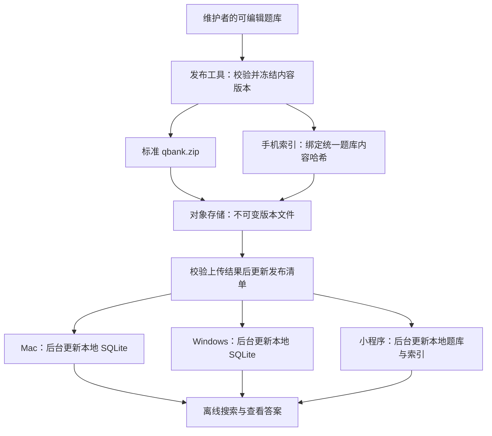

# 三端题库发布、自动更新与国内服务商选择

日期：2026-10-15

状态：后续阶段规划。根据 2026-10-15 用户批注，当前小程序先内置题库；下载、云资源和权限暂缓。若采用云服务，选择腾讯；公开／指定读者及密钥发放方式之后确定。尚未实现自动更新、部署云资源或购买服务。

三端格式调整：以统一 `.qbank.zip` v1 内容包为基础，手机索引作为独立配套文件，不再要求另一种手机专用题库内容包。加密方案见 [三端统一题库格式与加密评估](docs/三端统一题库格式与加密评估.md)。以下联网流程属于未来范围，不是当前内置首版的交付条件。

> 推荐采用“本地搜题，联网按发布版本更新”：维护者发布一次，Mac、Windows、微信小程序检查并下载同一内容版本，各自在本地搜索。首版采用整包更新，云端主要保存发布清单和文件。

小程序首版的页面、搜索与本地存储设计，单独见 [微信小程序开发规划：文字搜题首版](微信小程序开发规划_文字搜题首版_待审核.md)。本文件是独立的新方案，不把发布后台、桌面程序升级等全部并入小程序文字搜题首版。

## 1. 最终使用方式

维护者在桌面端完成录题或修订，制作并发布新题库版本。读者第一次选择并下载题库，以后打开软件时先使用本地内容，同时检查更新；有新版就后台下载，校验成功后切换。

三端共用题库身份、题目 ID、最终答案、内容版本和内容哈希。Mac／Windows 使用现有 SQLite 搜索，小程序使用另外生成的手机索引；不用为了更新题目重新安装软件。

未联网或尚未下载新版的设备会暂时保留旧内容；这里保证联网后的版本收敛，不承诺所有设备在同一时刻同步。更新失败也不能阻塞已下载题库的使用。

## 2. 分清三种更新

| 更新对象 | 触发示例 | 分发方式 |
| --- | --- | --- |
| 题库内容 | 改正答案、增加题目、删除过期题目 | 发布题库数据版本，三端自动检查、下载并切换 |
| Mac／Windows 程序 | 新增 OCR、修复界面、改变文件格式支持 | 按系统与 CPU 架构构建应用，接入桌面程序更新器 |
| 微信小程序代码 | 修改页面和搜索算法、支持新索引格式 | 通过微信的小程序代码发布流程，客户端配合版本更新管理器 |

微信提供 `getUpdateManager` 管理小程序代码更新。题库数据文件和程序代码须分开；从对象存储下载题库，不意味着可以通过同一路径替换小程序可执行代码。[微信官方 API 定义](https://github.com/wechat-miniprogram/api-typings/blob/master/types/wx/lib.wx.api.d.ts)

本项目当前 v0.2.6 具有离线包导入、导出能力，尚未接入云端发布或自动更新。现有安装需要先升级一次到带更新能力的程序，之后才能按本方案自动检查。

## 3. 推荐架构：静态发布优先



未来联网阶段选择腾讯云体系，COS 作为拟采用的文件存储；当前不部署或购买。通过 HTTPS 读取清单和题库，CDN 根据届时实际下载需要决定；用户的搜题计算继续在设备上完成。

第一阶段可由维护者在本地运行发布工具并上传文件，后续再整合为桌面端“发布更新”按钮。发布工具与下载客户端使用普通文件协议，避免把题库格式绑定到单一服务商。

如果题库仅允许指定用户下载，则增加登录和签发临时下载地址的轻量服务。它只负责授权，不必承担搜索。公开或私有的选择需在正式部署前确定；不会因为本文推荐对象存储就自动把题库设为公开。

## 4. 发布内容与版本协议

### 保持现有离线包兼容

现有 `.qbank.zip` v1 只含 `manifest.json` 和 `questions.jsonl`。其中 `release_id` 是 **JSONL 原始字节的 SHA-256**，不是 ZIP 文件的哈希。发布包的版本比较、只读导入和覆盖保护沿用 [现有规范](docs/导入格式与离线包规范_v1.md)。

新增的云端清单与手机索引清单放在独立文件中，不改变 v1 包结构。建议目录如下；这是拟定协议，尚非已经实现的工具输出：

```text
catalog.json
banks/<bank-id>/releases/<release-version>/artifacts/<artifact-revision>/
  release.json
  bank.qbank.zip
  wechat-index-v1.json
apps/<app-version>/<platform-arch>/
  应用安装或更新文件
  更新签名
```

### 区分不同编号

| 字段 | 含义 |
| --- | --- |
| `bank_id` | 同一个题库长期不变的身份；创建可编辑副本时取得新身份 |
| `release_version` | 题库内容的递增发布号，修改题目或答案后提高 |
| `release_id` | 标准 `questions.jsonl` 原始字节的哈希，三端内容身份一致 |
| `artifact_revision` | 同一内容下重新构建手机索引等制品的递增编号，不伪造题目变化 |
| `archive_sha256` | 统一题库压缩包的哈希；索引另有自己的文件哈希 |
| `index_schema_version` | 手机索引格式；用于判断客户端能否读取 |
| `app_version` | 程序自身的版本，独立于题库发布号 |

清单还需记录文件大小、解压大小、题目数、发布时间、最低兼容客户端版本和下载地址。三端读取同一标准内容包；小程序另取按 `release_id` 绑定的索引。记录位置表、分片与压缩属于索引制品，不能改变题目原始内容。

同一内容版本如果只调整索引结构，使用新制品修订号与新路径；客户端对所需制品独立比较修订号，不能只比较题库内容发布号。已发布路径的字节不能被覆盖替换。

### 校验完整性与发布者

现有包内 SHA-256 能发现内容损坏，但不证明文件由指定维护者发布。自动更新增加独立的清单签名：发布者保管私钥，客户端内置可信公钥；验签成功后再按清单检查 ZIP 和解压文件的哈希。

建议签名采用可在 Rust 和小程序 JavaScript 中实现的标准算法，例如 Ed25519，开发时固定库、签名字节格式和兼容范围。`catalog.json` 和 `release.json` 各自使用单文件签名信封，包含 Base64 编码的清单载荷、公钥标识和签名。客户端先验签载荷的原始字节，再解析其中的字段，避免双方 JSON 重排导致验证不一致。清单绑定题库 ID、版本、制品修订、大小、哈希和下载位置。

签名、哈希和最低版本校验均在后台完成。普通读者不接收上传凭据；签名私钥和云服务密钥不进入 Git、小程序包或读者桌面程序。

## 5. 维护者如何发布

1. 在可编辑主库录题或修订，确认本次最终答案。
2. 冻结本次快照，生成递增内容版本。复用现有结构校验；结构通过不代表知识答案自动正确。
3. 生成统一标准包和手机索引，核对题目 ID、顺序、选项、答案、数量和内容哈希一致。
4. 将文件上传到新的不可变路径，检查上传后的大小及哈希。
5. 生成并签署版本清单；统一内容包与索引均准备完成后，再更新对外的题库目录。
6. 目录更新携带上次版本的条件检查，避免重复执行发布命令时把更新指针倒退。
7. 保存发布记录、原始包和最近可用版本，供恢复和追溯。

目录及其签名作为一个对象发布，避免分开上传时出现内容和签名不匹配。读者遇到校验失败或发布文件暂不可用时，保留旧版本并重试，不能把未准备好的版本设为活动版本。

发布清单采用短缓存或重新验证策略；版本文件采用长缓存。发布文件使用新路径，避免 CDN 或浏览器缓存使用户收到旧内容。

普通客户端仍可离线制作现有题库包，但“制作包”和“成为官方发布者”是不同权限；重新打包不应获得更新所有读者题库的权限。

## 6. 读者端如何更新

### Mac 与 Windows

- 启动即读取本地 SQLite；联网检查在后台运行。
- 只更新用户已经订阅的只读发布题库，不自动下载全部题库，也不覆盖可编辑主库或分叉副本。
- 下载至临时目录，依次验签、检查格式和最低程序版本、核对大小与哈希，再进入导入阶段。
- 新版本在事务或独立暂存库中准备完成后切换，失败保持旧版。沿用现有导入规则，但增加适合自动订阅的更新入口。
- 更新与查询协调，当前结果绑定一个完整版本；切换后重查，不能出现新答案配旧选项。
- 保留手动导入和制包，作为无网络时的分发路径。

### 微信小程序

- 首次下载选中的题库，以后先读取手机本地文件，打开和回到前台时后台检查。
- 标准内容包和配套索引的新目录完整校验并加载成功后，才改变活动版本；退出或中断后可恢复。
- 同时预留旧数据、新压缩包、新解压数据的空间；空间不足时保留当前可用版本并提示。
- 版本未变不重新下载；整包更新失败后可重试，不要求首版实现增量同步。
- 网络断开时继续用已下载内容，前提是小程序本身可以正常启动；数据被清理后重新下载恢复。

小程序制作和分享离线包仍是后续功能，按最新要求不加入文字搜题首版。手机端缓存的数据协议保留标准题目文件，为后续制包留出兼容基础。

### 回退与兼容

当前导入器拒绝较旧的内容发布号，所以云端发现错误后应 **发布一个更高版本，内容恢复为正确旧内容**。只把云端指针改回旧版本，不能让所有已升级客户端一致回退。

手机制品回退同理：用更高制品修订号重新发布可用索引，不降低已接受的修订号。旧客户端无法理解新格式时继续使用当前版本，提示升级程序；不得尝试强行导入。

## 7. 桌面程序本身的自动升级

建议使用 Tauri 2 官方 Updater：支持静态 JSON 更新清单或更新服务，更新制品需要签名，并按系统和架构提供对应文件。该能力需另行开发接入。[Tauri 官方 Updater 文档](https://v2.tauri.app/plugin/updater/)

拟定体验：启动时后台检查程序更新，可先下载；准备完成后提示在合适时机重启安装，避免打断正在维护题库的人。题库数据更新无需随应用安装而中断。

应用更新签名和 macOS 开发者签名／公证分开处理。目前仓库交付说明中的 Mac 程序为本机临时签名版；正式分发需要安排相应签名流程，Windows 构建和安装也需单独验证。不能把 Mac 构建成功视为 Windows 更新链路已通过。

这一阶段需要按实际支持范围提供 Mac Apple Silicon、必要时的 Intel，以及 Windows 对应架构制品；不承诺尚未构建和验证的架构。更新私钥由维护者保存，CI 若参与构建应使用受控密钥配置。

## 8. 国内服务商选择

**用户已选择未来优先腾讯云，当前暂不部署。** 以下服务比较保留为历史评估，阿里云不再是本轮待选项；具体腾讯产品和费用到接入时再核实。

| 方案 | 本项目用途 | 额外工作与选择理由 |
| --- | --- | --- |
| 腾讯云 COS，按需加 CDN | 保存清单、标准题库包、手机索引和桌面更新文件 | 用户选择未来优先腾讯；具体资源待联网阶段落实 |
| 阿里云 OSS，按需加 CDN | 同样承担版本文件存储与下载 | 已有阿里云账号、域名或资源时同样合适；协议保持通用，迁移主要涉及文件和访问地址 |
| 腾讯 CloudBase 云存储／轻量鉴权服务 | 需要微信身份、访问规则、临时下载链接时再接入 | 官方 SDK 提供文件下载与临时链接能力；三端访问需分别处理身份，不为纯文件下载提前堆叠后端服务 |

COS 支持配置访问域名及下载加速方式；具体自有域名和 HTTPS 接入按选用方式配置。[腾讯 COS 访问域名配置](https://cloud.tencent.cn/document/product/436/55506)

OSS 的费用和能力范围见 [阿里云 OSS 计费概述](https://help.aliyun.com/zh/oss/billing/)。CloudBase 的文件 SDK、临时链接和权限设置见 [官方文件管理文档](https://docs.cloudbase.net/storage/sdk)。

首版没有常驻搜索计算需求，因此不建议先购买云服务器、托管数据库或搜索集群。后续需要在线搜索、账号管理或 OCR 时，再为那些功能选择计算服务。

GitHub 继续用于代码、文档和版本管理；面向读者的主要题库下载采用选定的文件服务。不能把“代码已推送到 GitHub”当成“题库更新服务已经部署”。

## 9. 费用如何估计

主要费用是文件存储、外网下载流量和请求次数；如果启用 CDN、鉴权或其他增值功能，再单独计入。COS 与 OSS 都有相应计费项目，实际单价取决于地域、产品配置和当时价格。[COS 计费概述](https://cloud.tencent.com/document/product/436/16871)、[OSS 计费概述](https://help.aliyun.com/zh/oss/billing/)

估算公式：

```text
每月题库下载量 ≈ 新用户首次下载量 + 活跃设备数 × 每月更新次数 × 每次下载包大小
月度总费用 ≈ 存储费用 + 下载流量费用 + 请求费用 + 按需启用服务的费用
```

举例仅用于预算方法：假设 100 台活跃设备、每月更新 4 次、每次下载 5 MiB，更新流量约为 1.95 GiB／月；首次下载、失败重试、程序升级另算。这里的设备数、更新频率和包体积均为假设，不是当前题库测量值。

小程序需要统一内容包及额外索引，应分别测量内容包和索引大小，再按各端人数估算流量。版本不变时只检查小清单，不重复下载完整题库。

在人数、题库体积和发布频率明确前，不承诺固定月费，也不以短期免费额度作为长期方案。购买前用 [腾讯 COS 价格计算器](https://buy.cloud.tencent.com/price/cos) 或阿里云官方计费页核算，并配置用量提醒。

## 10. 分阶段落地

| 阶段 | 本阶段完成什么 | 交付结果 |
| --- | --- | --- |
| 0：当前内置版 | 生成统一题目内容和手机索引，随小程序内置 | 已实现本地文字搜题，待真机验收 |
| A：后续最小发布链路 | 统一内容包、独立索引、签名清单、手动上传、手机首次下载和本地读取 | 云与权限确定后接入 |
| B：三端题库自动更新 | 发布工具完善、Mac／Windows 订阅更新、手机后台更新、版本恢复 | 维护一次内容，三端联网后自动取得同一发布版本 |
| C：桌面程序升级 | Tauri Updater、各平台构建签名、程序更新清单 | 程序自身可以检查和安装更新 |
| D：以后再做 | 小程序制包分享、账号权限扩展、增量更新、OCR 等 | 每项按实际需要单独规划，不扩大文字搜题首版 |

2026-10-15 批注已将下载和后台更新移至后续阶段。当前内置题库随小程序重新编译发布；阶段 A／B 恢复实施后，再交付后台检查和安全切换。

发布器最终应能在 Mac 或 Windows 的维护端使用；没有发布权限的客户端仍保留本地制包能力。一个维护者、多读者是本方案的默认工作方式，不做多人实时协同编辑。

## 11. 由你验证的交付清单

开发完成后提供以下操作步骤和记录项，由你在真实设备上执行；本轮只产出方案，不启动部署或自动跑长时间验证。

- [ ] 三端下载同一版本，核对题库 ID、内容版本、题目数和样例答案一致。
- [ ] 在主库改正一道题并增加一道题，发布后各端重新打开可取得新版；版本未变化时没有完整包重复下载。
- [ ] 后台更新过程中继续输入和滚动，题目／选项／答案始终来自同一个版本。
- [ ] 更新下载中断、签名错误、内容损坏、空间不足时，旧题库仍能打开搜索。
- [ ] 可编辑题库和用户自己的分叉副本不被订阅更新覆盖。
- [ ] 用更高发布号恢复旧内容，三端都能收到恢复版本；仅改变手机索引时制品修订号生效。
- [ ] 不兼容的新包被拒绝，当前版本保留；软件升级后可以取得兼容包。
- [ ] 桌面应用升级在 Mac 和 Windows 分别实际安装验证，原题库数据保留。
- [ ] 小程序代码更新与题库内容更新分别验证；离线使用和清理数据后重新下载也分别验证。
- [ ] 文件缓存策略、清单重试与下载权限按预期生效，读取账号不能上传或改写发布内容。

## 12. 需要审核的选项

已按最新要求采用：当前小程序内置题库、本地文字搜索、统一三端题目内容；未来云服务选腾讯。下列未决项保留到后续联网阶段。

下面是尚需确认的实施建议：

- [x] 若启用云服务，选择腾讯；当前暂缓，具体资源与 CDN 在接入时确定。
- [ ] 先使用发布工具和文件清单，后续再增加桌面端发布按钮，不先建设完整管理后台。
- [ ] 先完成题库内容自动更新，再接入桌面程序自动升级。
- [ ] 下载权限之后确定：公开或指定读者、身份验证、离线授权期限、密钥发放与保管。

实施时准备实际 AppID、可用的 HTTPS 地址、微信所需的请求和下载域名配置、目标设备范围与费用预算。域名、账号主体和上架事项以对应平台实际控制台要求为准。
