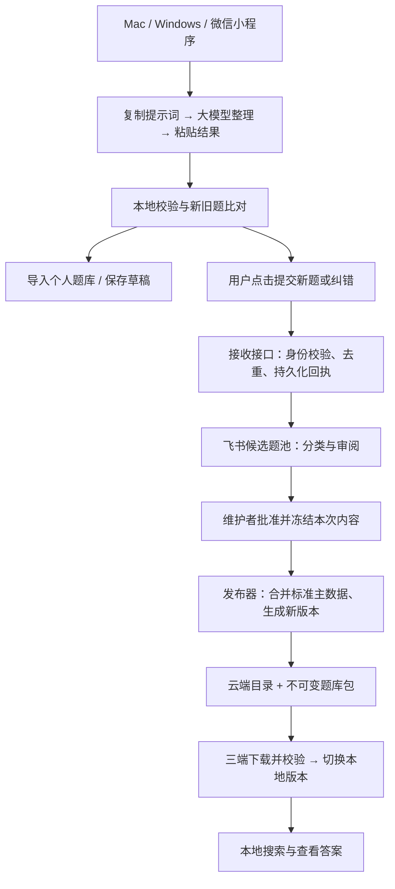

# 大模型录题、飞书收集与三端多题库发布方案

状态：待审核，尚未开发或部署本文新增功能。  
日期：2026-10-15。三端指 macOS、Windows、微信小程序。  
本轮开始前已将上一轮小程序搜索区折叠改动保存为本地快照 `f647859`。

2026-10-15 补充：用户明确当前入口优先采用「大模型拍照识别一道题 → 粘贴单题回复 → 上传飞书」。采集交互和输出格式以[单题拍照识别与飞书收集流程](单题拍照识别与飞书收集流程_待审核.md)为准；本文批量提示词与协议保留待后续使用，云端发包和多题库架构继续沿用。

## 1. 推荐结论

**采用你提出的方式：云端发放题库文件，各端本地搜题；新题与纠错建议汇总到飞书，审核后定期合并、打包、发布新版。**

飞书负责收集与审阅，云端文件存储负责正式题库和版本分发。搜题不请求飞书，也不必部署一套供所有读者实时查询的云端题目数据库。

三端共同增加「大模型输出规范模版」入口。点击复制提示词，在你使用的大模型中整理题目，再把结果粘贴回程序。程序识别新题、旧题和答案差异；新题可导入个人题库，也可提交到公共题库的候选池。正式公共题库只接收维护者批准的变更。



建议先采用「飞书基础版 + 腾讯云对象存储 COS + 一个轻量接收服务」作为国内正式使用方案。预算优先的试运行可评估 Cloudflare R2 与 Workers 免费额度；具体取舍见第 11 节。**现在先确定流程和格式，不开通收费服务。**

## 2. 当前工程与需要补齐的部分

以下依据本轮实际检查的代码，不把此前规划当作已实现功能。

| 部分 | 当前状态 | 本次方案要补齐 |
| --- | --- | --- |
| 桌面题库 | SQLite；按 `bank_id` 区分题库；题目身份为 `(bank_id, question_id)` | 大模型草稿入口、内容比对、提交与云端更新 |
| 标准数据 | 已有 Question v1.0、JSONL、Excel、Word、`.qbank.zip` | 新增大模型输入适配层，复用正式标准，不另造一套正式题目格式 |
| 小程序 | 当前分支内置一个压缩题库，本地生成索引 | 多题库目录、下载更新、完整标准数据存储、粘贴导入与提交 |
| 小程序压缩数据 | 为阅读删去了原始选项 UUID、真实修订等维护信息；解码时有合成值 | 不能直接拿它还原正式源数据或作旧题更新依据 |
| 云端与飞书 | 本轮未发现本文所述收集、审核、定时发布链路已落地 | 需要新增接口、台账、发布器及配置 |

相关实现：[桌面数据模型](src-tauri/src/model.rs)、[数据库](src-tauri/src/db.rs)、[标准格式](docs/导入格式与离线包规范_v1.md)、[小程序加载器](miniprogram/miniprogram/services/bank.ts)、[压缩模型](miniprogram/miniprogram/core/compact.ts)、[手机数据构建工具](tools/mobile-index/build.mjs)。

本方案承接此前的文字搜题首版，增加下一阶段功能；图片、OCR、多人同时编辑、在线大模型 API 调用仍不纳入这一阶段。

## 3. 三端界面与使用流程

### 3.1 「大模型输出规范模版」

沿用你指定的名称，三端显示完全一致。

- 桌面：放在「录题模板」中，与 Excel、Word、JSONL 并列；导入窗口也提供快捷入口。
- 小程序：放在「题库管理 → 导入与模板」；折叠后的主搜索页继续保持简洁。
- 点击模板即复制完整提示词，带入当前题库名称与 ID，并提示「已复制，可粘贴到大模型」。
- 未选择题库时，先选已有题库或新建个人题库。不能根据大模型自行编出的名称创建正式公共题库。
- 提示词保留版本号。三端共用同一份模板源文件，避免各端逐渐写成不同格式。

本轮可直接审阅的提示词正文：[大模型输出规范模版 v1 草案](templates/大模型输出规范模版_v1_草案.txt)。它是**拟新增入口使用的草稿协议**，当前已发布程序尚不能直接粘贴这一整段 JSON 导入。

### 3.2 粘贴与导入

1. 打开「粘贴大模型结果」，粘贴 JSON；此处独立于搜索框，不使用搜索的 300 字限制。
2. 程序显示目标题库，以及「新题、完全相同、存在差异、待补充」数量。
3. 新题默认勾选；完全相同的旧题自动跳过；差异题展开对照，按原题／新稿／手动修订选择结果。
4. 对个人可编辑题库，点击「导入选中题目」写入本地；对公共发布题库，点击「提交候选」进入审核队列，也可另存到个人题库先用。
5. 显示逐题结果和未处理原因。可以再次编辑、重试或导出草稿，不能悄悄丢掉失败题目。

新入口先暂存完整批次，再将使用者确认的有效记录作为一个事务提交；待补充题留在草稿中。现有标准文件导入的整批严格校验保持不变。

不因模型说“正确”就自动覆盖现有答案。维护者选定最终答案后，普通搜题页面只展示最终结果，不额外显示冲突标记；来源与修改记录留在管理端。

复制模板不会调用付费模型 API；你自行选择大模型。上传发生在点击「提交」之后，本地搜索词和其他剪贴板内容不上传。

## 4. 数据格式：输入草稿与正式题库分开

| 格式 | 用途 | 关键限制 |
| --- | --- | --- |
| `qbank-ai-import-1` JSON 对象 | 大模型输出、粘贴预检、候选收集 | 可以表达“答案未知”；不是直接写入正式库的记录 |
| Question v1.0 + `questions.jsonl` | 完整、可维护的标准题目数据 | 继续执行现有严格校验；普通新题必须有有效答案 |
| `.qbank.zip` | 三端交换和云端正式发放 | 沿用 `manifest.json` 与 `questions.jsonl` 两个成员的现有规范 |
| SQLite / 手机索引与压缩投影 | 各端本地高效检索 | 属于派生数据，可以从标准题目重新生成 |

大模型输出采用一个 JSON 对象包裹整批题目，便于检查批次是否截断、题数是否一致。**正式导出仍使用已有 JSONL；不是让模型输出 SQLite 二进制数据库。**

建议提示词每次整理不超过 30 题。首轮粘贴入口暂按最多 100 题、UTF-8 文本 1 MiB 设计；超限明确提示分批，不截断内容。更大的标准文件走文件导入。这是待实现的交互限制，与现有离线包容量限制分开。

### 4.1 草稿协议示例

下面只展示格式，不属于实际认证题库内容：

```json
{
  "format": "qbank-ai-import-1",
  "target": {"bank_id": null, "bank_name": "示例题库"},
  "complete": true,
  "item_count": 1,
  "items": [
    {
      "item_no": 1,
      "external_id": "",
      "type": "multiple",
      "stem": "下列哪些数是偶数？",
      "options": [
        {"key": "A", "content": "2"},
        {"key": "B", "content": "3"},
        {"key": "C", "content": "4"}
      ],
      "answer": ["A", "C"],
      "answer_origin": "provided",
      "explanation": "",
      "chapter": "",
      "tags": [],
      "applicable_version": "",
      "source_note": "示例材料明确给出答案 A、C",
      "warnings": []
    }
  ],
  "unresolved": [],
  "unprocessed_note": ""
}
```

协议约定：

- `type` 只接受 `single`、`multiple`、`true_false`。选择题为连续的 A—H，共 2—8 项；判断题 `options: []`。
- 单选 `answer: ["B"]`；多选至少两个不同字母；判断使用 `true` 或 `false`；不知道则为 `null`。
- `answer_origin` 为 `provided`（材料明确给出）、`inferred`（模型推断）、`unknown`（不能确定）。它是模型自述，不能当作审定凭证。
- `answer: null` 只进候选草稿，不借用旧版迁移例外直接进入正式题库。模型推断答案在导入预览中单独提醒，由使用者确认；公共发布仍需维护者审核。
- 缺图、无法识别题型、超过支持范围等，放入 `unresolved` 并保留原文和原因。不能编造选项或把填空题强行改为单选。
- `complete: true` 只表示本批材料都已归入 `items` 或 `unresolved`，不表示答案都正确。未处理完要标记 `false` 并说明位置；程序不把这种批次标成完整导入。
- `item_count` 必须等于 `items.length`。程序检查语法、字段、题型、选项、答案、数量及大小；不执行内容中的代码或指令。
- 模型不生成题目 UUID、选项 UUID、修订号、发布版本或哈希。新身份由程序生成，旧身份由程序比对确认。
- `target` 仅辅助防止贴错题库。最终以界面选择及服务端授权为准；不一致时要求重新确认目标，不按模型指令路由。

完整提示词包含上述字段定义、无法处理时的行为和禁止擅改原文的要求。正式实现时再为这个草稿协议添加独立 Schema，不修改现有 Question v1.0 的含义。

## 5. 新题、旧题与答案差异如何判断

首先在**目标题库内**比对。初级和高级存在相似题，不意味着其中一库应该删题。

| 情况 | 默认处理 |
| --- | --- |
| 可信编辑上下文带已有题目 ID 和修订号 | 定位该题，检查基准修订，展示差异 |
| 没有 ID，题型、题干和选项内容一致，答案也一致 | 识别为同题并跳过；新增来源可另作记录 |
| 选项内容一致但顺序变化 | 按选项内容重映射答案，再比较正确选项的内容 |
| 同一题只有答案不同 | 展示原答案、新答案和依据，维护者选定后更新 |
| 正文相同、仅解析／标签／章节不同 | 作为补充信息差异，默认不覆盖已有非空内容 |
| 只有外部编号相同，或题干相似但选项／版本不同 | 作为候选匹配，不自动合并 |
| 未找到匹配且结构完整 | 作为新题；生成 UUID、初始修订号与来源记录 |
| 内容缺失、答案未知、重复选项导致映射不唯一 | 保存待补充草稿，不能自动进入正式发布 |

例如，原题 `A=苹果，B=香蕉，答案=A`，新稿 `A=香蕉，B=苹果，答案=B`，比较后的答案都指向“苹果”，不是答案冲突。不能只比较字母。

如果新稿答案未知，但匹配到的旧题已有答案，显示旧题答案供比对，默认保留旧答案，不能用 `null` 清空它。

自动判重只做保守处理，例如统一换行符、去除字段首尾空白。代码大小写、数字、单位、运算符、否定词、正文内部空白不随意改写；搜索使用的大小写折叠和宽松归一化不能直接拿来判定“完全相同”。相似度仅用于列候选。

同一批中重复的题也要先合并候选；不同用户提交相同内容，服务端仍须再次比对。客户端可能持有旧版题库，不能只靠本机“没搜到”就认定云端也没有。

对已有题目的修订必须携带服务端确认的 `base_revision`。若准备提交时主库已变更，重新展示差异；不能让旧稿覆盖新修订。模型返回的 ID 或“这是新题”等描述没有写入权限。

## 6. 小程序如何处理标准数据和上传

### 6.1 小程序可以在本地完成标准化

小程序端可以用 TypeScript 完成 JSON 解析、校验、判重预览，生成与桌面一致的标准题目记录。三端共享草稿协议、归一化和答案映射规则；正式发布再进行一次独立严格校验。

不要求小程序与桌面运行同一个 SQLite 文件。共同标准是**题目结构、身份、修订及发布包**：桌面将其入 SQLite，小程序保存文件并建立 JavaScript 搜索索引。

必须补齐当前压缩实验的缺口：

1. 下载并保存完整的标准包，原始 JSONL 字节和正式清单一起保留。
2. 阅读可继续使用压缩投影／索引，但所有比对、回传、重新制包从完整记录取身份与修订。
3. 已有内置精简包只作阅读基线；在拿到完整标准源之前，不能用合成的 `option_id` 或固定修订号更新公共题目。
4. 手机缓存清理后可以重建索引；未提交草稿应提供导出备份，公共题库可以重新下载。

### 6.2 上传分成三种动作

| 动作 | 实际结果 |
| --- | --- |
| 「导入个人题库」 | 写入当前设备的个人题库，可立即本地搜索，不改变所有人的公共库 |
| 「提交新题／纠错」 | 上传候选内容与目标 `bank_id`，拿到回执，等待审核 |
| 「发布题库新版」 | 只有维护者操作；将已批准的变更合并成一个正式版本 |

“上传题目数据”和“在微信开发者工具上传小程序代码”是两件事。下载更新功能上线前，内置题库变更仍需随小程序代码发版；该功能上线后，后续标准题库内容可按目录版本下载，代码／协议功能变更仍按小程序代码发布流程处理。

首轮手机输入以粘贴文本、导入标准文件为主。文件选择、导出分享、网络域名和存储空间需在正式微信环境中确认；不能把开发者工具的宽松设置当作上线验证。

三端都保留制作离线题库包的目标：公共库可重新导出原版本完整包；个人库可生成自己的包。**能制包不等于能发布到官方云端目录**，后者必须校验发布者权限。个人副本获得新的题库身份，保留原库来源。

小程序重新分享已下载的原包可直接复用文件；为个人新题制包则需要新增 ZIP 写入及 SHA-256 能力，不能把现有解压／读取能力当作已经实现打包。个人题库跨设备首轮采用导入导出，个人草稿自动云同步另行安排。

## 7. 飞书负责收集、审核与发布记录

### 7.1 三张表即可开始

| 表 | 主要字段与用途 |
| --- | --- |
| 候选题池 | 提交 ID、题库 ID、提交者标识、提交时间、题型、题干、选项、答案、答案来源、原题引用、差异摘要、审阅意见、状态 |
| 题库目录 | `bank_id`、名称、分类、启用状态、维护者、当前发布版本；不直接把编辑结果当作公开下载目录 |
| 发布记录 | 发布批次、题库 ID、前后版本、增改删数量、内容哈希、批准者、发布时间、发布结果 |

候选题池提供「初级认证」「高级认证」「待审核」「待补充」「已处理」视图即可，首轮不必为每一个题库重复设计一套表。完整原始提交和审批快照放私有存储，以免长内容受表格字段限制。

完整正式题库与历史版本另存于云端文件存储。飞书不必永久保存全部一万题，只需保留活跃待审数据及近期处理记录。已发布条目在确认归档与可恢复后定期移出活跃池，建议保留最近 30 天；不能先删除再尝试备份。

### 7.2 需要一个接收接口

推荐路径是「客户端 → 接收接口 → 飞书」。接收接口使用飞书开放平台应用身份写入指定表格；飞书支持服务端新增记录和相应文档权限。[飞书新增记录 API](https://open.feishu.cn/document/server-docs/docs/bitable-v1/app-table-record/create)

飞书应用密钥、访问令牌、云存储写入凭据和发布签名私钥只放服务端。它们不能打包进小程序或桌面客户端，也不能放进复制的提示词。

接口首轮只需这些能力：

- `POST /submissions`：接收草稿、校验目标库和身份、生成持久化回执。
- `GET /submissions/{id}`：提交者查看自己的处理结果；需要验证访问者身份。
- 管理端审核／发布接口或命令：仅维护者可用，与普通提交权限分离。

搜索保持免登录。云端提交时才建立可验证的提交者会话；小程序和桌面可采用不同登录入口，但最终映射到同一权限体系。首版不收集头像、通讯录等无关资料。

接收台账保存 `submission_id`、内容哈希、目标库和处理状态。相同 ID、相同内容的重试返回原回执；相同 ID、不同内容明确拒绝。台账需要持久化和唯一性保证，不能只存在函数内存或靠飞书“先查再插”防重。

先持久化提交，再异步写飞书；飞书暂时失败时显示「已接收，待同步」，由服务端重试，不让用户以为已经审核。设备离线时只保留本地待提交队列，恢复网络后重试；尚未收到服务器回执的内容不能标记“上传成功”。

这里可能需要一张很小的云端台账表／键值存储，但不用把整套题库做成在线搜索数据库。

## 8. 定期打包发布的具体流程

你说的“定期发数据库”，建议落地为：**将已批准变更合并到完整主数据，发布一个新的整包版本。** 最初一万道文字题先整包更新，暂不做增量补丁。

1. **审阅与批准**：在飞书整理内容；维护者通过发布器／管理入口确认本批差异，冻结批准后的题目 JSON、内容哈希和原题修订。后续编辑重新成为待审版本，不能沿用旧批准。
2. **选取发布批次**：每个题库只取本次截止时刻已经批准的快照；等待审核或答案未知的记录不参与。
3. **读取当前主数据**：以该库最新正式完整数据为基线，再做判重、答案映射、修订检查。管理员直接维护的修改也走同一批准流程，避免两份“主库”互相覆盖。
4. **串行合并**：同一个题库的手动与定时发布共用锁和版本检查。分配新题／选项 UUID；更新题保留身份并增加修订号；删除须是维护者明确批准的动作。
5. **构建发布物**：生成完整标准包；如需手机压缩数据／预生成索引，同时从同一份完整数据构建，记录派生格式版本和文件哈希。
6. **先上传版本文件**：路径按题库与版本固定，发布后不可原地改写。验证文件可下载、数量和哈希一致，再更新公开目录指针。
7. **发布成功再记账**：目录切换成功后，才标记该批候选“已发布”；任何中断都能凭发布批次 ID 继续，不能重复添加新题。
8. **客户端下载更新**：先用本地版本，后台检查目录；下载到临时位置，验签、校验并建好索引后再切换。失败保留原版本和搜索能力。

建议先做「维护者一键发布」，链路稳定后再启用**每天 02:00（北京时间）检查已批准内容，有变化才发布**，并保留随时手动发布。这个时间是方案建议，本轮不创建定时任务。

只有云端定时任务才能在你的电脑关机时照常执行。如果先用本机发布器，须明确它是“开机运行时发布”，不能承诺全天自动运行。也不要把压缩全库和完整比对塞进一次客户端上传请求。

### 8.1 发布身份和回退

- 沿用现有 `release_id = questions.jsonl 原始字节的 SHA-256`；另记 ZIP 和派生文件哈希，不混用几种哈希。
- 现有 v1 ZIP 只含两个文件。新增签名放在外部发布目录／独立签名文件，不擅自往 ZIP 塞入第三个成员而导致旧程序拒绝。
- 自动更新目录建议带发布者签名，客户端内置校验公钥；哈希只证明文件一致，不能证明谁发布。旧客户端继续手动导入，支持新更新协议的客户端才自动更新。
- 每个题库保留至少最近 3 个发布版本及私有审批记录。坏版本紧急恢复时，**以更高版本号重新发布之前正确内容**，兼容现有拒绝降级的规则。
- 自动更新只替换公共发布库，不覆盖个人题库、草稿、提交队列或阅读偏好。
- 目录读取失败不影响已下载题库；题库退出目录也不直接删除本机副本。

## 9. 初级、高级及更多题库如何管理

**一个云端目录，多个独立题库，每个题库独立发布和更新。**

| 概念 | 规则 |
| --- | --- |
| 题库身份 `bank_id` | 创建时生成，长期固定；初级与高级必须不同 |
| 显示名称 | 可以更名，不改变身份；不能用名称充当主键 |
| 题目身份 | 在目标 `bank_id` 内使用 `question_id`；外部题号可以重复 |
| 题库版本 | 初级 v8 与高级 v2 独立演进，不要求一起发版 |
| 适用技术／考试版本 | 如 HarmonyOS 版本，是内容属性；与题库发布 v8、程序 v0.x 分开 |
| 跨库相同题 | 可以各自保留；提供相似提示或复制来源，默认不跨库自动合并 |
| 私人副本 | 新 `bank_id`，保留来源关系，不冒充原公共库 |

沿用当前「HarmonyOS 初级认证」的正式身份；「HarmonyOS 高级认证」在你准备好内容后单独创建。高级库为空时标为“尚未发布”，不发布空包来占位。

客户端提供题库列表，显示名称、题数、本机版本和下载／更新状态。默认只搜当前选中的题库，记住上次选择；“跨全部已下载题库搜索”可后续增加，结果必须标出所属库。

小程序即使折叠搜索区，也应在搜索框旁保留一个小型题库切换入口，避免用户在初级库输入高级题却不知所在题库。每批大模型导入只对应一个题库；混合材料先分类，未经确认不能自动分发。

文件和缓存按 `bank_id / release_id / index_version` 隔离。当前小程序的单个加载 Promise 和固定索引缓存文件必须改为按题库管理；不能切到高级后还复用初级索引。内存优先加载当前库，避免多个大题库同时常驻。

目录至少记录：题库身份、名称、题数、发布版本、标准数据哈希、标准包地址与文件哈希，以及各端最低兼容版本。手机派生文件若存在，须显式关联同一 `release_id`；它不能独立修改答案。

## 10. 正式数据、编辑数据与公开范围

为避免“谁改的是最终版”不清楚，约定如下：

- **已发布完整标准数据**是公共库的唯一正式基线；飞书是待审变更池，桌面不是另一份可随意覆盖云端的权威副本。
- 维护者本地修订、手机提交和飞书调整，最后都变成待批准的变更，再由同一个发布器合并。
- 未批准记录、提交者标识、审阅意见、私有来源凭据留在私有区，不随公共包发放。
- 现有包会保留 `sources/source_note` 等信息。发布时必须生成适合读者分发的内容，去除私人身份、内部回执和带令牌的链接；完整审计证据单独归档。
- 公共读取、候选提交、审核批准、正式发布是四种不同权限。普通用户可以导出自己的离线包，不自动获得修改官方目录的权限。
- 若某个题库将来限定人群，目录和下载需要鉴权；不能把“不展示链接”当作访问控制。首轮方案不额外建设付费授权或复杂 DRM。

## 11. 免费服务与国内服务商选择

以下公开政策核对日期为 2026-10-15，实际租户权益和后续调整以上线时控制台为准。“有免费额度”不等于所有资源、域名和平台账号永久免费。

| 方案 | 适合承担的工作 | 免费与限制 | 建议 |
| --- | --- | --- | --- |
| 飞书基础版 | 候选题收集、分类、审阅、发布台账 | 单表基础 2,000 行；官方列有可领取的额外 18,000 行权益，并出现“限时免费”说明；不要假定所有账号永久有 20,000 行 | 作为审核台，及时归档已处理记录 |
| 腾讯 COS + 轻量接收服务 | 国内题库文件发放、接口、定时发布 | COS 涉及存储、请求、外网下行等费用；函数／云开发资源另计，不承诺永久免费 | 国内正式使用优先评估，先设置预算与用量告警 |
| Cloudflare R2 + Workers | 预算优先的文件分发和小型接收接口 | R2 标准存储每月有 10 GB-month、100 万 A 类、1,000 万 B 类操作免费额度，直接外网传出不收费；Workers 有免费额度及 CPU 限制 | 可作为低量试运行候选，上线前由你确认国内手机网络体验与域名条件 |

飞书容量依据：[多维表格行数扩容](https://www.feishu.cn/hc/zh-CN/articles/389918352455-多维表格行数扩容)。其自建应用调用量还有租户级限制和分阶段政策，不能把历史活动额度当成永久 API 配额；应检查管理后台并采用批量写入、重试和归档。[飞书调用量通知](https://open.feishu.cn/document/uAjLw4CM/ukzMukzMukzM/platform-notices)

腾讯成本依据：[COS 流量费用](https://cloud.tencent.com/document/product/436/53863)。CloudBase 可作为接收和定时运行的备选，但体验期、活动赠送及正式套餐需分别看待，不将体验资源写成长期免费承诺。[CloudBase 创建环境](https://docs.cloudbase.net/quick-start/create-env)

Cloudflare 额度依据：[R2 定价](https://developers.cloudflare.com/r2/pricing/)、[Workers 定价](https://developers.cloudflare.com/workers/platform/pricing/)。R2 的 `r2.dev` 是有速率限制的开发入口，正式发放应评估自有域名等生产接入；免费 Worker 不宜承担整库压缩构建任务。[R2 公共访问说明](https://developers.cloudflare.com/r2/buckets/public-buckets/)

**推荐选择：飞书收集审核，腾讯云发包；若这一阶段必须尽量零云资源账单，再验证 R2／Workers 的免费额度路线。** 使用通用 HTTPS 接口、标准 ZIP 和供应商适配层，后续换存储无需改题目格式。

影响费用最大的未知量通常是下载人数和更新频率。估算用：`包大小 × 本月下载人数 × 每人本月更新次数`。例如假设每包 5 MB、1,000 人、每月 4 次整包更新，约 20 GB 下载量；这是算例，不是当前实测包大小或费用报价。读者每次输入搜索词不会产生云端查询费用。

如果暂时不运行接收服务，可以让维护者手动整理飞书并在本机打包上传，但不能同时把它描述成“三端直接提交、电脑关机也能定时发布”的完整自动化方案。

## 12. 开发顺序与交付边界

| 阶段 | 交付内容 | 完成标志 |
| --- | --- | --- |
| A：统一输入 | 提示词定稿、草稿 Schema、共享解析／比对规则；三端复制与粘贴预览 | 同一批输入在三端分类一致；选项乱序不误判答案 |
| B：多题库与本地导入 | 小程序完整标准存储、个人题库、初级／高级切换、三端离线包能力 | 切库不混索引；个人导入不覆盖公共库；包能跨端交换 |
| C：候选收集 | 接收接口、提交台账、飞书表、重试与审核快照 | 离线草稿可恢复；重复上传不重复收录；回执准确 |
| D：发布与更新 | 一键发布、云端目录、验签与校验、原子切换和回退 | 新版可被三端下载；更新失败仍能搜旧版 |
| E：定时运行 | 云端定时执行、额度告警、归档和恢复 | 只发布已批准变更；空批次不发版；失败可继续 |

结构校验通过不代表知识答案正确。模型推断、旧题纠错和新增认证题的内容审核仍由维护者决定，不能用另一次模型回答充当自动批准。

原有桌面 10 万题性能门槛继续保留；小程序先以真实约 1 万道文字题及目标手机确认容量和速度，不把桌面测试结论直接等同于手机结果。图片、公式结构、OCR、付费授权、多人同时编辑和增量更新以后另行安排。

## 13. 交给你操作的验收清单

开发完成时按你的偏好提供操作步骤，由你做界面和真机验证；本轮只交方案，不进行耗时界面验证。

1. 三端模板入口复制出的协议版本一致，并带对当前题库。
2. 粘贴单选、多选、判断混合材料，新题可导入；非法 JSON、截断内容、未知答案明确保留原因。
3. 重复粘贴、换选项顺序、重复点击上传都不增加同一题；相同答案内容不会误判冲突。
4. 修改旧题时看到准确对照；选择正确答案后，普通阅读页没有多余冲突提示。
5. 初级与高级独立搜索、提交、更新；题号重复、题库更名及切库不会串数据。
6. 手机导出的完整个人包可在桌面导入；公共包重新导出保留原身份、修订和内容哈希。
7. 飞书仅出现已提交内容；未经批准、缺答案及错误题目不会进入发布包。
8. 下载中断、飞书超额、手机断网或退出后，旧题库可用，未完成提交可以重试。
9. 云端旧题已被修改时，再上传旧版纠错稿会重新比较，不能悄悄覆盖。
10. 云端发布后打开三端可以更新；个人题库和草稿仍在；错误版本可以通过更高版本恢复。

## 14. 本轮建议审核的决定

- [ ] 同意「云端发包、本地搜题、飞书收集审核、定期合并发布」作为下一阶段主架构。
- [ ] 同意三端统一上线「大模型输出规范模版」及粘贴预检，新题可导入个人库，公共库变更须经过审核。
- [ ] 同意沿用 Question v1.0 / JSONL / `.qbank.zip`，大模型 JSON 仅作为输入草稿协议。
- [ ] 同意旧题自动比对、相同题跳过、答案差异人工选择；不根据模型判断自动覆盖正确答案。
- [ ] 同意初级与高级使用独立题库 ID 和版本，默认只搜索当前库。
- [ ] 同意飞书只保留活跃候选和近期处理记录，完整题库、私有审计和历史包另存。
- [ ] 同意先完成一键发布，再启用每天 02:00 的已审内容自动发布；没有变化不发版。
- [ ] 默认选腾讯云作为国内分发／接收服务候选；若零云资源账单优先，先验证 Cloudflare 免费额度路线。

部署前仍需提供或确认：飞书租户与可用权益、可配置的小程序网络域名、允许公开下载的题库范围、预计下载人数及云资源月度预算。这些不妨碍先完成本地格式与三端导入功能。
