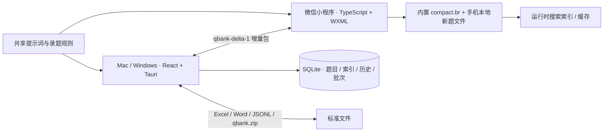
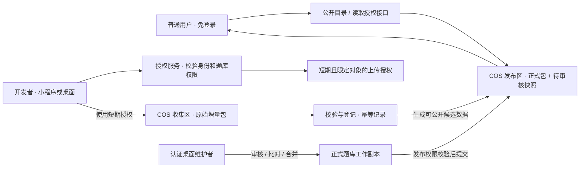

# 题库 · 完整开发文档

> 整理日期：2026-10-16。当前源码版本：**0.2.7**。本文是产品范围、数据协议、开发流程和验收状态的统一入口；原分散文档已删除，历史全文保留在 Git。
>
> 本轮整理基于分支 `codex/compact-bank-experiment`、起点提交 `ebe1681`，合并原有 **21 份产品与开发 Markdown** 的有效内容，保留历史验证依据，并纳入最近确认的云端权限、版本分发及新题录入需求。[AGENTS.md](AGENTS.md) 继续独立约束协作流程。
>
> **当前已能离线搜题、录题、交换增量包；云端授权服务已通过控制台健康检查，但开发者认证、上传、正式发布及待审核题自动同步尚未接通。** 部署及配置进度见第 10 节；健康检查成功不代表业务联调完成。

<a id="contents"></a>
## 目录

1. [状态定义与当前结论](#status)
2. [产品范围与已确认决策](#scope)
3. [功能完成矩阵](#feature-matrix)
4. [架构与代码入口](#architecture)
5. [桌面端使用与实现](#desktop)
6. [微信小程序使用与实现](#miniprogram)
7. [题库身份、标准数据与文件协议](#data)
8. [大模型录题、比对与增量包](#intake)
9. [开发者身份与权限边界](#auth)
10. [COS、授权服务与云资源](#cloud)
11. [正式题库、待审核题和版本同步](#sync)
12. [实施顺序、计划与建议](#roadmap)
13. [开发环境、构建与命令](#development)
14. [验证记录与交付门槛](#validation)
15. [历史题库迁移与答案核对](#migration)
16. [数据保护、发布和维护](#maintenance)
17. [历史方案与飞书备选](#alternatives)
18. [文档来源、冲突处理与追溯](#sources)

<a id="status"></a>
## 1. 状态定义与当前结论

| 标记 | 含义 | 不能据此推断 |
| --- | --- | --- |
| **已完成** | 在代码、自动检查、已记录的实际操作中有对应依据；同时注明验证层级 | 不等于所有设备都验收通过，也不等于已经上线 |
| **计划** | 用户已提出或确认，仍需实现、联调或验收 | 不写成当前可用功能 |
| **建议** | 为完整性、可靠性或后续扩展提出的方案，尚未确定采用 | 不自动纳入已承诺范围 |
| **历史记录** | 旧版本、旧实验或已被后续决定替代的事实 | 不作为当前版本的新验证结果 |

“已完成”应进一步区分：**源码实现 → 自动检查 → 目标设备验收 → 构建交付 → 发布上线**。每一层分别留证据，不跨层宣称完成。

当前结论：

- **已完成 · 源码与自动检查**：Mac、Windows 共用桌面功能；小程序本地文字搜题、多题库、提示词复制、模型回复解析、本地新题批次、增量包导入导出与微信文件分享入口。
- **已完成 · 历史实机记录**：Mac、Windows 的旧版桌面功能和 Windows v0.2.6 安装／升级／便携版测试，具体日期与限制见[验证记录](#validation)。
- **已完成 · 资源及服务代码**：两个 COS 桶、`qbank-auth` 函数和运行角色已创建；授权服务、gzip + Base64 上传包校验及 COS 登记代码通过 12 项本地测试。用户提供的云端 `GET /health` 返回 200、版本 0.2.7，但 `auth_configured` 和 `uploads_enabled` 仍为 `false`。
- **计划**：完成云端环境变量、真实微信身份校验和 COS 上传联调，接入客户端开发者登录与压缩上传；继续实现正式发布、匿名版本分发、所有用户同步待审核题、小程序粘贴后自动解析及逐字段编辑。
- **建议**：发布清单签名、细粒度设备授权、审计与费用预警、完整恢复工具等，见[建议清单](#recommendations)。

源码版本保持 0.2.7。云函数部署包独立于桌面安装包和小程序发布；软件版本、题库版本和数据协议版本分别管理。

<a id="scope"></a>
## 2. 产品范围与已确认决策

### 2.1 产品目标

题库是本地优先的文字题检索与维护工具，覆盖 **macOS、Windows、微信小程序**。以初级认证题库为起点，支持高级认证等更多独立题库。目标是快速找到原题、查看答案与解析，并以标准文件交换和维护内容。

桌面端已有截图／粘贴识题。小程序首先保证文字搜题；练习考试、成绩统计、复杂学习系统、照片上传和小程序内直接调用大模型均不属于当前首要范围。

“接近 Everything 的检索体验”是交互与延迟目标，不表示采用同一索引方法，也不表示已经证明所有百万题查询都瞬时完成。

### 2.2 最近决定优先于旧草案

| 主题 | 当前确定边界 | 状态 |
| --- | --- | --- |
| 普通使用 | 默认不用登录即可本地搜题、阅读；计划匿名获取公开题库和待审核内容 | 本地已完成；云端计划 |
| 新题上传 | 仅通过服务端认证的开发者可上传新题增量包 | 计划 |
| 小程序权限 | 可以录题、核实、编辑草稿、上传增量；不能审核合并或发布正式题库 | 部分已完成；编辑与上传计划 |
| 桌面维护 | 认证后获得相应题库的合并权限；正式发布再检查发布权限 | 计划；现有本地导入尚不检查云身份 |
| 未合并新题 | 所有用户自动同步、可搜索，明确显示“待审核”；不覆盖正式答案 | 计划 |
| 题库更新 | 启动先读本地，再联网比版本；更新失败保留旧数据 | 本地读取已完成；联网更新计划 |
| 云服务 | 使用腾讯云 COS；轻量授权服务处理身份、授权和登记，桌面负责审核合并 | 已选定；未联调 |
| 上传格式 | 上传包使用压缩后的 Base64 文本封装；继续兼容旧增量包 | 计划；具体建议 gzip + Base64 |
| 模型工作流 | 用户在外部模型识别一道题，通常由模型作答；复制整块回复进入程序 | 已完成基础流程 |
| 照片与模型版本 | 不保留原照片；记录模型名称、版本和版本来源，未知不得编造 | 已完成协议与校验 |
| 输入界面 | 提示词由复制按钮复制；模型回复放在一个可复制 JSON 代码块；粘贴后展示全题供编辑核实 | 前两项已完成；自动解析编辑计划 |
| 多题库 | 初级、高级等使用不同稳定 `bank_id`，独立版本和批次 | 本地已完成；云端计划 |
| 三端版本 | 当前统一为 0.2.7 | 源码已完成；不代表三端新制品均已发布 |

历史飞书方案保留为备选，Windows／Linux 自建服务保留为后选方案；当前不再把飞书接通作为 COS 路线的前置条件。

<a id="feature-matrix"></a>
## 3. 功能完成矩阵

| 功能 | Mac / Windows | 微信小程序 | 当前证据与剩余工作 |
| --- | --- | --- | --- |
| 本地题库与文字检索 | 已完成：SQLite 检索 | 已完成：本地数据及运行时索引 | 自动检查；设备性能见历史记录 |
| 多词 AND、连续短语与高亮 | 已完成 | 已完成 | 当前测试通过；长列表和复杂输入仍需持续实机验收 |
| 详细／极速模式 | 已完成 | 无对应双模式设计 | 小程序使用单一文字搜索界面 |
| 连续滚动，取消分页界面 | 已完成：两种桌面模式均连续加载 | 已完成结果浏览 | 底层游标分批读取仍保留，不能误删为“分页代码” |
| 折叠搜索区、动效、偏好保存 | 已完成 | 已完成 | 尊重系统减少动态效果偏好 |
| 极速模式鼠标即时预览 | 已完成 | 不适用 | 指针进入即打开，不设停留等待；展示完整内容 |
| 截图、粘贴图片和题目匹配 | 已完成 | 延后 | 桌面原生 OCR + 离线备用引擎；小程序不上传照片 |
| 新建、编辑、删除、历史、回收站 | 已完成 | 仅本地录题及批次能力 | 小程序完整管理功能未整体实现 |
| 标准 Excel / Word / JSONL | 已完成导入导出 | 未实现原生 Office 导入 | 小程序以模型单题和增量包为入口 |
| 全量 `.qbank.zip` | 已完成制作、导入、版本回退 | 未实现完整格式往返 | 手机版投影不可无损重建全部维护字段 |
| 提示词复制与模型回复校验 | 已完成 | 已完成 | 共享规则及三端资源同步检查通过 |
| 旧题、选项调序与答案比对 | 已完成 | 已完成 | 同题同答案跳过，冲突保留旧题 |
| 本地新增题、录入批次 | 已完成 | 已完成 | 可重启恢复；结构有效不代表答案已审核 |
| 增量包导入导出 | 已完成，支持拖入 | 已完成，支持聊天文件导入 | 当前是未压缩 `.qbank-delta.json` |
| 微信文件转发 | 不适用 | 已实现入口 | 当前轮未做真机收发；成功回调不证明朋友已收到 |
| 上传标记 | 已完成本地手动标记 | 已完成本地手动标记 | 没有真实服务端回执，不代表上传成功 |
| 多题库切换 | 已完成 | 已完成 | ID 隔离、选择记忆、详情携带题库 ID |
| 粘贴即解析、全题逐项编辑 | 现有解析预览可用 | 计划升级现有录题页 | 当前粘贴只填原文，还要点解析；预览字段不可逐项编辑 |
| 压缩 + Base64 上传封装 | 计划 | 计划 | 与现有内置 Brotli 题库不同用途 |
| 开发者认证、上传权限 | 计划 | 计划 | 不能仅靠界面隐藏或客户端身份声明 |
| 待审核题自动同步、统一状态 | 计划 | 计划 | 本地 `unreviewed` 不等于已发布云候选记录 |
| 云审核合并、正式发布 | 计划 | 不提供此权限 | 桌面执行维护，服务端控制正式写权限 |
| 自动检查题库版本并更新 | 计划 | 计划 | 当前小程序静态清单不是联网发布目录 |
| 软件本体自动升级 | 计划，未实现完整更新链路 | 微信代码发布机制独立管理 | 与题库内容更新分开 |
| 飞书准备脚本 | 已完成命令行准备与模拟测试 | 无直接飞书接入 | 历史鉴权失败，未实际收集题目 |

<a id="architecture"></a>
## 4. 架构与代码入口

### 4.1 当前已实现架构



当前没有把 COS、SCF 或飞书串入上述运行链路。桌面与手机的数据库／索引实现不同，交换的是标准题目数据，不要求手机直接使用桌面 SQLite 文件。

### 4.2 主要目录与维护责任

| 入口 | 用途 |
| --- | --- |
| [src/main.tsx](src/main.tsx)、[src/styles.css](src/styles.css) | 桌面主界面、导航与样式 |
| [src/detail-results.tsx](src/detail-results.tsx)、[src/speed-results.tsx](src/speed-results.tsx)、[src/use-question-results.ts](src/use-question-results.ts) | 两种结果列表、虚拟化与游标连续读取 |
| [src/question-preview.tsx](src/question-preview.tsx)、[src/layout-motion.ts](src/layout-motion.ts)、[src/preferences.ts](src/preferences.ts) | 即时预览、布局动画与偏好 |
| [src/intake-panel.tsx](src/intake-panel.tsx)、[src/prompt-template.tsx](src/prompt-template.tsx) | 桌面录题、批次、提示词入口 |
| [shared/intake.ts](shared/intake.ts) | 客户端录题校验、比对和增量协议的共享源文件 |
| [src-tauri/src/model.rs](src-tauri/src/model.rs)、[src-tauri/src/db.rs](src-tauri/src/db.rs) | 标准题目模型、数据库、检索、历史与版本 |
| [src-tauri/src/exchange.rs](src-tauri/src/exchange.rs)、[src-tauri/src/intake.rs](src-tauri/src/intake.rs) | Office / JSONL / 全量包与录题增量导入导出 |
| [src-tauri/src/ocr](src-tauri/src/ocr)、[src/ocr-client.ts](src/ocr-client.ts)、[src/ocr-panel.tsx](src/ocr-panel.tsx) | OCR 编排、候选匹配、界面与离线备用识别 |
| [mac](mac)、[windows](windows) | 平台 OCR、图标、打包配置和启动脚本；共用业务代码 |
| [miniprogram/miniprogram/pages](miniprogram/miniprogram/pages) | 小程序搜索、详情与录题页面 |
| [miniprogram/miniprogram/services/bank.ts](miniprogram/miniprogram/services/bank.ts) | 多题库加载、搜索索引与本地新题合并读取 |
| [miniprogram/miniprogram/services/intake-store.ts](miniprogram/miniprogram/services/intake-store.ts) | 手机本地批次、题库及新增题持久化 |
| [tools/mobile-index/build.mjs](tools/mobile-index/build.mjs) | 从标准种子生成手机投影、压缩数据及清单 |
| [scripts/sync-client-assets.mjs](scripts/sync-client-assets.mjs) | 三端提示词、版本和小程序录题逻辑同步 |
| [src-tauri/src/bin/qbank-tool.rs](src-tauri/src/bin/qbank-tool.rs) | 数据工具、导入／校验／检索基准入口 |
| [tools/feishu](tools/feishu) | 历史飞书准备、检查和表结构工具；非当前云主链路 |
| [tests](tests)、[src-tauri/tests](src-tauri/tests) | 客户端及 Rust 回归测试与固定样例 |
| [templates](templates)、[docs/question.schema.json](docs/question.schema.json)、[docs/manifest.schema.json](docs/manifest.schema.json) | 标准模板、提示词与协议约束 |

生成的 `src/generated/client-assets.ts`、小程序 `generated/client-assets.ts` 与 `core/intake.ts` 随仓库提交，但应修改共享源后运行同步命令，避免三端手工改出不同规则。

### 4.3 分支与历史实验

当前分支是 `codex/compact-bank-experiment`；名称含 experiment，不意味着整个应用尚无实现。此前 LAN 下载、内置完整 JSON、运行时索引、压缩投影属于渐进实验。当前以 `compact.br` + 运行时索引为小程序读取方案，不能把旧分支的网络下载能力当作当前默认行为。

平台整理后，Mac / Windows 配置由统一脚本按目标选择；共享 Rust / React 业务维持一份。接手前检查当前分支和差异，不用其他分支覆盖本地配置、签名或未提交数据。

<a id="desktop"></a>
## 5. 桌面端使用与实现

### 5.1 搜题和显示 · 已完成

- **详细模式**：题目列表与答案详情并列；侧栏和顶部区域可收起，保持所选题目与偏好。
- **极速模式**：紧凑题干／答案行，按约 80% / 20% 分配宽度；对当前题库全部题型逐字检索。
- 两种模式均连续向下读取，不再提供上一页、下一页或页码。底层仍按游标批量取数与虚拟化，避免一次渲染全部题目。
- 极速模式设置在左、模式切换在右；设置旁提供预览开关。打开后鼠标进入题目立即显示预览，不等待停留；框展示完整题干、选项、答案、解析，并按可用空间调整位置和尺寸。
- 当前预览按完整显示处理，不以框内滚动作为常规方案；极端超出窗口内容、特殊缩放比例仍需补充体验验收。
- 字号四档、六种主题（松绿、海蓝、紫藤、暖杏、石墨、深色），模式／题库／折叠／预览偏好保存。布局动画约 0.24 秒，并考虑减少动态效果设置。

检索规则：

- 桌面以 SQLite FTS5 trigram 和短词倒排索引组合覆盖长片段及一／二字查询；不把默认英文分词器当作完整中文方案。字段权重排序、同义词和语义检索不是当前默认实现。
- 搜索题干、选项、标签、章节、外部编号和系统 ID；答案、解析不作为普通检索字段。
- 空格分词按 AND 组合，双引号表示连续短语；当前输入限制 300 字符、最多 12 词。
- 搜索规范化使用 NFKC / 大小写处理；这只服务检索，不能复用于题目身份判定并删除代码语义。
- 多词分别高亮，长题展示对应命中片段；处理输入法组合输入和过期异步请求，避免旧结果覆盖新输入。
- 应用内 `⌘ / Ctrl + K` 聚焦搜索，`⌘⇧O / Ctrl⇧O` 打开截图识题；详情导航支持相关键盘操作。系统全局唤起、托盘和单实例仍在计划中。

### 5.2 维护与文件交换 · 已完成

支持本地编辑、历史修订、回收站、索引重建；发布题库保持原内容只读，可复制成独立可编辑题库。副本使用新 `bank_id`，不能冒充原发布源。

Excel / Word / JSONL 导入先预览并校验，确认后整批事务写入；修订过期、非法结构、内容损坏时拒绝。提供全量离线包制作、导入、升级和符合条件的回退。

v0.2.7 允许向所选题库追加本地录入的新题，并记录录题批次；已有题目发生答案冲突时保留旧题。**这尚不是云端正式库与待审核层的完整隔离实现。** 当前全量制包会导出题库中未删除的现有题目，未来正式发布入口必须增加审核筛选，避免把本地未审核新增题误发成正式内容。

### 5.3 截图 / 粘贴识题 · 已完成，部分场景待实机验收

1. 打开截图识题，进行截图框选、粘贴图片或粘贴识别后的文字。
2. 原生 OCR 识别后，在当前题库未删除题目中匹配，显示候选和答案。
3. 选项顺序变化时按选项内容映射答案；匹配有歧义时选择候选核实。

Mac 使用 Apple Vision；Windows 使用系统 `Windows.Media.Ocr` 和系统截图入口。离线 Tesseract.js 资源随构建准备，作为备用引擎；不能据此保证所有设备 OCR 都有相同精度和耗时。

当前输入上限：图片 20 MB、约 3,000 万像素，文字 16,000 字符；支持 PNG / JPEG / WebP。匹配使用索引召回和有限候选计算，最多展示 8 个候选；得分不是“答案正确概率”。不能仅因第一候选分数高就修改题库答案。

截图识题与“大模型拍照录新题”是两条流程：前者本地匹配已有题，后者接收用户从外部模型复制的标准文本，不保存原照片。

<a id="miniprogram"></a>
## 6. 微信小程序使用与实现

### 6.1 当前能力 · 已完成

项目在微信开发者工具中打开 [miniprogram](miniprogram) 目录，业务源码位于其下 `miniprogram/`。采用原生 TypeScript、WXML、WXSS 和 WebView 页面。

首页展开时显示题库、搜索说明、题库切换和录题入口；收起后只保留一行搜索。展开／收起约 0.22 秒，记忆状态并保留搜索内容和滚动体验。当前不是桌面“详细／极速”双模式。

随代码内置 **HarmonyOS 初级认证 914 题**。当前没有真实高级认证种子内容；可新建高级题库，或导入他人分享的同 ID 增量包。相同名称不代表相同题库，多人协作时应沿用同一份题库 ID。

题库选择、搜索索引、详情路由和录题批次按 `bank_id` 隔离。详情带题库 ID，不能切库后错误读取另一个题库的同名／同编号题目。

### 6.2 本地存储与压缩 · 已完成

- 内置数据为 [compact.br](miniprogram/miniprogram/data/compact.br) 和静态 [manifest.ts](miniprogram/miniprogram/data/manifest.ts)。此次检查压缩文件为 **82,500 字节**。
- 读取后还原手机展示投影，分块建立运行时短词索引；缓存文件为 `qbank-runtime-index-v1.json`。
- 缓存检查发布身份、数量、结构版本和校验值；失效时重建。索引写盘失败时仍可在内存搜索，不应导致题库不可读。
- 本地录入单独保存在微信用户文件目录 `qbank-intake-v1.json`，保存题库、完整标准新题和批次；采用串行写入、临时文件后改名以及内容校验。损坏时报告错误，不静默清空数据。
- 当前题库加载使用按库缓存；尚未实现经过验证的多大题库 LRU 淘汰与内存预算。

手机内置投影会省略部分维护字段，不能从该投影无损恢复原题 UUID、修订和全部来源；供阅读使用的选项身份也不能直接视作原库身份。**新录入题保留真实 UUID、选项 ID 和模型来源，能够导出标准增量包。**

当前手机代码未接入启动下载、云版本查询、登录或上传。`manifest.ts` 是内置清单；保留的开发服务器脚本不表示小程序已经自动联网更新。

### 6.3 当前录题与分享 · 已完成基础流程

入口为“录题 / 增量包”；提示词有独立复制按钮。当前流程是 **粘贴原文 → 点击解析并比对 → 查看只读题目预览 → 确认保存**。批次可持续增加新题，也可切为“新一批”。

先点击“保存本批次增量包”，再由用户点击“转发增量包给微信好友”，使用 `wx.shareFileMessage`。两步分离，让分享直接由用户点击触发。还可从微信聊天选择增量包导入。

导出、取消转发、分享成功回调均不等于云上传成功；文件是否收到需要接收端确认。微信清理数据或卸载可能删除未导出内容，不能把本地缓存当成云备份。

### 6.4 新题录入页升级 · 计划

沿用现有 `pages/intake/intake` 路由完善页面，无需再建立一套重复录题入口：

1. 保留“复制提示词”和明显的“粘贴”按钮。
2. 用户点击粘贴，读取文本后立即解析；成功直接显示完整题目，不再要求额外点击解析。
3. 展示并允许编辑：目标题库、题型、题干、每个选项、答案、解析、模型名称、版本、版本来源和识别提示；扩展元数据如章节、标签、适用版本也应有一致入口。
4. 选择题支持 2—8 个选项，判断题用明确的正确／错误选择；更改题型、删除或调序选项时检查答案映射，不能保留失效答案。
5. 编辑后重新校验并重新比对当前题库。只有当前编辑结果有效且确认保存，才生成新题及批次记录；旧题冲突继续保留旧答案。
6. 解析失败保留粘贴原文、定位错误，允许修正；内容残缺或无法确定答案时不得伪装成合法新题上传。
7. 本地草稿可不登录使用；上传时才要求开发者认证。服务端回执决定“已上传”，不让按钮或手动勾选代替真实结果。

建议保存模型原始文本与人工修改差异以便追溯，但不保存照片；当前实现只保存结构化模型来源，尚没有完整原始回复／修改轨迹。

<a id="data"></a>
## 7. 题库身份、标准数据与文件协议

### 7.1 身份和版本不能混用

| 字段／概念 | 含义 | 当前与计划 |
| --- | --- | --- |
| `app_version` | 软件代码版本，如 0.2.7 | 已完成三端同步 |
| `bank_id` | 稳定题库身份，名称变化不更换身份 | 本地已完成；云目录沿用 |
| `question_id` / `option_id` | 标准题目／选项 UUID | 已完成；新题自动生成 |
| `revision` / `base_revision` | 题目修订与修改所基于的版本 | 桌面已完成冲突检查 |
| `schema_version` | 标准题目和全量包的数据协议版本，当前 1.0 | 不随软件升级机械改号 |
| `release_version` | 某题库正式发布版本的递增整数 | 全量包已有；云端分发计划 |
| `release_id` | 当前全量包中 JSONL 原始字节的 SHA-256 | 内容身份，不是软件版本或 ZIP 文件哈希 |
| `batch_id` | 一次本地增量录入批次 UUID | 已完成 |
| `pending_revision` | 某库公开待审核内容的递增版本 | 计划新增 |
| `index_version` / `artifact_revision` | 搜索索引或平台数据制品格式／重建版本 | 手机已有本地校验概念；统一云协议待定 |

初级、高级独立 `bank_id`，各自更新。题目外部编号可跨库重复，不能单凭 `J-001` 或名称覆盖记录。跨库迁移、复制和同名合并必须是明确操作。

### 7.2 标准题目 JSONL v1.0 · 已完成

UTF-8，一行一个完整对象，不是一个大 JSON 数组。详细字段以 [question.schema.json](docs/question.schema.json) 和 Rust 模型为准。

```json
{"schema_version":"1.0","type":"multiple","stem":"下列哪些数是偶数？","options":[{"key":"A","content":"2"},{"key":"B","content":"3"},{"key":"C","content":"4"}],"answer":["A","C"],"bank":"数学基础","external_id":"MATH-001","tags":["偶数"]}
```

- `type` 为 `single` / `multiple` / `true_false`；选择题 2—8 个连续 A—H 选项；判断题 `options: []`。
- 单选答案为长度 1 的字母数组，多选至少 2 项且不重复；判断答案为 JSON 布尔值。
- 新题可不填题目和选项 UUID，由程序生成；修改已有题目须保留身份和有效基准修订号。
- `difficulty` 为 `easy` / `medium` / `hard` / 空字符串；保留章节、标签、适用版本、外部编号、来源等元数据。
- `status` 为 `unreviewed` / `verified` / `needs_review`。当前 `attachments` 只能为空数组，`extensions` 只能为空值，不接受未经定义的附件字段。
- 一次性旧题迁移中，有原文来源而无法确定答案的记录允许 `needs_review` 与 `answer: null`；普通新题不能用该例外绕过答案校验。

格式校验负责“数据能否安全导入”，不负责证明知识答案正确。模型自报版本也不是平台出具的真实性认证。

### 7.3 Excel / Word 规范 · 已完成

推荐人工批量录题使用 [templates](templates) 中的标准模板，模型单题使用[单题回复协议](#model-protocol)。旧自由排版 Word 仅通过一次性迁移适配，不作为长期导入标准。

| 字段 | 填写约束 |
| --- | --- |
| 外部编号 | 可选文本；非数据库身份 |
| 题型、题干 | 必填，题干保持原换行、数字、大小写与代码 |
| 题库 | 导入时必须确定；已有目标题库优先，未指定时按文件规则确定 |
| 章节、解析、标签、难度、适用版本、来源说明 | 可选；未知不猜；标签以 `\|` 分隔 |
| 选项 A—H | 选择题连续填写 2—8 项；判断题留空 |
| 答案 | 单选 `B`；多选 `A\|C`；判断 `正确` / `错误` |
| 系统 ID、基准修订号 | 新题留空；更新已有题目时保留导出值 |
| 记录元数据 | 导出额外携带的内部 JSON，保留来源、选项身份等；不要自行删除 |

固定人工录入列：

```text
外部编号 | 题型 | 题库 | 章节 | 题干 | 选项A | 选项B | 选项C | 选项D | 选项E | 选项F | 选项G | 选项H | 答案 | 解析 | 标签 | 难度 | 适用版本 | 来源说明 | 系统ID | 基准修订号
```

Excel 包含“填写说明、题目、字段字典、示例”四张表，只读取“题目”；说明中保留模板版本 1.0。表头不能缺失、拼错或随意增加。公式单元格会被拒绝，代码必须写成文本，不依赖公式缓存值、红字或勾号。

Word 使用 `.docx`，开头元数据表注明模板版本和默认题库；每题一个固定两列表格，左字段右内容。不合并、不嵌套，不依赖自动编号、颜色或页面位置。旧 `.doc` 需先转换。

本版不支持图片、Office 原生公式、宏、嵌入对象和 Word 修订；检测到时拒绝并提示，不静默丢弃。Unicode 数学符号、代码和 LaTeX 字符串可作为纯文本保存，不承诺公式渲染。

导入采取“解析 → 结构校验 → 预览 → 确认 → 事务写入”。有非法记录时不能只悄悄导入其余部分。完全相同文件重复导入可跳过；无系统 ID 且重新保存的新文件不能可靠充当旧题更新。

### 7.4 全量离线包 `.qbank.zip` · 已完成

ZIP 当前只允许两个成员：

```text
manifest.json
questions.jsonl
```

清单包含 `schema_version`、`bank_id`、`name`、`release_id`、`release_version`、`published_at`、`min_app_version`、`question_count`、文件路径／大小／哈希。当前协议为 1.0；旧清单兼容下限 `min_app_version: 0.1.0` 不等于当前软件版本仍是 0.1.0。

包保留题目顺序、身份、修订、来源及当前答案，不包含完整编辑历史、回收站或原 Office 文件。修改内容应进入维护流程或建立独立可编辑副本；重复制包不应凭空改变题库身份和内容版本。

| 导入情况 | 当前行为 |
| --- | --- |
| 新 `bank_id` | 建立本机只读发布题库 |
| 同 ID、同版本、同内容 | 跳过，不重复新增 |
| 同 ID、更高版本 | 差异预览后原子更新，保留可回退版本 |
| 同 ID、旧版本或同版本不同内容 | 拒绝覆盖 |
| 同 ID 对应本机可编辑库 | 拒绝发布包覆盖，避免抹掉维护内容 |
| 回退前发生后续编辑 | 阻止直接回退，不能丢弃用户改动 |
| 路径穿越、重复成员、符号链接、数量／哈希错误 | 拒绝整包，数据库保持原状 |

上限为输入文件 256 MiB、解压总内容 512 MiB、单题 JSON 1,000,000 字节。SHA-256 校验完整性，不能代替发布者身份签名。

### 7.5 上传传输封装 · 计划

用户要求的“Base64 压缩格式”拆成两个步骤：**先压缩，再 Base64 编码**。Base64 本身不是压缩，也不是加密；单独编码通常会增加约三分之一体积。

**建议采用 gzip + Base64** 作为三端共同传输封装，正式字段和格式编号通过兼容测试后冻结。现有手机内置 Brotli 投影保持独立，不用手机阅读投影替代标准增量数据。

拟定处理顺序：标准增量对象 → UTF-8 序列化 → 压缩 → Base64 → 上传；接收端严格逆向解码、限制大小，再调用现有标准校验与比对。外层需明确格式版本、编码、压缩算法、压缩前后大小与校验摘要。

必须补齐：

- 统一三端字节数限制，不能混用 JavaScript 字符数与 UTF-8 字节数；拒绝解压炸弹、超长字段和异常嵌套。
- 摘要计算对象精确定义为指定原始字节，不能在不同端自动格式化后再比较。
- 兼容旧 `qbank-delta-1` 文件；新格式用明确的新编号或封装标记，不能在旧 `payload` 中无提示塞入压缩串。
- 损坏、截断、未知算法／版本、大小不符一律停止；校验通过前不写题库。
- 模型回复仍输出普通 JSON 文本；模型不负责生成 Base64，也不要求模型自行压缩。

<a id="intake"></a>
## 8. 大模型录题、比对与增量包

<a id="model-protocol"></a>
### 8.1 单题回复协议 · 已完成

正在使用的提示词源为 [大模型拍照识题_单题输出提示词_v1_草案.txt](templates/大模型拍照识题_单题输出提示词_v1_草案.txt)；文件名保留“草案”，当前客户端已经使用其单题规则。旧批量提示词 [大模型输出规范模版_v1_草案.txt](templates/大模型输出规范模版_v1_草案.txt) 仅保留，不作为当前批量功能完成证据。

提示词要求模型：识别一道题、保留原文语义、独立作答、简短说明、记录实际可知的模型版本、不保存照片，并把全部回复放在**唯一的 `json` 代码块**中，便于一次复制。以下为有效的最小示例：

```json
{
  "format": "qbank-photo-question-1",
  "type": "single",
  "stem": "1 + 1 等于多少？",
  "options": [
    { "key": "A", "content": "1" },
    { "key": "B", "content": "2" }
  ],
  "answer": ["B"],
  "answer_origin": "inferred",
  "explanation": "1 加 1 等于 2。",
  "model": {
    "name": "未知",
    "version": "未知",
    "version_source": "unknown"
  },
  "warnings": []
}
```

协议只有上述九个顶层字段，模型版本来源为 `platform` / `user` / `unknown`。无法确认版本时填“未知”，不以日期、知识截止时间、订阅档位或“最新版”代替。

模型无法作答时可以返回 `answer: null`、`answer_origin: unknown` 并写明原因；**这类回复供人核实，当前录入器会拒绝直接入库**。未知题型、【看不清】、缺选项、答案引用错误、额外图片／附件字段、非法 JSON 均不得通过正常录题。

现有解析器支持裸 JSON 或唯一的 JSON 代码块，不执行文本中的指令。题库中的提示词、题干和模型回复都是数据，不应改变程序权限或上传目的地。

### 8.2 新题和旧题判定 · 已完成

仅在所选题库比对。题型、题干和选项内容一致视为同题；选项内容唯一时能处理顺序变化，答案按内容映射后比较。只规范换行和首尾空白，不删除数字、否定词、代码大小写或标点，不用激进模糊匹配直接覆盖。

| 比对结果 | 当前处理 |
| --- | --- |
| 新题 | 生成 UUID 与初始修订，状态 `unreviewed`，保存模型来源并加入本批次 |
| 同题同答案 | 显示已收录并跳过，不进入增量包 |
| 同题不同答案 | 展示两份答案供核实，保留旧题，不自动覆盖 |
| 选项内容重复，无法唯一映射 | 保留顺序约束，不猜答案映射 |
| 桌面回收站已有同题 | 参与比对，不因粘贴而自动恢复 |

已保存来源包括模型名称／版本／来源、`answer_origin`、警告与录入时间；目前不保留完整原始模型回复文本。建议后续把人工改答与模型原答分开记录，防止编辑后仍误称“模型原始答案”。

### 8.3 当前增量包 `qbank-delta-1` · 已完成

文件名为 `题库名_批次.qbank-delta.json`，是**未压缩 JSON**。字段为：

| 字段 | 含义 |
| --- | --- |
| `format` | 固定 `qbank-delta-1` |
| `bank_id`、`name` | 目标题库稳定身份和显示名称 |
| `batch_id`、`created_at` | 录入批次和创建时间 |
| `question_count` | 包内实际题数 |
| `payload` | 完整标准题目 JSONL 字符串，含身份、选项 ID 和模型来源 |
| `sha256` | `payload` UTF-8 字节的 SHA-256 |

只导出本批次仍在题库中的新题；旧题比对结果、手动上传标记和照片不随包传递。导出时记录导出时间，本地状态和包内容身份分开。

桌面拖入或选择文件后，按包内 `bank_id` 自动寻找题库；不存在则创建，存在则只追加新题。重复导入保持幂等；相同 ID／不同内容、答案冲突等记录跳过并报告，不覆盖或删除旧题。小程序聊天文件导入遵循同样的标准身份和比对原则。

当前桌面和手机的输入大小／单题限制还不完全一致，统一压缩协议时必须一并对齐。当前已有哈希、数量、UUID 和幂等校验，但不具备云发布者认证。

### 8.4 上传标记的现状与目标

**已完成**：本地批次初始为待上传，可手动切成 `uploaded_manual`，再改回。导出和微信转发不改变实际上传结论；他人导入后不继承本机手动标记。

**计划**：使用清晰的“本地草稿 → 待上传 → 上传中 → 已登记待审核／失败可重试 → 已合并／已驳回”等状态，记录服务端回执、包哈希、批次 ID 与所属题库。只有服务端校验并登记成功才显示真实已上传；重复点击和网络重试使用相同幂等身份。

当前提示词与部分分享提示仍写着“上传飞书”，后续接入 COS 时需同步三端改为实际去向。这是待改文案，不在文档整理中伪称已经替换代码。

<a id="auth"></a>
## 9. 开发者身份与权限边界 · 计划

### 9.1 角色与动作

下表描述**待实现的云权限目标**，不代表现有客户端已经鉴权。

| 动作 | 普通用户，免登录 | 认证开发者 | 桌面维护者（获相应授权） |
| --- | --- | --- | --- |
| 本地搜题、查看答案 | 允许 | 允许 | 允许 |
| 下载公开正式题和待审核题 | 允许 | 允许 | 允许 |
| 本地录题、编辑草稿、导出分享 | 允许 | 允许 | 允许 |
| 上传新题增量包到收集区 | 不允许 | 按题库授权允许 | 有上传权限时允许 |
| 枚举或下载他人的原始收集包 | 不允许 | 默认不允许 | 审核权限允许的范围 |
| 审核、合并正式题库 | 不允许 | 小程序不提供 | 需要维护权限 |
| 发布正式版本、修改发布指针 | 不允许 | 不因开发者身份自动获得 | 需要发布权限 |
| 修改云 IAM、桶策略和管理员角色 | 不允许 | 不允许 | 另属云管理权限，不下放给客户端 |

当前桌面离线增量导入不会校验云身份，因此不能称为“认证合并已完成”。实现受管题库流程时，正式库合并入口须按上述授权控制。私人本地题库与草稿是否进一步限制，应明确产品范围，不能用 UI 锁定冒充服务端安全控制。

### 9.2 微信身份不等于开发者身份

微信登录用于获取可信的用户身份标识；**成功登录本身不能证明该用户是小程序开发者**。开发版／体验版环境标识、客户端传来的 `isDeveloper`、AppID 或姓名都不能作为上传权限凭证。

计划先由服务端维护明确的开发者允许名单和按库权限：用户在执行上传时登录，服务端校验登录凭证并匹配身份；普通搜索不强制登录。是否能稳定地通过适用的微信开发者管理 API 自动同步名单，尚未完成官方接口权限与身份映射验证，不能作为当前已具备能力。

应支持移除开发者立即撤销后续授权，短期上传凭证到期失效；上传额度、题库范围和可执行动作在服务端判定。客户端隐藏按钮仅改善体验，不构成权限边界。

### 9.3 桌面认证方式 · 建议

推荐选择一种可撤销的桌面身份方式，再向 COS 申请短期、限定对象的授权：

- **建议优先**：桌面显示一次性二维码／配对码，在已认证的小程序中确认设备，服务端给桌面发可撤销会话；仍需分别授予上传、审核、发布能力。
- **较简单的备选**：每个维护者／设备单独的高熵访问令牌，服务端仅存摘要，支持到期与撤销；桌面使用系统安全存储，不能硬编码共用管理员口令。

腾讯云主账号 SecretId / SecretKey 不进入小程序、桌面打包资源、Git 或聊天。云运行角色用于服务端访问 COS，不能直接当作最终用户的身份系统。

<a id="cloud"></a>
## 10. COS、授权服务与云资源

### 10.1 已准备的资源

以下结合用户 2026-10-16 提供的控制台截图、健康检查返回结果和同日的运行角色策略核对。真实微信登录和 COS 写入尚未验收。

| 资源 | 已确认状态及依据 | 仍需验证 |
| --- | --- | --- |
| `qbank-inbox-1324463245` | 已创建，广州 `ap-guangzhou`，按私有读写配置 | 实际策略、上传路径、最小权限与拒绝测试 |
| `qbank-release-1324463245` | 已创建，同地域 | 正式／待审核目录、匿名读取授权和发布控制 |
| `qbank-auth` | Event 函数，Node.js 20.19，default 命名空间，128 MB，临时存储 0.5 GB，初始化 65 秒、执行 10 秒；用户提供的 `GET /health` 已确认部署代码为 0.2.7 | `auth_configured:false` 的具体配置缺项、真实身份校验、授权签发、COS 写入与拒绝测试 |
| `qbank-auth-role` | 截图显示已绑定到函数；实时控制台确认角色关联了自定义策略 `qbank-cos-access` | 函数实际使用角色凭证访问 COS，以及客户端授权是否进一步收窄 |
| `qbank-cos-access` | 实时核对当前版本 1：资源只覆盖上述两个广州题库桶的 `/*`，动作包括 `GetBucket`、`GetObject`、`HeadObject`、`PutObject`、`PostObject`，没有删除动作 | 按最终接口继续收窄目录及动作，并验证允许／拒绝请求 |
| 函数 URL / HTTPS 入口 | 尚无有效联调结果 | 请求路由、认证逻辑、小程序合法域名与真机请求 |

运行环境参数是截图记录，不是容量推荐结论。角色策略核对只证明已配置这些资源和动作，尚不证明调用成功或业务身份校验有效；客户端不能直接获得这份覆盖两个桶的权限。

当前接续位置：云端代码已运行，正在排查环境变量未齐全的问题；配置通过后创建函数 URL、验证微信登录并填写开发者允许名单。`QBANK_UPLOAD_ENABLED` 继续保持 `false`，完成权限配置及允许／拒绝验证后再启用上传。

#### 10.1.1 配置诊断与首轮实现状态

- **已完成 · 本地诊断**：本机 Git 忽略的 `cloud/qbank-auth/.env.local` 已通过格式检查，不能据此认定云端配置或微信 AppSecret 有效。此文件不随 ZIP 部署；真实值应单独保存到腾讯云的函数环境变量。可跟踪的 `.env.example` 只保留空密钥占位。
- **已完成 · 源码及测试，待重新部署**：`GET /health` 新增 `auth_checks`，逐项报告 `WX_APP_ID`、`WX_APP_SECRET`、`QBANK_SESSION_SECRET`、`QBANK_BANKS` 的状态，仅返回固定状态标签，不返回配置原值。`ok` 表示本地格式检查通过，`missing` 表示缺失，`invalid` 表示格式不符，`empty` 表示没有配置题库。JSON 配置无法解析时仍返回 `CONFIG_INVALID`。
- **已完成 · 本地服务实现，待云端业务验收**：`POST /v1/auth/wechat` 校验微信身份及允许名单，`GET /v1/me` 返回当前会话的题库权限，`POST /v1/uploads` 接收 gzip + Base64 包、校验并写入 COS，成功才返回回执。首轮由 SCF 接收包并写入 COS，尚未向客户端签发 COS 直传凭证。
- **已实现的私有收集路径**：`inbox/<bank_id>/<batch_id>.json`，同批次同内容重试返回原回执，不同内容冲突拒绝覆盖。`cloud/qbank-auth/cam-policy.json` 是新的限定目录策略，包含桶版本检查与禁止覆盖条件，是否已在云端替换旧策略仍须核对。
- **验收边界**：12 项自动测试使用模拟微信与 COS，不证明真实凭据及权限可用；限流目前只在单个函数实例内生效。公开待审核快照、下载分发及桌面审核／正式发布仍待实现。

### 10.2 分工 · 已选定方向，计划实现



COS 负责保存与传输对象，不能独立验证微信开发者身份、决定审核结果或执行题库语义合并。因此无需让云函数做所有题库合并，但仍需要在线可信服务完成授权和登记；当前选用 SCF 承载该轻量服务。

小程序不能持有永久 COS 密钥。方案可选择服务端签发限定对象的临时凭证或预签名上传请求；具体实现应按实际使用的 COS API 最小授权，不能为方便给整桶读写／删除权限。

### 10.3 对象目录与发布过程 · 建议设计，待实现

```text
收集桶
  inbox/<bank_id>/<batch_id>/<content_hash>.包

发布桶
  catalog.json
  banks/<bank_id>/manifest.json
  banks/<bank_id>/releases/<release_version>/<release_id>/...
  banks/<bank_id>/pending/<pending_revision>/...
```

对象路径由服务端根据已验证身份和题库生成，不能让客户端任意指定桶名、覆盖键或正式发布路径。原始收集包保留私有；供所有用户搜索的待审核快照只包含允许公开的题目、答案、模型来源和必要状态，剥离身份凭证、内部审核备注等信息。

推荐先上传不可变版本文件并校验，再原子更新清单引用。维护者并发发布需要比较基准版本或使用条件写入，防止后写覆盖前写；失败不能让清单指向半个版本。

### 10.4 接口职责与错误边界 · 计划

| 接口职责 | 身份要求 | 必须做的事 |
| --- | --- | --- |
| 公开目录、版本和受限下载授权 | 普通用户无需登录 | 只能读取公开登记的目录和对象，不成为任意 COS 读取代理 |
| 开发者登录／会话 | 上传者登录 | 校验可信登录结果、允许名单、题库权限、撤销状态 |
| 申请上传 | 认证开发者 | 校验包大小、目标题库、批次、摘要；签发短时限定上传授权 |
| 上传完成登记 | 认证开发者 | 再核对对象存在、完整性和标准内容；成功后生成回执，重试幂等 |
| 审核读取／处理 | 认证桌面维护者 | 只读取允许的题库，记录审核动作与基准版本 |
| 正式发布 | 发布者 | 校验维护权限、发布权限、版本和文件完整性，最后切换清单 |

若继续保持桶私有，可以用免登录的公开读取接口发有限的下载授权；“匿名使用”不等于“整桶公开可读写”。发布清单可缓存，签名 URL 到期需刷新，不能把带到期签名的 URL 当成永久内容身份。

初期不必开 CDN、固定公网出口、复杂私有网络或大规格常驻服务。是否使用自定义域名、HTTPS 证书及小程序域名配置，以实际部署和平台要求验收；不要沿用旧 API 网关教程。控制台已提示旧 API 网关触发器服务调整，优先核对当前函数 URL 方案。

云资源收费、免费额度和服务政策会变化，旧方案的免费数字不作为预算保证。费用至少考虑存储、请求、外网下载、函数计算、日志和备份；以部署时控制台和官方计费说明确认。

<a id="sync"></a>
## 11. 正式题库、待审核题和版本同步 · 计划

### 11.1 三层数据边界

| 层 | 来源与用途 | 修改方式 |
| --- | --- | --- |
| 正式版本 | 维护者审核后发布的稳定内容 | 通过正式版本升级替换；保留回退依据 |
| 公开待审核层 | 开发者提交、格式合格但尚未审核合并的新题 | 根据待审核修订同步，明确“待审核” |
| 本地草稿／未上传新增 | 本机录入和编辑，尚未获服务端回执 | 仅本机操作；云同步不得删除或覆盖 |

搜索聚合三层，但保留来源和状态。正式题目的已确认答案优先；候选题不能静默改写原正式答案。相同题目不同答案在维护界面比较；普通用户不应看到重复矛盾条目冒充多个正式答案。

旧题答案冲突目前只显示并跳过。若未来需要提交“答案纠错”，应使用独立的纠错提案类型，不伪装成新增题增量。这是建议扩展，不属于已经实现的上传能力。

### 11.2 启动与版本比较

1. 立即打开本地已安装题库，开始搜索；不等待登录或网络。
2. 后台获取题库目录，针对已安装／选中的题库比较 `release_version`、`release_id`、`pending_revision` 及制品格式要求。
3. 版本相同不重复下载；有变化才下载对应完整包或待审核快照。初期建议完整快照更新，待真实数据量证明有必要再做差量补丁。
4. 写入临时位置，检查大小、哈希、协议、题库身份和兼容版本，构建索引后再切换；任何失败保留旧版并允许重试。
5. 后台更新不丢搜索词、当前库和用户本地新题。新库通过目录选择后下载，不默认安装所有题库。

小程序首次安装仍可使用内置库；未内置的新库需联网下载。已缓存内容可离线使用，但微信清理数据会丢失本地文件，且不能保证微信在所有情况下都允许完全离线冷启动。

### 11.3 合并、驳回与去重

- 待审核题被合并后，云端同时发布包含它的正式版本，并在候选状态中指向目标正式题身份／版本。
- 客户端仅在成功应用对应正式版本后移除该候选副本，避免“候选已删、正式包还没下载”的短暂丢题。
- 已驳回、撤回或不应继续公开的候选需有可同步的删除标记；客户端下次同步移除缓存，不能只从最新清单漏掉就假定所有旧客户端都会删除。
- 离线用户只能看到上次同步的状态；联网后收敛。未上传本地草稿不受云候选撤回影响。
- 重复包按批次和内容摘要去重，题目再按标准身份与内容比对；不能仅按文件名或外部题号去重。
- 多人并发审核以正式基准版本检测冲突；有冲突重新比对，不以最后一次上传强制覆盖。

### 11.4 发布清单建议

在保持旧 `.qbank.zip` 清单兼容的前提下，新增云目录描述每库名称、稳定 ID、正式版本、待审核修订、适用客户端最低版本、制品路径／大小／摘要、发布时间、停用或撤回状态。平台索引可以重建，但不得因此假增题库内容版本。

内容包更新与程序代码更新分开：桌面自动升级需要独立签名和更新流程，小程序代码仍走微信开发者工具上传／审核／发布。下载到题库文件不等于小程序代码已经发版。

<a id="roadmap"></a>
## 12. 实施顺序、计划与建议

### 12.1 已确认计划

以下顺序先打通可本地验证的部分，再接云端；每阶段都有完成标准，不以“文件已创建”代替可用。

| 顺序 | 待做事项 | 主要改动位置 | 完成标准 |
| --- | --- | --- | --- |
| P1 | 小程序粘贴即解析、全题可编辑、重新比对 | `pages/intake`、共享录题服务 | 单选／多选／判断可核实编辑，非法内容定位明确，改答案或题型后不误保存 |
| P1 | 压缩 + Base64 封装，保留旧增量兼容 | `shared/intake.ts`、Rust intake、小程序服务 | 三端相互编码解码一致，损坏／超限拒绝，旧包仍能导入 |
| P1 | 清理飞书旧文案，统一状态词 | 共享提示词、三端录题界面 | 不再把导出或分享称为实际云上传 |
| P2 | 开发者允许名单、会话和按库权限 | 新授权服务及客户端登录入口 | 普通用户免登录可读；非开发者上传被服务端拒绝；撤销生效 |
| P2 | COS 上传授权、登记、回执与重试 | SCF、COS 策略、三端上传服务 | 开发者完整上传一次，重试不重复；跨库／覆盖／删除尝试失败 |
| P2 | 正式／待审核／本地草稿分层 | 桌面 DB、小程序 bank/intake、云目录 | 同步不覆盖本地草稿，待审核始终可辨认 |
| P3 | 匿名版本查询和自动更新 | 三端启动与 bank 服务 | 不变版本不重下、更新失败可用旧版、离线可搜、切库互不污染 |
| P3 | 公开候选快照与撤回同步 | 登记服务、待审核清单、客户端索引 | 所有用户搜到待审核题，合并无空窗，撤回会收敛删除 |
| P3 | 认证桌面审核、合并与正式发布 | 桌面维护页、授权与清单写入 | 逐题比对、基准冲突检测、非发布者不能改正式指针 |
| P4 | 三端实机、故障恢复和发布验收 | 构建／发布流程 | 完成下方验收清单后再标记上线 |

其他已确认但尚未整体完成的桌面范围：系统全局快捷键、托盘／单实例、完整备份恢复、更多检索过滤与排序、进度取消、长时间和大规模稳定性验收。小程序 OCR、练习统计和复杂账户体系继续延后。

原系统规划中的延后事项继续保留，状态如下，不因文档合并而视为取消或完成：

| 事项 | 当前边界 | 后续计划 |
| --- | --- | --- |
| Word 导出模式 | 已实现标准交换版 | 学习版、无答案试卷版、独立答案版及按筛选结果导出尚未实现；打印版不承诺可直接重新导入 |
| 大批次导入控制 | 有预览、事务和上次导入回退 | 分阶段进度、可取消／恢复、任意批次撤回仍需实现；不得抹掉后续修改 |
| 备份策略 | 当前可手动保存完整本机目录 | 数据库结构升级前一致性备份、自动保留策略、校验后恢复与实际灾备演练 |
| Office 兼容性 | 标准结构及自动往返已有检查 | 目标版本 Mac / Windows Word 和 WPS 实际打开、编辑后再导入，不能仅靠 ZIP 结构验证 |
| 图片与公式 | 当前不支持，遇到不支持对象明确拒绝 | 富内容模型、附件身份、呈现和语义往返，按真实素材单独设计 |
| 复杂拍照识题 | 当前桌面印刷体样例已有结果 | 倾斜、反光、残缺、手写、复杂公式、否定词变化和库外题单独测错误确信率与 Top-1 / Top-5 |

原始 18—30 工作日的首版估算属于早期提案，不作为现在剩余任务的工期承诺；账户、证书、审核和知识答案审校另计。百万题是扩容观察，不提高为当前首版硬门槛。

### 12.2 下一阶段验收清单

- [ ] 三端展示版本一致，提示词完整一致；当前新录题页流程在手机完成。
- [ ] 逐字段编辑、选项调序、删除选项、切换题型、无法作答和损坏回复均正确处理。
- [ ] Mac → Windows → 小程序互导新旧增量格式，重复导入不重复；哈希不符、超限和解压异常不写数据。
- [ ] 初级和高级各录唯一题，切换、搜索、详情、上传与回执均不串库。
- [ ] 普通用户全程不登录可搜；绕过界面直接调用上传接口仍被拒绝。
- [ ] 开发者只能上传授权库及指定对象，无法列出他人原始包、覆盖正式库或删除内容。
- [ ] 无效／过期／撤销身份、签名过期、断网重试、重复登记有明确行为。
- [ ] 全体用户同步到待审核题并看到标记；正式合并后不丢题、不重复，驳回／撤回可同步。
- [ ] 正式更新过程中继续搜旧版；崩溃、哈希错误、磁盘不足不损坏当前版本。
- [ ] 桌面审核与发布分别鉴权；并发维护不覆盖他人新版本。
- [ ] 手机实际微信文件转发、接收、导入成功；取消不误记上传。
- [ ] 真实安装包／小程序上传版本与源码对应，发布状态有独立证据。

<a id="recommendations"></a>
### 12.3 尚未决定采用的建议

| 建议 | 作用 | 采用条件与边界 |
| --- | --- | --- |
| 发布清单 Ed25519 签名 | 验证发布者，补足 SHA-256 只检查完整性的不足 | 公钥可内置，私钥仅发布环境持有；当前未实现 |
| 设备配对及独立可撤销令牌 | 避免共享管理员密钥 | 与开发者名单、题库权限配合，不能代替角色判定 |
| 审核审计、上传限额、费用预警 | 可追溯、控制误传及费用 | 先定义保留时间和必要字段，不无界存日志 |
| 正式发布区版本控制／异地备份 | 恢复误覆盖、误删和事故 | 评估额外存储费；与应用版本回退是不同能力 |
| 模型原文与人工修改差异 | 解释“模型答案”和“维护者改答”的来源 | 仅文本，不留照片；当前来源字段不等于完整审计 |
| 独立答案纠错提案 | 让旧题冲突可以进入审核流程 | 与新题上传分开，不能自动改正式答案 |
| 大题库索引缓存淘汰与差量更新 | 控制手机多库内存和下载量 | 用真实一万题和多库测试决定，不先承诺性能 |
| AES-GCM 内容加密 | 有明确保密需求时保护存储／传输包 | 客户端最终能阅读即可能复制；不是 DRM；目前无需当作默认前置 |
| CDN / 自定义下载域名 | 访问量上升时优化分发和域名维护 | 根据成本和实际网络质量决定，初期可暂不采用 |
| 自动从微信管理接口同步开发者 | 减少名单人工维护 | 先验证账号权限、接口能力和身份映射，不能先假定可用 |

<a id="development"></a>
## 13. 开发环境、构建与命令

### 13.1 环境和启动约定

- Node.js ≥ 22.18.0；仓库 `packageManager` 为 `pnpm@11.25.0`；Rust 稳定工具链。
- Mac 需要 Xcode Command Line Tools；Windows 需要 MSVC C++ 构建工具和 Windows SDK，建议在原生 Windows 构建验收。
- 桌面为 Tauri 2、React 19、TypeScript；具体依赖锁定以 `pnpm-lock.yaml`、`Cargo.lock` 为准，不能靠文档中的旧版本替换锁文件。
- Node、pnpm、Rust 属于开发依赖，不是用户运行已打包程序的要求。Windows 运行需要 WebView2。
- Mac 环境未提供 Node / Cargo PATH 时使用 `sh mac/scripts/env.sh <命令>`；Windows 在 PowerShell 中点调用 `windows/scripts/env.ps1`，将可选工作区 Rust 加入当前会话环境。

每个新请求开始前按 [AGENTS.md](AGENTS.md) 检查分支与状态：有应跟踪的已有改动先做本地快照，干净则以 HEAD 为起点，不创建空提交；同轮补充消息不重复快照。该规则不自动授权推送或重写历史。

### 13.2 通用命令

```sh
pnpm install --frozen-lockfile
pnpm dev
pnpm tauri dev
pnpm build
pnpm tauri build
```

`pnpm dev` 运行前端；完整桌面能力使用 `pnpm tauri dev`。开发／构建脚本会同步共享资源并准备离线 OCR 资源。`scripts/tauri.mjs` 根据当前平台或目标选择平台配置；直接调用底层 Tauri 时需指定相应配置，不能绕开平台差异。

```sh
pnpm test:platforms
pnpm test:ui
pnpm test:intake
pnpm test:miniprogram
pnpm test:feishu
pnpm check:miniprogram
cargo test --locked --manifest-path src-tauri/Cargo.toml --test intake --test core --test ocr
```

测试数据库使用临时目录或 `QBANK_DATA_DIR`，不要指向日常用户数据库；基准脚本若拒绝覆盖同名输出，应换新的输出位置，不清空已有数据。

### 13.3 Mac 构建

```sh
sh mac/scripts/env.sh pnpm tauri dev
sh mac/scripts/env.sh pnpm build
sh mac/scripts/env.sh pnpm tauri build
```

通常应用产物位于 `src-tauri/target/release/bundle/macos/题库.app`。现有历史交付使用本地临时签名，不代表开发者证书签名或公证完成。正式外部分发的签名、公证与下载验证仍需单独完成。

### 13.4 Windows 构建与便携版

```powershell
. .\windows\scripts\env.ps1
pnpm.cmd install --frozen-lockfile
pnpm.cmd tauri dev
pnpm.cmd tauri build --bundles nsis -- --locked
pnpm.cmd build:windows:portable
```

安装包采用当前用户 NSIS，配置含简体中文／英文和离线 WebView2 安装组件；通常在 `src-tauri/target/release/bundle/nsis/`，指定 target 时以实际输出目录为准。

便携脚本构建 x86_64 MSVC release 的 `--no-bundle` 可执行文件，检查 PE 架构并生成 SHA-256；失败不能继续复制旧产物。便携版不需要 Node 和旁置资源，但仍依赖系统 WebView2，且使用相同 AppData 数据目录，**不是数据跟随 EXE 的 U 盘模式**。避免安装版和便携版同时写同一数据库。

Windows 实机脚本为 [windows-smoke.mjs](windows/scripts/windows-smoke.mjs) 与 [windows-ui-benchmark.mjs](windows/scripts/windows-ui-benchmark.mjs)。历史验收使用独立目录的 Playwright 1.62.1，借助 `QBANK_PLAYWRIGHT_MODULE` 连接实际 WebView2，不必把测试工具装进应用依赖，也不必为此下载 Chromium。

### 13.5 微信小程序

```sh
pnpm prepare:miniprogram
pnpm check:miniprogram
pnpm test:miniprogram
```

`prepare:miniprogram` 重新生成内置数据和同步资源；修改标准种子后运行。开发者工具打开 `miniprogram`，保留本机 AppID / 私有配置，不覆盖用户配置来“修复”编译。

`pnpm serve:miniprogram` 仅是历史局域网下载实验的开发服务；当前内置方案运行不依赖它。旧 HTTP / 局域网地址不能用于正式小程序服务配置。

预览二维码、开发者工具编译、代码上传、审核通过、发布上线是不同步骤。截图／视频由用户准备；本轮文档整理不执行这些发布动作。

### 13.6 模板、模型资源和维护脚本

- [scripts/build_templates.mjs](scripts/build_templates.mjs) 重建表格模板，使用额外的文档工具依赖；[scripts/build_word_template.py](scripts/build_word_template.py) 需要相应 Python 文档库与字体。不是普通应用构建的必需步骤。
- [scripts/migrate_legacy.py](scripts/migrate_legacy.py) 只用于旧题一次性迁移；保留原文和审校依据，不随意重跑覆盖已修订种子。
- [scripts/prepare-ocr.mjs](scripts/prepare-ocr.mjs) 准备离线识别资源，按锁定版本／哈希检查，并保留第三方许可证。不能为了减小包体悄悄删除备用引擎后继续声称离线可用。
- 源码文本按 `.gitattributes` 处理换行，数据库、模型压缩文件和 Office 模板按二进制处理；跨平台提交避免全文件换行噪声。

<a id="validation"></a>
## 14. 验证记录与交付门槛

### 14.1 原确认的性能目标 · 计划验收口径

以下是目标，不是全部已经完成的指标。桌面以 macOS 27 / Windows 11 的实际验收系统构建号、硬件和数据哈希分别记录；16 GB 内存与 SSD 是参考条件，不是所有设备性能保证。

| 场景 | 目标 | 当前证据 |
| --- | --- | --- |
| 千题／一万题、索引就绪 | 首屏 P95 ≤ 50 ms | 有桌面历史测量；手机真实一万题尚待验收 |
| 十万题、索引就绪 | 核心 P95 ≤ 50 ms；首屏 P95 ≤ 100 ms、P99 ≤ 200 ms | Mac / Windows 历史查询集达标，非所有输入和设备保证 |
| 百万题扩容 | 首屏 P95 ≤ 200 ms，另记 P99 | Mac 历史结果；Windows 未完成；非首版硬门槛 |
| 十万题未预热查询 | P95 ≤ 500 ms | 严格冷查询仍需单独验证 |
| 十万题已有索引冷启动 | 进入可搜状态 ≤ 2 秒 | 尚未完成统一口径验收 |
| 已运行应用快捷键唤起 | 搜索框可输入 P95 ≤ 150 ms | 全局唤起功能与验收未完成 |
| 编辑后的索引一致性 | 提交后 1 秒内可检索 | 功能已有回归，系统性时延验收仍需记录 |

查询集至少 200 个，含一字、二字、长片段、API、符号、组合词、零命中和高频词，随机多轮记录 P50 / P95 / P99。生成大库不能只复制 914 题凑数量；同时记录平均／最大题长、索引体积、首次建索引、导入期间检索、内存和连续滚动漏题／重复情况。

端到端统计从已提交的搜索输入变化到正确首屏绘制，包含防抖、IPC、检索、排序和绘制。是否计入实体键盘、微信启动、系统缓存预热必须单列；OCR 耗时不能套用文字检索指标。

### 14.2 本轮实际检查：2026-10-16

在当前 Mac 工作区、源码 0.2.7 上执行，**不是 Windows / 手机实机验收**：

| 检查 | 结果 |
| --- | --- |
| Node：intake、miniprogram、platform-build、search-presentation、ocr-client、feishu-setup 六组 | **44 通过，0 失败** |
| Rust：core、intake、ocr | **30 通过，0 失败**（16 + 6 + 8） |
| 共享资源 `sync-client-assets --check` | 通过 |
| 手机版题库 `build --check` | 通过，914 题，compact.br 为 82,500 字节 |
| 桌面 TypeScript / 小程序 TypeScript | 两项均通过 |
| 根 package、小程序 package、Tauri 配置、Cargo 版本 | 均为 0.2.7 |
| 初始工作区 | 干净，以 `ebe1681` 为起点，无空提交 |

此次 `pnpm check:miniprogram` 包装命令曾因包管理器访问 registry 元数据失败、随后非交互安装中止而未执行成功。没有强行重装依赖；改用现有 Node 和本地 TypeScript 直接执行其组成检查，结果如上。不能把包装命令本身记作成功。

可复现的直接检查命令：

```sh
sh mac/scripts/env.sh node --test tests/intake.test.mjs tests/miniprogram.test.mjs tests/platform-build.test.mjs tests/search-presentation.test.mjs tests/ocr-client.test.mjs tests/feishu-setup.test.mjs
sh mac/scripts/env.sh cargo test --locked --offline --manifest-path src-tauri/Cargo.toml --test intake --test core --test ocr
sh mac/scripts/env.sh node scripts/sync-client-assets.mjs --check
sh mac/scripts/env.sh node tools/mobile-index/build.mjs --check
sh mac/scripts/env.sh node node_modules/typescript/bin/tsc --noEmit
sh mac/scripts/env.sh node node_modules/typescript/bin/tsc --noEmit -p miniprogram/tsconfig.json
```

本轮未重建安装包、未测试真实微信分享和云权限、未重新上传小程序。Feishu 10 项测试使用模拟响应，不能证明真实鉴权通过。

### 14.3 Mac 历史验收

环境记录：MacBook Pro `Mac16,1`，M4 10 核、16 GB；macOS 27.0.1（26A434），Xcode 27（27A266a）。历史报告包含功能回归、数据迁移、索引与应用界面性能，后续 v0.2.2—0.2.6 的部分界面变更主要做构建和交互核查，并非每次重跑全部性能。

| 数据量 | 核心检索 P95 / P99 | 初版详细界面 P95 / P99 | 建索引 | 数据库体积 |
| --- | --- | --- | --- | --- |
| 1 万 | 0.82 / 1.23 ms | 29 / 41 ms | 1.42 s | 约 40 MiB |
| 10 万 | 3.64 / 4.39 ms | 31 / 41 ms | 约 20 s | 355.7 MiB |
| 100 万 | 24.58 / 27.28 ms | 50 / 60 ms | 243.53 s | 3.45 GiB |

初版测试为 200 查询 × 3 轮，共 600 样本；百万题界面最长样本约 220 ms。界面计时从 React 搜索状态变化到 IPC、SQLite、渲染并等待两帧，不含真实键盘和输入法全过程，未逐次清空系统文件缓存。

后续 10 万题界面复测：详细 P95 / P99 为 49 / 51 ms、最大 66 ms，极速 50 / 51 ms、最大 67 ms；v0.2.1 极速另一轮记录为 P50 21 ms、P95 34 ms、P99 37 ms、最大 52 ms，核心 P95 4.75 ms。不同轮次不能拼成统一性能保证。

OCR 历史样例：M-015 调序选项正确映射为 B、C、D；J-134 备用引擎约 0.30 s，存在“沿／治”识别误差；S-112 保留候选不确定性。Vision 首次识别曾约 14—15 s，后续约 0.12 s，属于观察值，不是 SLA。

10 万题 OCR 文字匹配 20 样本均首位命中，P95 83.53 ms；5 个单字模糊样本 P95 54.70 ms。这只测 Rust 匹配，不包含截图、OCR 或完整 UI。固定样例在 [tests/fixtures/ocr](tests/fixtures/ocr)，生成日志和交付包通常不跟踪入库。

### 14.4 Windows 历史验收：v0.2.6

2026-10-14 的实际 Windows 环境：Windows 11 Pro 26H1、10.0.28000.2956 x64；i9-14900K、31.74 GiB；WebView 窗口 1320 × 850、DPR 1.5，WebView2 154.0.4258.53，MSVC 14.44.35207、SDK 10.0.26100。

- 36 项自动测试（12 UI + 16 core + 8 OCR）与 15 组真实 EXE / WebView2 / IPC 冒烟通过；并非只运行浏览器 Mock。
- 验证连续加载超过 50 / 100 条、详细列表至 150 条、即时预览、Escape、主题字号和重启偏好；验证 CRUD、只读库副本、回收站、历史、索引、Office / JSON 往返、离线包更新回退。
- 验证系统 OCR 三张图片与 Tesseract 实际 WebView 运行，图片／文本粘贴、拖入、选项调序答案、取消识别。系统原生文件选择框未逐一人工点击验收。
- 在无效外部代理条件下记录到零外部资源请求；这不等于整台机器完全断网验收。
- 从实际 v0.2.4（`972265b`）升级到 v0.2.6，使用 `/S /UPDATE` 保留独立数据库、历史、回收站与偏好；卸载不选择删除数据后，数据库哈希一致，重装可恢复。正常用户库保持 914 题，未混入测试数据。

| 数据量 | 核心 P95 / P99 | 详细界面 P95 / P99 | 极速界面 P95 / P99 | 建索引 / 数据库 |
| --- | --- | --- | --- | --- |
| 1 万 | 1.54 / 2.00 ms | 31.3 / 44.3 ms | 24.4 / 26.3 ms | 1.74 s / 35.61 MiB |
| 10 万 | 8.29 / 9.85 ms | 31.6 / 49.7 ms | 49.4 / 98.3 ms | 32.24 s / 319.05 MiB |

每模式 600 样本；10 万题极速最大 131.9 ms。没有 Windows 百万题已完成证据。

历史安装包：234,480,475 字节（约 223.62 MiB），应用本体未签名，包含独立签名的离线 WebView2 安装组件；SHA-256：

```text
7315a2abd57a3fdb27faa36a9a242cd2f2f3aaace0aad781a9f7ac22d1afc798
```

2026-10-15 的 v0.2.6 单文件便携版基于 `c54c0d7`，29,554,688 字节（约 28.19 MiB），40 项测试与 15 组实际程序检查通过；从空工作目录启动，无旁置 DLL / 资源，仅依赖系统运行库与 WebView2。SHA-256：

```text
59cf40955f307326371225df35b63a4c72079616700deea83cb4894ea24bc580
```

这些哈希仅用于识别旧制品，不能写进 0.2.7 新制品发布记录。历史构建中出现的 PDB 文件名警告未影响构建；临时目录访问问题和 PowerShell 哈希兼容问题已在当时处理，不作为当前失败状态沿用。

### 14.5 小程序历史实验与验证

| 阶段 | 已记录结果 | 适用限制 |
| --- | --- | --- |
| 局域网下载实验 | 记录过手机请求开发服务器并下载、打开搜索 | 不是正式 HTTPS 云更新；不证明完全离线冷启动 |
| 内置 JSON + 运行时索引 | 历史预览包约 1,321 KB，11 项测试；避免在包内携带完整索引 | 属于较早分支，不代表当前压缩版所有实机行为 |
| 手机投影 + 字典 + Brotli | 标准 JSONL 约 1,196,000 B；标准内容 Brotli 169,514 B；投影字典 JSON 278,582 B；compact.br 82,500 B | 投影缩减维护字段，不能用作完整正式题库往返 |
| 旧压缩版预览 | 约 117 KB，相对 1,321 KB 缩小约 91.1% | 是加入后续录题功能前的测量，非当前 0.2.7 包体大小 |
| Node 实验 | 解析准备约 48 ms、建索引约 148 ms；少量查询从约 1.45 ms 到 43.59 ms | 无手机 UI，不代表手机 P95 |
| 模拟器加载 | 一轮首次读取 163 ms、索引 434 ms、缓存写入 72 ms，总约 669 ms；缓存读取另有 178 / 427 ms 观察 | 不同轮次结果，不是稳定真机指标 |

此前对一万至一万六千题容量的推算仅是估计；真实一万题、多库、长文本和不同手机内存仍待验证。某旧版本手机反馈可用，不能直接当作压缩版或 0.2.7 真机验收。

头像资源已提供正方形 512 × 512 PNG 和 SVG，旧圆角图保留；资源存在不代表微信后台头像已替换。品牌资源在源码包外的维护目录，不必打入业务代码包。

### 14.6 尚未完成的验收

除[下一阶段清单](#roadmap)外，还需按目标设备完成：

- 真正冷启动、长时间连续滚动、超大题库内存、并发修改、断电／崩溃恢复与完整备份恢复。
- Windows 新装且没有 WebView2 的完全离线安装、原生文件对话框、系统截图取消／超时与避免读旧剪贴板。
- 多显示器、不同缩放和输入法；Windows 当前历史测试以 150% 缩放为主，100% / 200% 和其他硬件不能视作已覆盖。
- Windows OCR 语言包缺失、休眠恢复、ARM64；Mac 跨系统版本与签名／公证后的安装行为。
- 小程序实际微信分享收发、清理数据后恢复、断网重开和真实多题库；云上传与认证全部真实联调。
- Mac / Windows / 小程序真实设备间完整文件往返，验证模型版本、选项身份、中文换行和答案不变。

<a id="migration"></a>
## 15. 历史题库迁移与答案核对

### 15.1 一次性 Word 迁移 · 已完成

旧资料共六份，9 月 23 日版本作为主数据：单选 V6 501 题、多选 V5 170 题、判断 V3 243 题，总 **914 题**。9 月 20 日备份分别为 488 / 168 / 240，总 896 题，主版本增加 13 / 2 / 3，共 18 题。备份用于恢复和比较，不和主版本重复导入。

迁移保留正文、选项、题号、代码、来源和不确定性；重复题先保留，不为凑“无重复”而丢失原始证据。正文前缀比较不是文件二进制完全相同的证明。

发现并处理的典型问题：

- 27 道单选缺少有效显式答案，按旧格式红字等线索迁移并保留审校依据。
- J-134、J-137、J-145 勾选与文字答案存在冲突；未能确认者不编造答案。
- M-015 / M-083、M-039 / M-061 重复且答案冲突；另有 J-078 / J-107、J-186 / J-194、M-019 / M-079、M-090 / M-110 等重复记录。
- S-109 尾部答案 B 混入正文；S-058 引用了缺失的图片。
- 31 道单选和 61 道多选中的矩形绘图不是题图，不能按“图片题”批量推断或删除正文。
- M-091 重复自动编号造成假冲突，按原文四个选项恢复。

当前种子状态经本轮统计：`unreviewed` **849**、`needs_review` **56**、`verified` **9**；三道空答案为 J-137、J-145、S-371。914 是题目总量，不是已经全部审定正确的题量。

### 15.2 2026-10-14 答案核对记录 · 历史依据

下表保留原审校结论和来源链接；本轮未重新核实外部知识或这些网页的现行内容，不应把旧 API 语境的结论扩展到所有 HarmonyOS 版本。普通题目页不额外展示已解决的历史冲突，维护者仍可追溯。

| 编号 | 当前答案 | 依据 |
| --- | --- | --- |
| J-134 | 正确 | List 支持水平及垂直布局。 [资料链接](https://developer.huawei.com/consumer/cn/doc/harmonyos-guides/arkts-layout-development-create-list) |
| M-015 | A、B、D | 按旧题的三种模式命名：Auto 自适应、Stack 单页面、Split 分栏；层叠不是另一个独立模式。 [资料链接](https://raw.githubusercontent.com/openharmony/docs/OpenHarmony-5.0.0-Release/zh-cn/application-dev/ui/arkts-navigation-navigation.md) |
| M-083 | A、B、D | 与 M-015 同题，按旧版官方文档的模式命名统一。 [资料链接](https://raw.githubusercontent.com/openharmony/docs/OpenHarmony-5.0.0-Release/zh-cn/application-dev/ui/arkts-navigation-navigation.md) |
| M-039 | A、B、D | Scroll、List、Grid 为滚动容器；Row 和 Column 为行列布局。 [资料链接](https://developer.huawei.com/consumer/cn/doc/doccenter-dev-faq/faqs-arkui-802) |
| M-061 | A、B、D | 与 M-039 同题，统一为 Scroll、List、Grid。 [资料链接](https://developer.huawei.com/consumer/cn/doc/doccenter-dev-faq/faqs-arkui-802) |
| M-091 | A、B、C、D | 原文四个选项均为红色且文字答案 ABCD；重复自动编号造成假冲突，按顺序恢复为 A 至 D。 原始 Word 第 91 题 |
| M-096 | A、B、C | 按直接在 build UI 描述中调用的语义：根节点唯一，不允许本地变量或直接日志调用；普通函数不能任意直接调用。事件回调中的日志不在此限制内。 [资料链接](https://raw.githubusercontent.com/openharmony/docs/master/zh-cn/application-dev/ui/state-management/arkts-create-custom-components.md) |
| M-154 | A、C | singleton 是默认模式且同类型仅一个实例；标识拉起对应 specified 模式。 [资料链接](https://raw.githubusercontent.com/openharmony/docs/master/zh-cn/application-dev/application-models/uiability-launch-type.md) |
| S-124 | C | 按恢复后的 A 至 D 顺序：TabContent 高度由 Tabs 父组件高度及 TabBar 高度决定。 [资料链接](https://raw.githubusercontent.com/openharmony/docs/master/zh-cn/application-dev/reference/apis-arkui/arkui-ts/ts-container-tabcontent.md) |
| J-137 | 暂不定答 | 未找到可明确支持原题所述应用与元服务必须同名同图标的版本约束，保留原始证据，暂不提供确定答案。 [资料链接](https://developer.huawei.com/consumer/cn/doc/doccenter-submission/agc-help-release-atomic-nameicon-0000002327731069) |
| J-145 | 暂不定答 | 官方现行动效指南列举点击、滑动、翻动、夹捏、拖拽，未明确原题将走焦归入常见手势的语境，不能仅凭未列举就判错。 [资料链接](https://developer.huawei.com/consumer/cn/doc/harmonyos-guides/arkts-animation-usage-guide) |
| S-371 | 暂不定答 | mediaquery、窗口尺寸事件与栅格断点均与窗口变化相关；原题单选限定不足，需核对原课程语境。 [资料链接](https://raw.githubusercontent.com/openharmony/docs/master/zh-cn/application-dev/ui/arkts-layout-development-media-query.md) |

### 15.3 种子身份记录

本轮标准种子 SHA-256：

```text
56e869293fcd4f6c471f405bf4f6bf8a47072390132af30b9ce5ef732d62e78e
```

手机版检查报告的发布身份：

```text
5978c419cfb8ad326eebde355ed0bd8714a70dc9318aba6be5d56790d45823af
```

两者对应的生成数据表示不同，不能因为哈希不相同就判定文件损坏；必须按各协议定义的原始字节验证。下次内容或生成规则变化后重新记录，不把这两个值硬编码为永远有效的版本。

<a id="maintenance"></a>
## 16. 数据保护、发布和维护

### 16.1 本机数据保护

默认桌面应用身份为 `local.questionbank.desktop`：Mac 数据目录位于 `~/Library/Application Support/local.questionbank.desktop`，Windows 位于 `%APPDATA%\local.questionbank.desktop`。当前用户安装目录与数据目录不同，Windows 安装通常在 `%LOCALAPPDATA%\题库`。

正式包和增量包是内容交换格式，不是完整工作区备份。需要完整迁移时先关闭应用，保存整个数据目录，包括数据库、可能存在的 WAL / SHM 及相关文件；不能只在应用运行时随意复制主 DB 就声称备份一致。完整的一键备份恢复工具尚待实现。

小程序本地数据可能因清理微信或卸载而丢失；上传未接通前及时导出自己的新题包。未来云同步也不应删除未获回执的本地记录。

### 16.2 Git 与凭据

遵守 `.gitignore`：本机数据库、原始私人资料、`.local`、`.env*`、依赖、工具链、构建目录和 `交付` 等输出不强制提交。标准模板、共享规则、必要压缩种子和固定测试样例按现有仓库规则跟踪。

密钥只进入受控服务端配置或本机安全存储；不放进源码、安装包资源、小程序、示例截图和日志。检查工具不打印 App Secret、永久云密钥或完整会话令牌。

每次任务提交应区分：本轮开始前快照、实现提交、远端推送、制品发布。用户仅授权本地快照时，不自动推送；提交／推送成功也不等于软件或小程序已经上线。

### 16.3 发版证据要求

正式发版记录至少包含：源码提交、软件版本、题库发布身份、平台架构、构建命令、制品路径／大小／哈希、测试环境、签名状态、实际安装或真机验收结果、远端上传和可下载／已发布状态。

旧安装包哈希不能复用；未签名安装包不能写成已公证；小程序预览二维码不等于提交审核，审核通过不等于已发布；COS 上传成功不等于正式清单已切换。

<a id="alternatives"></a>
## 17. 历史方案与飞书备选

### 17.1 飞书的定位变化

旧方案使用飞书多维表格收集候选题、目录和发布记录，由维护者审核后打包；目前用户已选择 COS，飞书改为可选审核界面，不再阻塞主链路。普通电子表格不能直接替代多维表格 API 的数据结构。

历史准备证据：应用“题库采集服务”，App ID `cli_aa5a741cfd381bf8`；用户截图显示表格相关权限已发布；多维表格链接为 [题库采集与审核](https://my.feishu.cn/wiki/Vn2Ewm62GiNHLMklBFxcYkO8nTf?table=tblsNpEEUFmjoZWR&view=vewVhfsluk)。这些是识别资源的信息，不包含 Secret。

历史真实鉴权返回业务错误 **21001**，发生在获取 tenant token 之前；直连和代理的基础 HTTP 200 连通性检查不能证明鉴权成功。尚未取得成功表格读写的依据，也没有客户端自动上传飞书或定期发布上线的证据。本轮不重复诊断该外部问题。

### 17.2 已实现的飞书准备工具

```sh
pnpm feishu:prepare
pnpm feishu:check
pnpm feishu:plan
pnpm feishu:setup
pnpm test:feishu
```

`prepare` 创建本机配置且不覆盖已有文件；`check` / `plan` 只读检查；`setup` 是写操作，只补缺失的数据表和字段，类型冲突等问题先停止。其模拟测试覆盖业务错误、HTTP 错误、重名歧义、缺字段、幂等和敏感信息处理。

`.env.feishu.local` 被忽略；填写项以 [tools/feishu/.env.example](tools/feishu/.env.example) 为准。App ID、知识库节点 token、Bitable app token、table ID 不是同一个值；不能从普通 wiki 链接直接猜 `FEISHU_BASE_APP_TOKEN`。表格需单独授权给应用，开放平台 API 权限与文档访问权限是两层。

表结构绑定保存在 `.local/feishu/table-bindings.json`。当前工具只准备结构，不插入题目、不替三端接收上传、不审核答案，也不生成真实云发布结果。

### 17.3 若恢复飞书路线，保留的结构设计

| 表 | 建议字段 |
| --- | --- |
| 候选题 | submission / batch / bank ID，题干、题型、选项、答案、解析、标准题目 JSON、内容摘要、模型名称和版本来源、提交时间、审核状态、重复／冲突关联、审核备注 |
| 题库目录 | 稳定 ID、名称、级别、适用版本、维护者、当前发布身份和状态 |
| 发布记录 | 题库 ID、正式版本、发布 ID、题量、摘要、制品地址、最低客户端版本、发布时间、状态和回退关联 |

客户端仍应调用自己的授权／接收接口，由服务端持有飞书应用凭据；不能将 App Secret 下发客户端。重试幂等、失败队列、字段限制、审核和发布顺序仍需实现，不能因表格建好而跳过。

### 17.4 其他历史选项

| 方案 | 当前定位 | 主要边界 |
| --- | --- | --- |
| 腾讯云 COS + SCF | 已选定，待接通 | 对象存储负责分发，授权服务负责可信身份和登记 |
| 飞书多维表格 | 保留备选 | 适合人工审核展示，不替代正式分发协议和客户端索引 |
| Windows / Linux 小主机自建 | 延后选择 | 需可靠外网 HTTPS、域名、证书、在线率、备份与安全维护；现有外网问题尚未解决 |
| CloudBase、OSS、Cloudflare 等 | 历史比较方案 | 当前不实施；费用、国内访问和平台限制需采用时重新核对 |

不承诺“永久免费”。一年一万道文字题是容量规划输入，不是已完成压力验收；同时考虑用户数、启动频率、下载量与日志，不能只看题目数量估算账单。

<a id="sources"></a>
## 18. 文档来源、冲突处理与追溯

### 18.1 本次整合范围

整合前仓库跟踪 22 份 Markdown：21 份产品／开发文档，加独立的 `AGENTS.md`。本文承接 21 份正文的有效设计、实现、操作与验收记录。按用户要求，原 21 份文档已删除，不保留跳转文件；当前只维护本文和独立协作规则。下表的旧路径仅用于 Git 历史追溯。

| 原文档 | 统一位置与承接内容 |
| --- | --- |
| `README.md` | [项目总览、完成矩阵和开发入口](#status) |
| `docs/v0.2.7_录题与增量包.md` | [三端提示词、录题、比对、批次与增量包](#intake) |
| `docs/三端统一题库格式与加密评估.md` | [统一数据、手机投影、压缩封装与安全建议](#data) |
| `docs/导入格式与离线包规范_v1.md` | [Excel / Word / JSONL 和全量离线包规范](#data) |
| `docs/平台目录与分支对比.md` | [平台归属、共享代码与历史分支](#architecture) |
| `docs/截图识题实现与验证.md` | [桌面截图、粘贴、OCR 与匹配边界](#desktop) |
| `docs/答案核对记录.md` | [原题迁移、答案审校表与来源](#migration) |
| `mac/README.md` | [Mac 环境、开发与打包](#development) |
| `mac/docs/本机验证报告.md` | [Mac 历史功能、性能与待验收项](#validation) |
| `miniprogram/README.md` | [小程序现状、压缩实验、多题库与录题升级](#miniprogram) |
| `windows/README.md` | [Windows 开发交接与构建](#development) |
| `windows/docs/Windows验证报告.md` | [Windows 实机、安装升级、性能与验收边界](#validation) |
| `windows/docs/单文件免安装版.md` | [Windows 便携版历史制品、依赖和验证](#validation) |
| `三端题库发布与自动更新方案_待审核.md` | [版本分发、更新、云服务与费用边界](#sync) |
| `单题拍照识别与飞书收集流程_待审核.md` | [单题回复协议与上传去向变化](#intake) |
| `大模型录题与三端多题库管理方案_待审核.md` | [录题、多库、权限、审核与当前实施范围](#scope) |
| `微信小程序开发规划_文字搜题首版_待审核.md` | [文字搜题首版及后续新增范围](#miniprogram) |
| `系统级题库建设规划_已确认.md` | [确认范围、数据、性能目标与未完成计划](#roadmap) |
| `系统级题库建设规划_待审核.md` | [最初提案与后续决策的统一口径](#scope) |
| `飞书接入准备清单.md` | [飞书应用和表格准备、配置工具与历史阻塞](#alternatives) |
| `飞书题库收集与发布接入方案_待审核.md` | [飞书候选审核备选及收集发布边界](#alternatives) |

`AGENTS.md` 不改写为产品需求，不删除；第三方依赖目录中的 Markdown、忽略的交付副本和本机凭据不是本次规范正文范围。

### 18.2 处理过的冲突

| 旧描述 | 本文统一口径 |
| --- | --- |
| 小程序只支持文字搜索，不能录题 | 初期规划已被 0.2.7 扩展：已有本地录题和增量包；逐字段编辑仍待做 |
| 小程序会从局域网下载题库 | 属于旧实验；当前默认内置 Brotli 数据，正式云更新未接入 |
| 每个客户端都能制作完整离线包 | 桌面可制作 `.qbank.zip`；小程序目前可导出新增题增量，不能从压缩阅读投影还原完整原库 |
| 飞书为唯一上传去向 | 已改选 COS；飞书保留备选，代码中的旧文案列入待改 |
| 复制提示词、模型回复文本框混淆 | 提示词用按钮复制；模型完整回复集中在唯一 JSON 代码块，粘贴后由录题页核实 |
| 导出／分享或手动标记表示已上传 | 只是本地操作；未来必须由服务端回执确认上传 |
| “开发者”登录后天然有全部管理权限 | 身份与权限分开：上传、审核合并、发布和云管理分别控制 |
| 待审核题仅维护者可见 | 用户最新决定为所有用户可搜索并标记待审核；仍不能覆盖正式答案 |
| 压缩数据就是加密数据 | 压缩、Base64、哈希、签名与加密各有目的，不能互相替代 |
| 0.2.6 安装测试或旧手机包可证明 0.2.7 已发布 | 历史记录保留版本和环境；当前源码／测试与实际上线分开 |
| 1.0、0.1.0、0.2.7 都是应用版本 | 分别可能是数据协议、兼容下限和当前应用版本，需看字段含义 |

### 18.3 历史全文恢复与后续维护

原 Markdown 全文已在本轮起点提交 `ebe1681` 中保留。例如：

```sh
git show 'ebe1681:mac/docs/本机验证报告.md'
git show 'ebe1681:系统级题库建设规划_已确认.md'
git show 'ebe1681:飞书题库收集与发布接入方案_待审核.md'
```

这保留原始逐步记录、环境输出和完整提案，当前开发则以本文为准。历史文件名中的“已确认”“待审核”只代表当时状态，不能凌驾于本文及用户最新决定。

后续实现一个计划项时，同时补上源码入口、测试结果、设备验收和发布状态，再更新完成矩阵；新的建议先留在建议区，不把未验证推断写进已完成。更改协议时同步 JSON Schema、解析器、跨端固定样例和本文件，而不是只修改文案。
