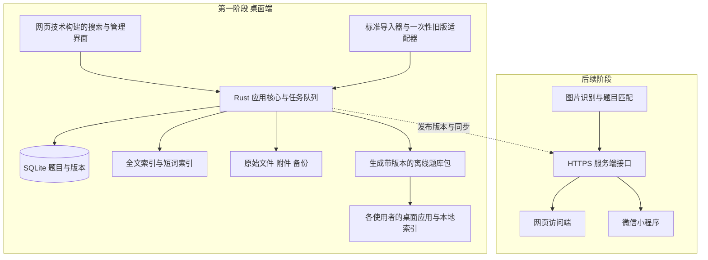

# 系统级题库建设规划

版本：v1.2  
日期：2026 年 10 月 14 日  
状态：建设范围已确认；Mac 本机验证版实施中，完整首版另行验收  
范围：现有文件盘点、产品方案、技术选型、导入规范、离线发布和实施验收。本文已纳入用户的审核结论及两项后续明确选择，作为实施基线。

**采用 Tauri 2 跨平台桌面应用，使用网页技术构建界面，以 SQLite 和全文索引保存、检索题目。以 macOS 27 和 Windows 11 的最新正式更新为验收系统基准。维护者发布离线题库包，使用者在各自电脑安装桌面端并导入，互不影响地离线读取。**

**现有 Word 只做一次兼容迁移。后续以标准 Excel 模板作为人工批量录入的推荐入口，保留规范 Word 导入导出；大量数据交换使用 JSONL。三种文件格式共用一套题目规范。**

**预计一年内约 1 万题；10 万题性能指标是首版硬门槛，100 万题只做扩容验证。没有多人同时编辑需求。图片与公式先保留数据和接口扩展位置，不作为首版完整处理能力。**

这份规划中的性能指标是已确认的验收目标，工期仍为估算。2026-10-14 已开始制作 Mac 本机验证版，实际完成项与性能数据见 [本机验证报告](docs/本机验证报告.md)，不以本规划的目标代替实测结论。“与 Everything 相媲美”通过明确的数据规模、查询样本和端到端耗时验收。需求已确认与功能已完成分别记录。

## 1 已确认的建设范围

| 确认事项 | 实施基线 | 原因 |
| --- | --- | --- |
| 产品形态 | Mac／Windows 桌面应用优先 | 本地检索、可靠存储、全局快捷键和文件操作更容易形成完整体验 |
| 界面技术 | React＋TypeScript，装入 Tauri 2 | 保留网页技术的开发效率，为未来网页端复用界面组件创造条件 |
| 数据存储 | 本地 SQLite；索引可以重建 | 离线使用，不必先部署服务器，数据能备份和迁移 |
| 使用规模 | 一年内预计约 1 万题 | 以日常使用规模检验体验，并保留增长余量 |
| 检索目标 | 10 万题为首版硬门槛，100 万题只做扩容压测 | 用户已明确选择，不要求百万题成绩阻塞首版交付 |
| 系统基准 | macOS 27、Windows 11，采用验收时最新正式更新并记录构建号 | 不以旧系统兼容性扩大首版测试范围 |
| 当前文件 | 以 9.23 三份文档为迁移主源，9.20 三份作为历史来源 | 避免把两个版本重复导入为两套现用题目 |
| 新导入规范 | Excel 日常批量录题；Word 按固定表格录题；JSONL 批量交换 | 分别照顾人工编辑、文档协作与系统处理效率 |
| 旧格式支持 | 一次迁移适配器，完成后归档 | 后续开发不持续追逐旧文档的颜色、编号和排版变化 |
| 首版运行方式 | 单一维护者编辑，各使用者安装桌面端并导入离线发布包 | 多人同时读取不依赖维护者电脑在线或共享数据库文件 |
| 图片与公式 | 预留模型与接口，完整支持后续实施 | 当前以文本、代码和三种基础题型形成闭环 |
| 小程序与拍照 | 预留数据与接口边界，后续阶段实施 | 避免后续重建题目模型，同时控制首版范围 |

维护端与阅读端使用同一应用，按题库来源区分可维护题库和只读发布题库。**所有客户端都必须具备制作离线题库包的能力，阅读端也能重新制包；只读限制只约束内容编辑。**首版落实离线发布、导入、版本显示和回退；在线只读网页与小程序保留后续接口，不在首版部署共享服务。无需建设多人同时编辑机制。

## 2 所有现有文件的盘点结果

首次盘点范围为项目目录 `/Users/star/GitHubProjects/题库` 及全部子目录，包括隐藏文件。生成规划前发现 6 份 `.docx` 和 1 个 `.DS_Store`，没有应用源码、数据库、构建配置或现成网站。当前工作目录以此路径为准。`.DS_Store` 属于目录显示元数据，不作为题库资料。

已读取全部 6 份 Word 的正文结构、题号及自动编号定义、答案字段、文字颜色和媒体关系，并比较新旧版正文。下列题数是原始题目条目数，尚未去重，也不代表答案已获专业核验。

| 文件 | 题型 | 原始题目条目 | 迁移角色 |
| --- | --- | ---: | --- |
| [9.23 V6 初级认证题-单选.docx](</Users/star/GitHubProjects/题库/9.23 V6 初级认证题-单选.docx>) | 单选 | 501 | 当前主源 |
| [9.23 V5 初级认证题-多选.docx](</Users/star/GitHubProjects/题库/9.23 V5 初级认证题-多选.docx>) | 多选 | 170 | 当前主源 |
| [9.23 V3 初级认证题-判断.docx](</Users/star/GitHubProjects/题库/9.23 V3 初级认证题-判断.docx>) | 判断 | 243 | 当前主源 |
| [9.20 V6 初级认证题-单选(1).docx](</Users/star/GitHubProjects/题库/备份_原题库/9.20 V6 初级认证题-单选(1).docx>) | 单选 | 488 | 历史对照 |
| [9.20 V5 初级认证题-多选(1).docx](</Users/star/GitHubProjects/题库/备份_原题库/9.20 V5 初级认证题-多选(1).docx>) | 多选 | 168 | 历史对照 |
| [9.20 V3 初级认证题-判断(1).docx](</Users/star/GitHubProjects/题库/备份_原题库/9.20 V3 初级认证题-判断(1).docx>) | 判断 | 240 | 历史对照 |

当前版合计 **914 条**，备份版合计 **896 条**。本次逐段比较发现，三份当前版正文均以前一版全文为前缀，再分别追加 13 道单选、2 道多选、3 道判断，共 **18 道**。这个结论针对正文文本，不等同于文件二进制或所有版式完全一致。

### 2.1 已确认会影响导入的问题

| 问题 | 当前版中的证据 | 处理建议 |
| --- | --- | --- |
| 答案藏在文字颜色中 | 单选共 501 条，只有 475 个独立“答案”段落，其中第 30 题答案字段为空；另外 26 题没有独立答案段落。这 27 题均存在红字线索 | 旧版适配器读取红色文字，产生候选答案并保留依据；新格式必须填写答案字段 |
| 勾选标记和文字答案冲突 | 判断第 134、137 题勾选“正确”而文字答案为“错”；第 145 题相反 | 核对后直接写入正确答案；原始证据只在来源记录中保留 |
| 同题不同答案 | 多选第 15／83 题文本一致但答案分别为 BCD／ABD；第 39／61 题分别为 ABE／ABD | 核对正确答案后统一录入；不能仅以较后出现的答案覆盖 |
| 重复条目 | 另有判断第 78／107、186／194 题，以及多选第 19／79、90／110 题重复文本 | 提议关联到同一题目，保留全部来源；最终去重需经过预览 |
| 编号和选项不全在纯文本中 | 大量题号、A／B／C 选项使用 Word 自动编号；判断第 50 题正文写作“50在应用……” | 联合解析正文与 `numbering.xml`，不能只用按数字或“答案”切分的正则 |
| 题干内混入答案 | 单选第 109 题题干末尾带“B” | 保留原文；建议清理项必须可见、可撤回 |
| 配图缺失 | 单选第 58 题引用“如下图”，文档内没有图片媒体文件或图片关系 | 标记“缺少题图”，保留题目，不凭描述补造原图 |
| 存在绘图标记 | 当前单选含 31 个矩形绘图、多选含 61 个；不是嵌入图片 | 不把矩形覆盖、边框等版式标记直接解释成答案或题图 |

以上为已确认的迁移风险，不是对所有题目正确性的审定。全文中还包含代码、跨段选项、技术名词大小写混用等情况。当前文档没有正文表格、原生数学公式或修订记录；图片与复杂公式完整处理能力列为后续扩展，启用前需另造测试样本验证。

### 2.2 一次迁移的基本态度

无需先把旧 Word 全部人工重排。可明确解析的题目先入库使用；有冲突的题目先核对，确认后直接录入正确答案，不额外显示冲突提示；缺项和暂不能确认的题目保留原文供后续处理。原 Word 与历史备份保持原样，系统保存文件指纹、来源题号和原始片段。

914 条是迁移核对基线，不能先承诺得到 914 道互不重复、答案全部正确的正式题目。迁移报告必须分别说明原始条目、独立题目、重复关联和待复核记录数量。

## 3 首版需要形成的完整使用体验

### 3.1 搜题

打开应用即可输入；也可通过可自定义的全局快捷键唤起搜索窗口。支持题干片段、中文词、英文 API 名、选项内容和题目编号检索，结果显示匹配片段、题型、所属题库和答案状态。

界面采用左侧题库与筛选、中间结果、右侧题目详情的布局。键盘可选择结果、展开答案和复制内容；支持题型、章节、标签、来源版本及待复核状态筛选。中文输入法组词期间不反复切换结果。

本机验证阶段补充：顶部增加「详细模式／极速模式」。详细模式保留现有布局；极速模式只检索当前题库，覆盖所有题型，输入即搜，一题一行，题目片段与答案按 4∶1 排列。片段从命中处起显示，超出宽度省略。用户已明确取消极速模式翻页按钮，采用连续向下滚动、按需加载与可视区域渲染。

设置增加小、中、大、超大四档字号，中号沿用原大小；提供整页配色选择，个人显示偏好在本机持久保存。

### 3.2 管理题目

支持多个题库、章节、标签、题目新增与编辑、批量分类、重复题处理、回收站和修订历史。首版落实单选、多选、判断三种题型；填空、简答和组合题只预留模型扩展位置。

来源记录内部区分“源文提供”“由旧版标记提取”“人工已复核”等状态；已确认答案在题目页面正常展示，不额外显示历史冲突。形式校验通过，不自动等于知识答案正确。

### 3.3 导入导出和维护

导入必须有预览、校验报告、重复处理、批次记录和撤回能力。导出可按整库、筛选结果或选中题目进行。提供备份、恢复、索引状态查看和索引重建，不让用户依靠复制零散数据库文件维护题库。

首版不把在线考试、课程商城、复杂审批和统计报表列入必交付范围。学习练习、收藏和错题功能可以在核心题库稳定后增加。

### 3.4 多人离线读取与题库发布

维护者在自己的题库中编辑，确认内容后生成一个带发布版本的 `.qbank.zip` 文件。使用者各自安装桌面应用、导入这个发布包，在本机保存数据库与搜索索引。多人可同时搜索，不共享运行中的 SQLite 文件，也不要求维护者电脑在线。

发布题库在阅读端按只读方式展示，不能直接修改题干、选项或答案。应用仍可支持用户另建自己的可维护题库；个人设置与导入的发布内容分开保存。首版不依赖账号登录或在线权限服务器。

每次发布生成完整快照。对预计 1 万题的规模，优先把完整包的更新与回退做可靠，暂不增加增量补丁协议。读取者导入新版本时，先检查题库身份、格式版本和文件校验值，再展示本次新增、变更和移除数量；校验成功后切换该题库的活动版本。

安装更新过程中可以继续查询旧版本，失败或取消后仍可使用旧版本。默认保留上一版供回退；其他题库不受此次更新影响。同一个包再次导入不重复新增题目；低版本包不自动覆盖高版本。

界面显示发布版本、发布日期和题目数量。完全离线时无法自动得知维护者是否又发布了新版本；使用者取得新包后导入更新。发布包的发送由维护者自行安排，应用负责生成和校验文件。

## 4 跨平台方案比较与选择

| 方案 | Mac／Windows | 离线数据与系统能力 | 开发和维护代价 | 结论 |
| --- | --- | --- | --- | --- |
| 单个 HTML 文件 | 浏览器可打开 | 可以做轻量搜索；长期数据管理、文件权限和后台能力需要额外设计 | 起步简单，扩展完整题库后限制增多 | 适合演示或只读题库快照 |
| Web／PWA | 浏览器跨平台 | 可离线缓存，也可接服务端；本地存储受浏览器策略管理 | 适合免安装访问和多人共享 | 可作为后续访问端 |
| **Tauri 2＋网页界面** | 支持桌面跨平台 | 原生文件访问、本地数据库、系统托盘和快捷键 | 需要 Rust 与前端两部分，需验证不同 WebView 行为 | **推荐主方案** |
| Electron＋网页界面 | 支持桌面跨平台 | 本地能力完整，Node.js 文档处理生态便利 | 打包浏览器运行时，资源占用需实测 | 若团队更熟悉 JS，作为备选 |
| 两套原生应用 | 各自开发 | 系统集成直接 | 两套界面与交付流程，后续网页复用较少 | 当前投入不划算 |

Tauri 采用核心进程与 WebView 分工：核心进程管理系统与数据库能力，网页进程呈现界面；使用操作系统的 WebView，也意味着要处理平台差异。这与本项目的桌面优先方向吻合。[Tauri 进程模型](https://v2.tauri.app/concept/process-model/)

纯浏览器方案并非不能做快速搜索；主要取舍是系统集成和长期数据管理。浏览器存储有配额、持久化授权与清理策略，若采用 PWA，应提供服务端副本或可靠的用户备份，不能只依赖浏览器缓存。[MDN 浏览器存储策略](https://developer.mozilla.org/en-US/docs/Web/API/Storage_API/Storage_quotas_and_eviction_criteria)

Electron 也能实现同样的题库能力。若技术验证发现 Tauri 的文档处理或跨平台维护成本明显高于预期，可改用 Electron，保留数据规范和检索接口。选框架本身不能保证检索速度。[Electron 进程模型](https://www.electronjs.org/docs/latest/tutorial/process-model)

### 4.1 已确认的平台交付范围

- 验收系统基准为 macOS 27 与 Windows 11，在测试执行时使用最新正式更新，并在报告中锁定具体版本和构建号。“以此为基准”是用户确定的产品要求，不代表已经完成兼容验证。
- 首版优先交付 Mac Apple Silicon 与 Windows x64 安装包；如实际使用设备为其他架构，再纳入构建与验证矩阵。旧版 macOS、Windows 10、Windows ARM64 和 Intel Mac 不作为未实测的默认兼容承诺。
- Mac 交付 `.app`／`.dmg`，Windows 交付安装包；用户无需安装 Node.js、Python、Rust 或数据库。
- Windows 安装器处理 WebView2 缺失，提供适合离线环境的安装方案。桌面运行离线，不代表所有安装包都天然能离线安装。[Tauri Windows 安装器](https://v2.tauri.app/distribute/windows-installer/)
- 正式对外分发时完成 macOS 签名与公证，并评估 Windows 签名；分别在实际目标系统验证安装、启动与升级。[Tauri macOS 签名](https://v2.tauri.app/distribute/sign/macos/)
- 菜单栏／托盘、单实例、快捷键和可选开机启动列入桌面体验；开机启动由用户主动启用。快捷键冲突时允许修改。

## 5 总体架构



界面只通过稳定的应用接口访问题目，不直接执行 SQL。解析文件、建索引和导出在后台任务中运行，显示进度并允许取消；查询具有独立的优先级，不能被一次大导入长期阻塞。

维护端 SQLite 保存可编辑的权威题目数据，阅读端保存发布快照及各自的本地索引。索引属于可重新生成的数据。使用事务、明确的数据库迁移版本和备份机制。搜索接口与具体索引实现隔离；百万题压测用于识别扩容瓶颈，不因扩容目标未达成而自动推翻已满足 10 万题门槛的首版方案。

前端组件可为网页端复用，但桌面文件操作、快捷键和数据库访问需要替换为网页适配层。微信小程序单独实现符合其运行环境的界面，共用题目规范和服务端接口，不能直接把桌面应用打包成小程序。

## 6 题目数据规范

### 6.1 核心数据对象

| 对象 | 保存的信息 | 设计要求 |
| --- | --- | --- |
| 题库与章节 | 题库、章节层级、标签 | 一道题可带多个标签，章节与标签分开 |
| 题目 | 稳定 ID、题型、题干、解析、状态、当前修订号 | 内部 ID 不取自 Word 的“第几题” |
| 选项与答案 | 选项稳定 ID、显示顺序、内容、正确选项集合或判断值 | 答案关联选项身份，重排时不能串答案 |
| 来源记录 | 文件指纹、原文件名、原题号、原文片段、提取方式 | 支持一题多个来源以及同题冲突版本 |
| 内容修订 | 变更前后内容、时间、操作来源 | 可以追溯和恢复；删除使用可恢复状态 |
| 导入批次 | 文件、模板版本、校验结果、新增／更新／跳过数量 | 重试不重复入库，撤回范围明确 |
| 发布版本 | 题库 ID、发布 ID、递增版本号、日期、题目数、文件清单 | 读者按题库身份更新，导入同一版本保持幂等，可回退 |
| 附件与公式扩展 | 附件引用、内容格式和扩展版本的位置 | 首版预留，后续启用时统一完善存储、编辑、导入与导出 |
| 搜索索引 | 规范化文本、检索词、短词与筛选索引 | 与题目一致更新，损坏后可重建 |

题目至少区分三个概念：内容修订号、来源文档版本、适用知识／软件版本。现有文件名中的 V3／V5／V6 记录为来源信息，不直接当作 HarmonyOS 版本。

正文保留原始大小写、换行、代码符号和必要格式；检索使用独立的规范化副本。对代码中的 `@`、`!`、`<`、`.` 等符号不能为了“清洗”而从原题删除。未来题图、公式和 OCR 文本也挂在同一题目上，避免重新编号建库。

首版不会把图片占位符或公式原始字符串宣称为完整富文本支持。导入遇到尚不支持的图片、原生公式或复杂对象时，报告具体位置并保留原文件，由用户选择保留为待处理记录或跳过；不能静默删去对象后当作完整题目入库。

### 6.2 一致性和去重规则

- 文件指纹相同的重复导入，直接提示历史批次，不再次新增。
- 相同题型、题干、选项和答案的候选重复项，预览后可合并来源；不能仅按题干相同就合并。
- 题干与选项相同但答案不同，保留审校依据，核对后直接保存正确答案；同题干而选项不同，视为不同版本或不同题目候选。
- 模糊相似仅用于提示，不能自动删除或覆盖。代码空白、否定词和关键符号参与保守比较。
- 更新已有题目时携带系统 ID 和基准修订号；版本已变化则提示冲突，不能无条件“最后导入覆盖”。

## 7 达到即时搜索体验的方案

### 7.1 对标范围

Everything 官方介绍强调即时文件名检索。题库需要检索题干、选项和解析，文本长度与查询方式不同，因此采用“输入即出结果”的使用体验对标，并公开题库自身的性能测试条件。[Everything 官方说明](https://www.voidtools.com/support/everything/)

搜索时读取预建索引，不在每次输入后打开 Word、遍历整库 JSON 或逐条扫描所有题干。原 Word 的解析耗时属于导入阶段。

### 7.2 检索路径

1. **题目 ID 和外部编号**：使用普通精确索引，直接定位。
2. **中文词、英文词和 API 名**：中文分词与技术词词典预处理后进入 FTS5；保留完整标识符，并补充必要的拆词索引。
3. **任意连续片段**：评估 FTS5 trigram，支持题干中间片段检索；与词检索结果合并、去重。
4. **一字、两字或极短标识符**：建立专用短词倒排索引，不通过全表 `LIKE '%关键词%'` 兜底。
5. **字段筛选**：题库、题型、章节和状态使用普通索引，与文本候选集合联合过滤。

FTS5 默认 `unicode61` 不提供中文词典分词；trigram 的全文匹配不覆盖少于 3 个 Unicode 字符的查询。因此不能只配置一个默认 FTS 表就认定中文搜索完成。具体索引组合要在 P0 比较召回、延迟和磁盘占用后锁定。[SQLite FTS5 分词器说明](https://www.sqlite.org/fts5.html#tokenizers)

拟定排序为：完整题干／编号精确命中优先，其次连续片段，再按题干、选项、标签、解析的字段权重排序。默认不把单个答案字母作为全文检索字段；答案内容、答案状态通过详情或专门筛选访问。

输入多个词默认同时匹配。支持显式短语搜索和字段筛选。错别字、同义词和语义近似结果单独标记，不悄悄替换查询中的“不正确”“不支持”等关键否定表达。

### 7.3 界面与后台共同控制延迟

- 每次只取首批约 50 条结果，列表使用虚拟滚动，继续滚动再分页。
- 查询可以取消或淘汰旧请求，避免旧结果覆盖新输入。
- 中文输入法完成组词后发起查询；若采用短暂防抖，其等待计入端到端耗时。
- 导入采用后台分批解析与暂存，减少数据库长时间写锁；已发布题库仍可查询。
- 新增、编辑、删除与索引变更保持一致；大批次导入完成后统一发布可见版本。
- 缓存用于加速重复操作，但性能验收必须包含从未查询过的关键词。
- 搜索结果总数若计算昂贵，可以延后统计并说明；不能为获得漂亮数字而截断真正可访问的匹配结果。

### 7.4 拟定性能验收表

系统版本已按用户要求固定为 macOS 27 和 Windows 11 的验收时最新正式更新；具体机型尚未提供。性能参考配置建议为 16 GB 内存与 SSD，P0 记录实际 CPU、内存、磁盘和架构并固定测试机器。系统版本本身不能代替硬件基准，不能把一台机器的成绩推广到所有运行相同系统的电脑。两个平台单独记录系统构建号、应用版本及测试数据哈希，不合并成一个平均数。

P95 表示 95% 的请求在该时间内完成。端到端指标从已提交的搜索输入变化开始，到首屏正确结果绘制完成，包含防抖、进程通信、查询、排序和界面绘制。

| 场景 | 拟定目标 | 验收定位 |
| --- | --- | --- |
| 当前约千题，已启动 | 首屏 P95 ≤ 50 ms | 小库体验 |
| 1 万题，索引就绪 | 首屏 P95 ≤ 50 ms 的体验目标 | 用户预计一年内规模，优先验证 |
| 10 万题，索引就绪 | 查询核心 P95 ≤ 50 ms；首屏 P95 ≤ 100 ms，P99 ≤ 200 ms | 首版关键指标 |
| 100 万题，索引就绪 | 首屏 P95 ≤ 200 ms 的扩容目标，并记录 P99 | 仅做扩容验证，不作为首版发布硬门槛 |
| 10 万题，冷查询 | 未预热查询 P95 ≤ 500 ms | 防止只测热缓存 |
| 冷启动 | 10 万题已有索引时，进入可搜索状态 ≤ 2 秒 | 启动不全量重建索引 |
| 快捷键唤起 | 应用已运行时，搜索框可输入 P95 ≤ 150 ms | 桌面使用体验 |
| 编辑完成后检索 | 提交成功后 1 秒内反映变化 | 数据与索引一致性 |

高频一字词、无结果查询和多条件筛选必须纳入上述同规模查询集，不能把困难查询排除后宣称达标。10 万题硬门槛未达到时先解决查询语义、索引方案与资源代价问题；百万题未达到扩容目标时记录原因和扩容方案，不扩大为首版必修范围。

### 7.5 如何测试

以当前题库作为真实样本，另外生成 1 万、10 万、100 万条具有不同内容和词频分布的测试题，不能仅复制 914 道题填数量。记录题干与选项总字符数、平均／最大长度、图片占比和索引体积。

固定不少于 200 个查询，覆盖中文一字／两字／长片段、API 名、符号、组合词、筛选、零命中和高频词。对热索引运行多轮随机顺序测试，记录 P50／P95／P99；对应用刚启动、操作系统缓存未控制等场景分别标注，不能一概称作“冷启动”。

同时记录首次建索引耗时、导入期间检索延迟、进程总内存、数据库与索引磁盘大小。检索正确性与速度一起验收，使用人工标注的查询集核对必命中题目，并抽查翻页是否漏题或重复。

## 8 现有 Word 的一次性迁移

迁移步骤按以下顺序执行：

1. 记录全部 6 个源文件的哈希，保存原始文件清单；选择 9.23 三份为当前导入源。
2. 读取正文、自动编号、选项顺序、红字与勾选标记；处理跨段题干和代码，不直接按答案段落分题。
3. 建立统一的题目暂存记录，关联原题号、原文及解析依据。
4. 对显式答案、红字候选、勾选标记交叉校验。格式线索可以辅助提取，不冒充经过专业核验的答案。
5. 展示迁移预览：正常条目、候选答案、重复组、冲突组、缺失题图和解析失败片段。
6. 正常条目先导入；可识别但存在疑点的题目以待复核状态保留。无法确定题目边界的片段进入隔离区，原文可查看。
7. 输出逐题迁移报告，核对 914 条原始题目均有去向；记录旧版来源，避免再导入 896 条重复现用数据。
8. 完成首次可用题库备份，导出一份标准交换文件，后续维护转入新规范。

按用户最新决定，能确认的冲突答案直接修正，题目页面不额外显示冲突信息。尚无法确认的答案保持未确定，不编造正确答案；原始证据留在来源记录。自动搜题不能把未知答案作为“唯一确定答案”。不以修正全部历史知识答案为首次上线前提；核对使用可追溯的资料，不以模型猜测覆盖原文。

对账关系为：**原始 914 条 = 已处理为题目或来源关联的条目 + 仍在待处理／隔离区的条目**。独立题目数量另列，重复合并不能使原始来源凭空消失。

## 9 后续统一导入格式

### 9.1 格式分工

| 格式 | 推荐用途 | 内容组织 | 是否长期支持 |
| --- | --- | --- | --- |
| **标准 `.xlsx`** | 日常人工批量编题、校对、分类 | 一题一行、固定字段、明确答案 | 是，推荐人工入口 |
| **标准 `.docx`** | 习惯 Word 的编题与协作、题库导出 | 一题一个固定的两列表格 | 是，满足 Word 导入导出需求 |
| **`.jsonl`** | 大批量导入、程序生成、跨系统交换 | UTF-8，一行一个题目对象 | 是，推荐程序入口 |
| `.qbank.zip` | 首版离线发布与跨电脑读取 | 版本清单＋JSONL；附件目录预留 | 是，首版必交付，后续扩展图片与公式 |
| 现有自由排版 Word | 本次历史迁移 | 专用适配规则 | 不作为未来编题标准 |

这些格式共享 `schema_version`。新增模板版本必须有兼容说明和迁移方式，不能在不通知的情况下改变字段含义。Word／Excel 是录入载体，系统中的权威数据仍采用统一模型。

### 9.2 通用字段与约束

| 字段 | 新建题目是否必填 | 规则 |
| --- | --- | --- |
| 题型 | 必填 | `单选`、`多选`、`判断`；机器值为 `single`、`multiple`、`true_false` |
| 题库 | 必须确定 | 可在文件中填写，也可在导入时整批指定 |
| 题干 | 必填 | 保留换行与代码；不能为空或只有题号 |
| 选项 A 至 H | 选择题必填 | 2 至 8 个连续选项，不硬编码为四个；判断题留空 |
| 答案 | 新规范必填 | 单选如 `B`；多选如 `A\|C`；判断为 `正确` 或 `错误` |
| 解析 | 可选 | 没有解析时留空，不自动编写 |
| 章节 | 可选 | 如 `开发基础/组件`，分隔符约定固定 |
| 标签 | 可选 | 多项使用 `\|` 分隔；标签名本身不使用该分隔符 |
| 难度 | 可选 | `简单`、`中等`、`困难`，留空表示未知 |
| 外部编号 | 可选 | 文本形式，由录题者维护；不能单凭这个字段覆盖已有题目 |
| 适用版本 | 可选 | 如实际核实的 API／课程版本；未知留空 |
| 来源说明 | 可选 | 文档、章节或网址等来源描述 |
| 系统 ID、基准修订号 | 更新已有题目时必填 | 系统导出时自动携带，新题留空；用户不需要手工生成 |

新格式不接受用红色、加粗、打勾或空行数量表达答案。旧版中的 `ACD` 等写法只由旧版适配器转换；标准多选答案统一采用 `A|C|D`，降低分隔歧义。

单选必须有且仅有一个正确选项；多选首版要求至少两个且不能重复；答案只能引用实际存在的选项。判断题使用布尔值存储，不在不同端混用 A／B 与对／错。

### 9.3 Excel 模板规范

拟交付 `题库导入模板_v1.xlsx`，包含四个工作表：`填写说明`、`题目`、`字段字典`、`示例`。导入器只读取 `题目`，避免把说明和示例一起入库。

`题目` 第一行为固定表头，不合并单元格，不使用空行表示层级。题型、难度使用下拉选项；选项、答案、编号及代码相关单元格保存为文本。正文换行使用单元格内换行。

固定字段顺序建议为：

```text
外部编号 | 题型 | 题库 | 章节 | 题干 | 选项A | 选项B | 选项C | 选项D | 选项E | 选项F | 选项G | 选项H | 答案 | 解析 | 标签 | 难度 | 适用版本 | 来源说明 | 系统ID | 基准修订号
```

以下为简化示例，实际模板包含全部字段；未展示的可选字段留空：

| 外部编号 | 题型 | 题库 | 题干 | 选项A | 选项B | 选项C | 选项D | 答案 | 解析 |
| --- | --- | --- | --- | --- | --- | --- | --- | --- | --- |
| DEMO-001 | 单选 | 模板示例 | 1＋1 等于多少？ | 1 | 2 | 3 | 4 | B | 1＋1＝2。 |
| DEMO-002 | 多选 | 模板示例 | 下列哪些数是偶数？ | 2 | 3 | 4 | 5 | A\|C | 2 和 4 是偶数。 |
| DEMO-003 | 判断 | 模板示例 | 2 是偶数。 |  |  |  |  | 正确 | 2 能被 2 整除。 |

模板不执行公式或宏。遇到公式单元格，提示改为明确文本值；不能偷偷取过期缓存值。导出题干、代码和选项时写为文本，避免以 `=`、`+`、`-`、`@` 开头的内容被表格软件解释成公式。

首版 Excel 入口定位为文本、代码和明确字段的批量编辑。图片、公式按扩展计划后续支持；首版发现这些对象时给出定位和待处理提示，不把拖进 Excel 的浮动图片位置当作可靠的题目关联规则。

### 9.4 Word 模板规范

拟交付 `题库导入模板_v1.docx`。文档开头设一个元数据表，填写模板版本 `1.0` 和默认题库；此后每道题使用一个独立的两列表格，左列为固定字段名，右列为内容。

不依赖 Word 自动题号、字体颜色或页面位置识别字段。题目表之间的说明文字不会作为题干导入；无法识别的题目表必须报告，不能忽略。

单选示例：

| 字段 | 内容 |
| --- | --- |
| 外部编号 | DEMO-001 |
| 题型 | 单选 |
| 题库 | 模板示例 |
| 章节 | 数学基础 |
| 题干 | 1＋1 等于多少？ |
| 选项A | 1 |
| 选项B | 2 |
| 选项C | 3 |
| 选项D | 4 |
| 选项E |  |
| 选项F |  |
| 选项G |  |
| 选项H |  |
| 答案 | B |
| 解析 | 1＋1＝2。 |
| 标签 | 基础运算 |
| 难度 | 简单 |
| 适用版本 |  |
| 来源说明 | 模板示例 |
| 系统ID |  |
| 基准修订号 |  |

多选题使用同一表格，题型改为 `多选`，每个选项独立一行，答案填写 `A|C`。判断题题型为 `判断`，选项行留空，答案填写 `正确` 或 `错误`。

同一字段允许多段内容，代码保留换行和符号。不允许跨题合并单元格、用嵌套表格表达选项、把答案放在批注里。图片和原生公式首版按未支持对象报告并保留原文件，不静默丢弃；将来启用图片能力时，统一要求把图片放在所属题干或选项单元格内。

首版明确支持 `.docx`；旧二进制 `.doc` 由用户先在 Word／WPS 中另存为 `.docx`。不能把 `.html` 改后缀伪装成 Word 文件。

### 9.5 JSONL 交换规范

使用 UTF-8 编码，每个非空行是一个完整 JSON 对象，正文换行写成 `\n`。每条记录带 `schema_version`，便于流式读取、逐行定位问题及断点重试。

下面三行分别展示单选、多选和判断的新建记录；是拟定协议示例，不是已完成的导入器：

```jsonl
{"schema_version":"1.0","external_id":"DEMO-001","bank":"模板示例","type":"single","stem":"1＋1 等于多少？","options":[{"key":"A","content":"1"},{"key":"B","content":"2"},{"key":"C","content":"3"},{"key":"D","content":"4"}],"answer":["B"],"explanation":"1＋1＝2。","tags":["基础运算"],"difficulty":"easy"}
{"schema_version":"1.0","external_id":"DEMO-002","bank":"模板示例","type":"multiple","stem":"下列哪些数是偶数？","options":[{"key":"A","content":"2"},{"key":"B","content":"3"},{"key":"C","content":"4"},{"key":"D","content":"5"}],"answer":["A","C"],"explanation":"2 和 4 是偶数。","tags":["基础运算"],"difficulty":"easy"}
{"schema_version":"1.0","external_id":"DEMO-003","bank":"模板示例","type":"true_false","stem":"2 是偶数。","options":[],"answer":true,"explanation":"2 能被 2 整除。","tags":["基础运算"],"difficulty":"easy"}
```

这里的 `key` 是交换文件中的选项标签。导入时解析为内部选项 ID；交换文件更新整道题时必须携带完整选项与答案，不能仅提交“把 B 设为正确”而省略选项版本。

已有题目导出增加 `question_id`、`base_revision` 和必要的来源信息。选择题答案固定为字符串数组，判断题答案固定为布尔值；用题型区分并校验，禁止随意混用字符串、数字和布尔值。

首版离线发布使用普通 ZIP 容器，附件目录作为未来扩展位置：

```text
题库交换包.qbank.zip
├── manifest.json       包格式 题库身份 发布版本 文件清单 校验值
├── questions.jsonl     题目数据
└── assets/             附件目录预留 首版可省略
```

发布包清单至少包含 `schema_version`、`bank_id`、`release_id`、递增的 `release_version`、`published_at`、`min_app_version`、`question_count` 和文件校验清单。正式规范会区分“可编辑交换包”和“只读发布包”的用途；本次多人读取使用只读发布包。

发布包保留稳定题目 ID、题目修订号、答案状态和必要的来源说明，但不默认附带维护者的原始 Word 全文、编辑历史、个人设置或导入日志。待复核题可随包发布，审校元数据继续保留；已确认的正确答案正常展示，不额外显示冲突状态。对已识别题目结构但无法确定唯一答案的历史题，保存候选答案和问题标记，允许明确的“答案未确定”状态；阅读端不能自动选取一个候选作为正确答案。标准新编题模板仍要求答案必填，历史疑问题的保留规则不放宽普通录题校验。

导入时校验文件数量、解压后体积、格式版本及内容校验值，禁止文件路径逃出包目录。校验完成后暂存、建立本地索引，再原子切换当前题库版本。重复导入同一发布版本不重复建题；旧版本需显式执行回退才能成为活动版本。完整系统备份还包含修订历史、导入日志和设置，与用于分发的题库包分开。

### 9.6 正式模板交付清单

模板规范现已确认，实施时交付真实可编辑文件：Word 空白模板与示例、Excel 空白模板与示例、JSONL 示例及 JSON Schema、字段说明、常见错误示例，以及发布包清单规范和示例包。实际模板与导入器必须使用同一个字段版本，并通过往返校验。

## 10 标准导入与导出流程

### 10.1 所有导入格式走同一条流程

**选择文件 → 识别版本 → 解析到暂存区 → 字段校验 → 重复与更新预览 → 确认入库 → 索引更新 → 批次报告。**

预览页展示“新增、更新、重复、待复核、无法导入”的数量，并能定位到 Word 的第几个题目表、Excel 行号或 JSONL 行号。默认遇到新格式缺答案等错误时不直接提交；可由用户明确选择只导入有效记录，其余保留在本批次报告中。

大型文件分批解析，暂存数据在批次发布前不进入正式搜索。取消或崩溃后不留下半道题；恢复导入时根据文件指纹、批次与记录标识避免重复。

撤回某一导入批次时，只回退该批次引入的变更。已被后续人工修改的题目必须提示冲突，不能为了撤回旧批次而抹掉之后的编辑。

### 10.2 Word 导出

| 导出模式 | 内容 | 是否设计为可重新导入 |
| --- | --- | --- |
| 标准交换版 | 固定题目表、答案、解析、系统 ID 和修订号 | 是 |
| 学习版 | 连续题目排版，答案与解析随题或集中展示 | 不作为标准输入承诺 |
| 试卷版 | 仅题目和选项 | 否，文件本身缺答案 |
| 答案版 | 对应题号、答案和可选解析 | 与试卷对应，不单独当完整题库 |

所有模式都可按题库、题型、筛选结果或指定题目导出。显示题号重新连续编号时，系统 ID 和来源关联保持稳定。首版不打乱选项；以后如增加随机选项，必须同步重新计算答案标签。

Word 生成可使用支持 Node／浏览器的 `docx` 库，在后台任务生成真实 OOXML 文件；导入器独立读取规范字段，不反向依赖打印版的布局。[docx 官方文档](https://docx.js.org/)

若使用 Mammoth 辅助生成预览，必须另行清理 HTML，并由 OOXML 读取旧版颜色等证据；不能把转换后的 HTML 当作完整可靠的题库结构。Mammoth 官方明确说明不会替使用方清理源文档内容。[Mammoth 官方说明](https://github.com/mwilliamson/mammoth.js#security)

### 10.3 往返验证

从系统导出标准 Word／Excel／JSONL，再导入到空白题库，核对首版支持的题型、题干、选项、答案、解析和标签一致。UI 排版、导出时间和新的批次号不计入语义一致性。未来启用附件能力时增加附件指纹和公式语义的往返验证。

至少覆盖三种题型、六个以上选项、多段代码、中文标点、否定词、空解析和长文本；另用图片、原生公式样本确认首版会明确报告未支持对象。Word 另外在 Mac 与 Windows 的 Word 实际打开检查，并验证 WPS 编辑保存后的模板仍可正确读取。未实测的软件版本不写成兼容承诺。

发布包另外验证跨电脑读取、同包重复导入、升级到新版本、降级拦截、主动回退、损坏包拒绝、安装更新期间继续查询旧版本，以及一个题库的更新不影响其他题库。

## 11 数据可靠性与备份

每次数据库结构升级前自动备份，日常提供手动备份与可配置的自动备份保留策略。备份保存数据库一致快照、附件及清单校验值；数据库正在使用 WAL 时，不能仅复制主 `.db` 文件就当作完整备份。

恢复先校验包版本与完整性，在临时位置恢复并通过检查后再切换。通过实际的“备份—修改／删除—恢复—再次搜索”验证流程确认可恢复，而不是只检查生成了压缩包。

Mac 与 Windows 使用同一种发布包分发只读题库；每位使用者在本机建立独立副本。可以自行通过网盘等方式传递已完成的包文件，但不把运行中的 SQLite 文件作为多人共享存储。跨设备读取按发布版本更新，不需要实时同步服务。

本地版默认不上传题目。导入文档中的活动内容不执行，富文本展示经过清理；外部网站不进入具有本地文件权限的应用窗口。未来服务端加入身份验证、题库访问权限和操作日志，接口密钥只保存在服务端或系统安全存储中。

## 12 微信小程序的后续接入

小程序阶段提供独立服务端，接收桌面端发布的题库版本。小程序通过 HTTPS 查询与获取题目，电脑关闭后仍可使用已发布的题库。

小程序继续采用“桌面维护并发布，小程序查询使用”的模式，沿用首版的题库 ID、发布版本和内容快照。现阶段没有多人同时编辑需求，不安排云端协同编辑；如以后需求变化，再单独评估同步与冲突处理机制。

预留的业务接口包括搜索、题目详情、题库版本、增量变更和识别任务。列表接口只返回必要信息，详情按权限读取答案；云端将题库、用户收藏和练习记录分开存储。

服务端建议复用 Rust 业务核心并增加 HTTP 层，先围绕版本化只读题库提供服务。是否引入 PostgreSQL 或独立搜索服务，依据后续账号、练习记录和访问量需求确定，不因“多人读取”就提前部署复杂服务端。协议与领域规则可复用，不同运行环境的存储与索引仍需验证。

小程序上线前单独确认主体、服务类目、域名配置、隐私说明、题库分享范围与发布审核要求。本轮微信官方网络文档抓取未成功，具体准入规则不视为已经核实，实施该阶段时以官方后台和最新文档为准。[微信小程序网络文档入口](https://developers.weixin.qq.com/miniprogram/dev/framework/ability/network.html)

## 13 拍照识别题目并显示答案

2026-10-14 更新：用户已授权开始截图 OCR 与复制粘贴识题开发，并明确不要求全部离线。v0.2.0 已实现桌面截图、图片／文字粘贴、系统 OCR、随程序打包的中英文 OCR，以及当前题库候选匹配和答案对应。Mac 本机已完成实际验证；Windows 适配已通过接口检查，仍待实机验证。完成范围与样本结果见 [截图识题实现与验证](docs/截图识题实现与验证.md)。以下相机、小程序与复杂拍照场景仍为后续验收目标。

拟定流程：**拍照／选图 → 裁切、旋转与图像预处理 → OCR → 拆分题干和选项 → 候选检索 → 比对 → 展示题库答案与来源。**

第一版拍照能力聚焦“识别后找到库内题目”。识别器返回原文、文字坐标及置信信息；界面可修正识别错字。优先处理印刷体中文、英文和常见代码，复杂公式、手写与缺失配图使用单独样本评估。

当前桌面实现采用 macOS Vision / Windows OCR，并以 Tesseract.js 中英文内置模型作为可选或失败回退路径。后续可评估 PaddleOCR 或在线识别服务。OCR 方案依据本题库中的代码、装饰器、数字和中英文混排实测选型，不直接把通用模型公开成绩视为本项目准确率。[PaddleOCR 官方仓库](https://github.com/PaddlePaddle/PaddleOCR)

答案展示需要遵守以下规则：

- 比对题干与选项，特别检查“不正确／正确”、数字、版本和代码符号；不能只看语义相似度。
- 照片中的选项顺序可能不同，应按选项内容重新映射答案。例如库内答案 B 对应的内容出现在照片的 D，显示照片中的 D 及其内容。
- 高置信且无争议时展示命中题目和答案；多个近似题、OCR 不确定或题库答案冲突时展示候选，供用户确认。
- 未命中时显示“未找到可靠匹配”。若将来提供模型推导答案，必须与已有题库答案清晰区分，且不自动写回正式题库。
- OCR 耗时与检索耗时分别统计，拍照到答案的耗时不能套用本地文字搜索的毫秒级承诺。

验收样本至少包含清晰拍照、倾斜、反光、裁切不全、选项换序、同题干不同选项、否定词变化和题库外问题。分别统计 OCR 字符错误率、候选 Top-1／Top-5 命中率、错误确信率与总耗时，再决定何时可以自动展开答案。

上传图片前说明处理位置，云端设置图片保留与删除策略；本地 OCR 和云 OCR 分别展示是否需要联网。小程序中的拍照能力优先调用服务端识别，不依赖用户的桌面应用保持运行。

## 14 实施阶段与交付物

以下为单人持续开发的粗估，不含等待账号、证书、发布审核和人工核对知识答案的时间。P0 完成后重新估算，首版以可验证成果而非日历时间验收。

| 阶段 | 工作 | 交付与通过条件 | 粗估工作日 |
| --- | --- | --- | ---: |
| P0 技术验证 | macOS 27／Windows 11 的 Tauri 启动验证；中文索引对比；1 万／10 万题验收与百万题扩容压测 | 固定系统构建号与硬件、性能报告、索引决策；10 万题门槛不达标先解决，百万题记录扩容结论 | 2～4 |
| P1 数据与旧版迁移 | 统一模型、暂存校验、旧版适配、重复与冲突报告 | 914 条来源逐条对账，形成首次可用数据和备份；问题项有明确去向 | 3～5 |
| P2 桌面题库核心 | 搜索界面、筛选、详情、编辑、标签、快捷键、索引一致性 | 日常搜题和维护闭环，10 万题性能门槛通过 | 5～8 |
| P3 标准导入导出与发布 | Excel／Word 模板、JSONL、预览与撤回、文档导出、离线包发布与只读导入、版本回退 | 模板和三种格式往返验证通过，多台电脑各自读取发布包，更新与回退不影响其他题库 | 5～8 |
| P4 发布与恢复验证 | 安装器、签名准备、升级迁移、备份恢复、双平台回归 | 干净机器安装并实际检索／导入／导出；备份恢复验收通过 | 3～5 |
| F1 在线读取与小程序 | 版本发布服务、身份与权限、小程序界面，按需提供只读网页 | 电脑关闭后，小程序仍可检索已发布题目；沿用桌面发布版本 | 单独评估 |
| F2a 图片与公式扩展 | 富内容模型、附件管理、公式呈现、模板与导出适配 | 图文与公式内容能可靠保存和往返，不改变既有题目身份 | 按实际素材单独评估 |
| F2b 拍照搜题 | OCR、题目比对、答案映射和置信判断 | 独立图片样本集达标，低置信和无答案场景正确处理；纯文本题目的拍照检索可先于复杂公式能力交付 | 单独评估 |

纳入离线发布、阅读端版本更新与回退后，首版粗估合计 18～30 个工作日，约 4～6 个工作周；P0 结束后重估。桌面与离线多人读取不依赖按月付费的服务器；签名、云端、小程序和 OCR 的账号、基础设施及调用费用在对应阶段单独核定。

## 15 首版验收清单

- [ ] macOS 27 和 Windows 11 的验收时最新正式更新上，均能在未安装开发工具的目标环境安装运行；报告包含实际构建号和硬件配置。
- [ ] 断网后可以搜索、编辑、导入和导出；首次安装所需依赖已有明确方案。
- [ ] 当前 914 条原始题目全部可追溯，历史备份未重复当成现用题目批量新增。
- [ ] 27 道单选的格式答案线索、3 道判断冲突、两组多选答案冲突和缺图题得到单独记录。
- [ ] 原文件保持原样，合并、修正、撤回与恢复都有可查记录。
- [ ] 中文短词、长片段和 API 名都能检索，输入流畅，结果不会被旧请求覆盖。
- [ ] 10 万题按约定机器和查询集达到首屏 P95 ≤ 100 ms；百万题压测有真实报告。
- [ ] Word／Excel／JSONL 模板可下载、可填写、可校验；缺答案或引用不存在选项有明确提示。
- [ ] 标准导出再导入后，首版支持的文本题目语义一致；图片、公式等未支持对象有明确提示，不静默丢失。
- [ ] 维护者生成版本化离线题库包，多个使用者各自在桌面端导入后可以同时离线读取。
- [ ] 阅读端展示题库版本与日期，发布题目按只读方式展示，不能误改维护者发布的内容。
- [ ] 同包重复导入不重复新增，包更新保持题目身份，更新失败仍能读旧版，主动回退可用。
- [ ] Word 在目标办公软件中实际打开检查，代码、选项、答案和分页可读。
- [ ] 大导入可取消，崩溃后没有半条正式记录，撤回不覆盖后续人工编辑。
- [ ] 删除、升级和索引损坏后，能通过恢复或重建流程重新得到正确搜索结果。

## 16 审核决策记录

确认日期：2026 年 10 月 14 日。以下勾选表示用户确认的建设范围；第 15 节功能验收保持未完成，不能用需求确认代替实际验证。

- [x] 采用桌面优先的 Tauri 2 方案，保留网页与小程序接口。
- [x] 首版以离线使用为主，没有多人同时编辑需求。
- [x] 多人读取采用“每人安装桌面端，导入发布的离线题库包”。
- [x] 现有 Word 只兼容迁移一次，后续录入统一走新模板。
- [x] Excel 为人工批量录题的推荐格式，同时长期支持标准 Word 和 JSONL。
- [x] 按后续补充要求：冲突答案核对后直接按正确答案录入，不额外显示冲突提示；不能确认时不猜测。
- [x] 开始制作程序，先进行 Mac 本机验证；所有客户端均具备制作离线题库包的能力。
- [x] 预计一年内约 1 万题，以该规模优先检验日常体验。
- [x] 10 万题必须达标，100 万题只做扩容验证；百万题不是首版硬门槛。
- [x] 首版先支持单选、多选、判断三类题目。
- [x] 系统基准为 macOS 27 与 Windows 11 的最新正式更新，测试时固定具体构建号。
- [x] 图片与公式保留扩展能力，完整支持放在后续阶段。
- [x] 截图 OCR 与复制粘贴自动识题同时开发，先在本机验证；优先使用系统能力，并随程序提供内置引擎。
- [x] OCR 不要求全部离线，可以按需要接入在线方案；当前版本已使用系统与内置引擎完成闭环。

最初清单中两项互斥的性能选择，已按用户后续明确回复统一为“10 万题硬门槛、100 万题扩容验证”，不再保留冲突选项。机型与硬件参数在 P0 实测时记录；用户已选择安装桌面端，因此不以免安装网页作为首版交付方式。
