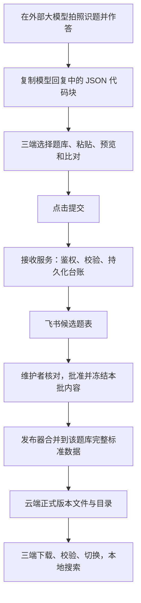

# 飞书题库收集与发布接入方案

状态：待审核；仅确定接入方案，尚未创建飞书应用、部署接口或上传题目。  
日期：2026-10-15。  
适用：Mac、Windows、微信小程序；初级认证、高级认证及后续题库。

## 1. 推荐方案

**一个飞书企业自建应用 + 一个多维表格文件 + 一个三端共用的接收服务。**

飞书用来收集、整理和审阅候选题。正式题库由发布器生成，放到云端文件存储，三端下载后本地搜索。搜索过程不访问飞书，也不把飞书当作所有用户实时查询的题目数据库。

本次细化[单题拍照识别与飞书收集流程](单题拍照识别与飞书收集流程_待审核.md)，继续使用[单题提示词草案](templates/大模型拍照识题_单题输出提示词_v1_草案.txt)。[原批量提示词](templates/大模型输出规范模版_v1_草案.txt)继续保留。



用户操作只需要：**复制提示词 → 给模型照片 → 复制模型回复 → 粘贴到题库 → 提交**。提示词入口提供复制按钮；要求模型把回复放进唯一的 `json` 代码块，利用所用模型产品的代码块复制功能。题库负责兼容纯 JSON 和带代码围栏的整条回复。

题库、接收服务和飞书都只接收文字结果，不接收照片、图片链接或图片附件。题目选项和答案保留原文，模型版本无法确认时允许“未知”。外部模型服务如何处理用户上传的照片，不由本接入服务控制。

## 2. 三端如何接入

| 部分 | 统一行为 |
| --- | --- |
| 模板入口 | 展示「大模型输出规范模版」，点击复制当前单题提示词 |
| 粘贴入口 | 显示当前题库，粘贴后自动解析、预览题目、比对已有题 |
| 提交按钮 | 新题显示「提交到飞书」；旧题有差异显示「提交差异建议」；缺漏内容允许「提交待补充」 |
| 已有同题 | 内容和答案一致则提示已收录，不重复新增；服务端对实际提交再用最新正式版本复核 |
| 原始材料 | 保存模型文字原稿和结构化结果，修订不会覆盖原稿 |
| 离线状态 | 草稿与待发送内容留在本机；有持久化回执后才标记已接收 |
| 搜题页面 | 只展示正式题库中的最终答案，不添加模型争议或审核状态 |

题目比对范围限定为选定的 `bank_id`。选项顺序变化时按内容映射答案，不能把两份题目的字母答案直接相比；遇到重复选项或内容歧义时交给维护者判断。相似题只能作为候选，不能自动覆盖。

首轮不增加所有读者的登录要求。**只有提交者需要获得投稿权限**：建议维护者发放短期、一次性邀请码，向接收服务兑换可撤销的投稿凭据，客户端后续自动使用。它是本系统的投稿凭据，不是飞书密钥，也不授予审核或发布权限。投稿者不必加入飞书组织；审阅人员使用飞书账号。

## 3. 飞书多维表格怎么建

创建一个文件「题库采集与审核」，内部使用三张表。第一阶段先接通「候选题」和「题库目录」，发布功能上线时启用「发布记录」。

### 3.1 候选题

每条需要收集的新题、差异建议或待补充提交对应一条候选记录。同一请求重试不加行；不同模型针对同一道候选题的作答分别保留来源，审阅时关联到同一题目，正式题库只合并一次。

| 字段 | 飞书类型 | 内容与写入责任 |
| --- | --- | --- |
| 提交编号 | 文本，主字段 | 接收服务校验的 UUID；不同于飞书自己的 `record_id` |
| 题库 ID | 文本 | 服务端核验后的真实 `bank_id`，不能凭名称猜库 |
| 目标题库 | 单选 | 初级认证／高级认证等易读名称，由服务端映射 |
| 题型 | 单选 | 单选／多选／判断／待确认 |
| 题干 | 多行文本 | 可审阅和修改的题干 |
| 选项 A—H | 八个文本字段 | 每个选项独立一列；判断题全部为空 |
| 模型答案 | 文本 | 单选 `B`，多选 `A\|C`，判断 `正确`／`错误`；未知留空 |
| 核定答案 | 文本 | 维护者确认后的答案，与模型原答案分开保存 |
| 模型解析／核定解析 | 两个多行文本字段 | 分别保留模型输出和维护者修订；解析不参与日常搜题 |
| 模型名称／模型版本 | 两个文本字段 | 原始输出中的值，未知就保留“未知” |
| 版本来源声明 | 单选 | 原 JSON 的 `platform`／`user`／`unknown` |
| 版本核验来源 | 单选 | 粘贴文本／用户补填／接口元数据／未知，由接收服务确定 |
| 待核对内容 | 多行文本 | 看不清、缺图、答案不确定等问题 |
| 比对结果 | 单选 | 新题／一致／有差异／相似待判定，由服务端比对 |
| 关联原题 ID／原题修订号 | 文本／数字 | 修订建议对应的正式题目，由服务端或维护者确认 |
| 审核状态 | 单选 | 待核对／待补充／待发布／不收录 |
| 发布状态／发布批次 | 单选／文本 | 接收与发布服务回写，表格里的值只是状态展示 |
| 提交者代号／来源端 | 文本／单选 | 服务端身份代号；Mac／Windows／微信小程序 |
| 提交时间 | 日期时间 | 服务端接收时间 |
| 文字原稿 | 多行文本 | 模型回复的原文；完整原稿同时留在私有台账 |

通常的单题原稿直接放表内；如果超过飞书实际字段限制，完整原稿保存在私有台账，表内提供需要授权的查看入口，不截断后冒充完整原稿。客户端修改内容、补填模型版本时另外保存修改记录。

**粘贴文本中的 `version_source: "platform"` 仍是模型输出的声明，不能因此标成已核验。** 只有以后直接调用模型接口、由服务端取得的版本元数据，才能记录为「接口元数据」。用户手动补填的版本另记为「用户补填」，保留原始值。

审核界面可以先将模型答案带入待确认区域，但批准时必须明确确认核定答案。空答案、缺选项或需要缺失图片才能作答的题不能进入正式发布包。

建议创建这些视图：`全部待处理`、`初级认证`、`高级认证`、`答案差异`、`待补充`、`待发布`、`已处理`。视图负责筛选，隐藏字段不等于安全权限。普通投稿者不授予该表编辑权限；只有维护者和受邀审阅者可以编辑。

### 3.2 题库目录

字段：`bank_id`、题库名称、显示顺序、是否允许投稿、维护者、当前正式发布版本、当前内容哈希。

初级库沿用现有身份，高级库首次建立时生成新的身份。显示名称可以调整，`bank_id` 保持不变。飞书目录只是管理视图；新增题库或改动投稿范围，需要服务端校验后才对客户端生效，编辑表格不会立即改写公开下载目录。

### 3.3 发布记录

字段：发布批次、题库 ID、版本号、新增题数、修订题数、总题数、标准内容哈希、包文件哈希、发布者、发布时间、结果与失败原因。

发布记录的真实状态来自发布器台账。手工把飞书状态改成「已发布」，不会让文件自动上线。

## 4. 飞书后台配置步骤

1. **创建应用**：在飞书开放平台，以有管理权限的组织账号创建企业自建应用，例如「题库采集服务」，取得 App ID 和 App Secret。
2. **创建表格**：建立上述多维表格和字段，记录 Bitable 的 `app_token` 与各张表的 `table_id`。
3. **申请所需权限**：按记录新增、读取和更新接口启用所需权限；若初始化阶段用 API 检查字段，还需相应字段读取权限。优先选择满足接口要求的较小权限范围，不申请聊天、通讯录或附件上传能力。
4. **发布应用版本**：完成组织要求的权限审批和应用版本发布，权限改动后重新按后台要求发布。[飞书官方应用接入示例](https://www.feishu.cn/content/137710114294)
5. **授权表格资源**：由表格拥有者／管理者在表格右上角「… → 更多 → 添加文档应用」中加入该应用，并给予可编辑权限。应用 API 权限与具体文档授权都要生效。[飞书云文档权限说明](https://www.feishu.cn/hc/zh-CN/articles/360044508113-云文档权限常见问题)
6. **配置服务端**：将密钥放进部署环境的密钥配置，绑定固定表格与字段；启动时检查字段名称、类型及标识的映射是否一致。
7. **配置客户端**：三端只配置自己的 HTTPS 接收接口地址；小程序网络域名配置在接入时按微信后台实际要求完成。
8. **做一次真实投稿**：从客户端提交一题，核对回执和飞书记录；再重复发送同一提交，确认没有第二行。

首次建议使用普通多维表格文件，减少知识库节点转换带来的配置步骤。需要区分以下标识：

| 标识 | 用途 |
| --- | --- |
| 应用 App ID / App Secret | 服务端以应用身份取得调用凭据 |
| Bitable `app_token` | 指定多维表格文件；不是应用 App ID，也不是访问令牌 |
| `table_id` | 指定文件内的一张数据表；不是视图 ID |
| `record_id` | 飞书创建记录后返回的行标识 |
| 本系统 `submission_id` | 一次投稿的稳定身份，用于回执与重试防重 |

服务端配置项建议为 `FEISHU_APP_ID`、`FEISHU_APP_SECRET`、`FEISHU_BASE_APP_TOKEN`、`FEISHU_CANDIDATES_TABLE_ID`、`FEISHU_BANKS_TABLE_ID`，发布阶段再添加 `FEISHU_RELEASES_TABLE_ID`。还需配置持久化台账、投稿凭据和维护者身份。

App Secret、飞书访问令牌和云端写入凭据不进入 Git、不发给客户端，也无需发到聊天里。App ID、表格地址和字段设计可以用于协作确认。

## 5. 接收接口与可靠性

### 5.1 三端调用自己的接口

建议提供以下接口，路径是本项目拟定，不是已经上线的地址：

| 接口 | 作用 |
| --- | --- |
| `POST /v1/submissions` | 提交一道题，返回持久化回执 |
| `GET /v1/submissions/:id` | 查看自己的提交是否已同步、审阅或发布 |
| `POST /v1/contributor-sessions` | 兑换邀请码，取得本系统投稿凭据 |

提交正文携带 `submission_id`、`bank_id`、本地 `client_release_id` 和 `reply_text`。`reply_text` 就是复制的模型回复，由服务端按单题协议重新解析；不同时接受两份互相矛盾的“原文”和“最终对象”作为权威输入。用户补填内容放独立的修改字段，保留原稿。提交者身份从凭据取得，不相信正文自报的用户 ID 或审核状态。

下面是判断题的完整请求示例；其中 UUID 仅为示例，真实请求使用客户端保存的投稿 ID 和已登记的题库 ID。`client_release_id: null` 表示本地版本未知，服务端仍按最新正式版本复核。

```json
{
  "submission_id": "a869d433-7d24-466a-8b7e-3a5fbf83b918",
  "bank_id": "2fe9fcb5-c1e2-4971-9b68-2bc519060c1d",
  "client_release_id": null,
  "reply_text": "{\"format\":\"qbank-photo-question-1\",\"type\":\"true_false\",\"stem\":\"4 是偶数。\",\"options\":[],\"answer\":true,\"answer_origin\":\"inferred\",\"explanation\":\"4 能被 2 整除。\",\"model\":{\"name\":\"未知\",\"version\":\"未知\",\"version_source\":\"unknown\"},\"warnings\":[]}"
}
```

回执必须区分实际状态：

| 状态 | 用户看到的含义 |
| --- | --- |
| 仅保存在本机 | 尚未提交，联网后可重试 |
| `queued` | 服务端已接收，等待同步飞书 |
| `synced` | 已写入飞书，等待处理 |
| `duplicate` | 最新正式库已经收录一致内容，无需新建候选 |
| `needs_attention` | 服务端已接收，但飞书配置或额度等需要维护者处理 |
| `published` | 已包含在某个正式题库版本中 |

飞书审核通过与正式版本上线是两个状态；收到 `queued` 不能显示「已写入飞书」。断网时只有本地草稿，不能显示服务器已接收。

### 5.2 服务端如何写飞书

以自建应用身份使用 `tenant_access_token`，通过新增记录接口写入指定表：

```text
POST /open-apis/bitable/v1/apps/{app_token}/tables/{table_id}/records?client_token={operation_uuid}
Authorization: Bearer {tenant_access_token}
Content-Type: application/json
```

请求体为 `fields` 字段映射。新增记录接口支持 UUID v4 形式的 `client_token`；日期字段写入毫秒时间戳。接收服务必须同时判断 HTTP 状态、响应业务码 `code` 和创建成功的记录信息，不能仅凭 HTTP 200 判断成功。[飞书新增记录 API](https://open.feishu.cn/document/server-docs/docs/bitable-v1/app-table-record/create)

令牌通过服务端凭据流程获取并缓存，优先使用官方 SDK 的令牌管理能力；不把短期令牌硬编码到配置或小程序里。记录查询、更新和字段读取在实现时按官方对应接口配置，不用新增记录权限代替全部权限检查。

### 5.3 防重、失败恢复和数据来源

- **先落台账再写飞书**：将投稿内容、内容哈希、身份、处理状态及待同步任务一起持久化。收到事务提交成功才返回回执，函数内存不能作为台账。
- **一次投稿一个稳定 ID**：同一身份、同一提交 ID、相同内容重试返回原回执；同一 ID 改内容返回冲突，修改后应创建新投稿。唯一性由持久化存储约束。
- **飞书操作也保留 ID**：每个写入操作保存固定 `client_token`，重试复用；超时不等于写入失败，先按提交编号核对已有记录。不能把供应商的幂等能力假定成永久去重数据库。
- **保留同步队列**：超时、限流和暂时故障按退避策略重试；字段错误、权限不足和容量不足标成需要维护者处理，不高速重复调用。
- **一致旧题不堆积候选**：服务端查到正式库已有一致题目，返回已有题目与版本，只保留必要接收台账；答案有差异的提议保留为待审，不能覆盖旧答案。
- **防重不等于合并来源**：不同模型、不同时间的有价值作答分别保存。发布时按正式题目身份合并，不能因为内容相似就删除来源记录。
- **字段变更可诊断**：配置固定的表与字段映射，发现改名、删列或改类型时暂停该同步并报错；不擅自向别的列写入。
- **只收允许的数据**：验证投稿权限、题库权限、文本大小和单题结构，限制提交频率。服务端不抓取原文中的链接、不执行模型文字，也不接收模型指定的飞书表 ID。

客户端仅上传用户点击提交的内容，不上传日常搜索词或未提交的剪贴板文本。私有台账需要备份；保留期限与已发布记录归档策略在部署时配置。

## 6. 审核后怎样变成正式题库

先做维护者主动「生成并发布」，链路稳定后再做已批准内容的定期发布。

1. 在飞书核对题干、选项、模型版本、核定答案和归属，将准备收录的候选标成「待发布」。
2. 发布器读取候选，按题库展示新增与修订差异；维护者确认一次本批内容，冻结批准后的完整 JSON、内容哈希和原题修订号。
3. 以该题库**上一个正式版本的完整数据**为基线合并本批变化。新题分配稳定题目 ID 和选项 ID，并将分配结果写入发布台账，重试时复用；旧题保留身份并检查修订号。不能只把新增行导出成“完整新版”。
4. 按现有 Question v1.0 严格验证：题型、选项、答案和身份均合法才打包。草稿允许未知答案，正式发布不借用旧数据迁移例外放行。
5. 生成 `.qbank.zip` 和小程序所需的派生数据／索引，同一内容版本在三端一致；模型来源放在兼容的来源元数据中，个人投稿身份、完整文字原稿及内部审核信息留在私有台账。
6. 上传不可变版本文件，校验下载与哈希后再切换该题库的公开目录。成功切换后才回写飞书「已发布」。

同一题库一次只能执行一个发布批次；发布过程保留批次台账，中断后继续。冻结后修改飞书题目会产生新的待审内容，不能沿用之前的批准。原题在此期间已有更新时，重新比对后再批准。

现有 `release_id` 是标准 JSONL 字节的 SHA-256，不是 ZIP 文件的哈希；发布目录同时保存包文件自己的校验值。保持 v1 ZIP 的现有成员结构，发布签名放外部目录或独立文件。客户端下载校验通过后才切换，失败继续用旧版。

回退采用**提高发布版本号并恢复已确认的旧内容**，兼容当前禁止降版的导入规则。不修改已经发布的版本文件。

已处理的飞书记录先完整归档、确认发布与可恢复，再按保留期限清理，建议保留近期 30 天处理记录；未解决候选不因时间到期自动删除。归档保留所有模型来源和审核历史。

## 7. 多题库与三端发版

**一个接收服务、一个飞书工作区，多套独立题库。** 初级认证和高级认证共享流程，但 `bank_id`、正式版本号、下载文件和本地缓存独立。

- 客户端提交前明确选库，切换后重新比对；服务端再次校验题库是否存在和允许投稿。
- 同题出现在不同认证库时，允许分别收录，并可保留关联来源，不跨库强制去重。
- 初级发布失败不影响高级库已发布版本；本次没有变化的库不增加版本。
- 后续支持下载更新后，题库内容发版不再要求重新发布三端程序。提示词、格式解析或程序功能改变，仍按程序／小程序代码发布流程更新。
- 当前小程序内置版本尚不能视为已具备上述云更新能力，需要另行开发多库目录、下载校验、缓存隔离和切换。

小程序接收模型草稿后可以转换为统一采集结构；正式数据库格式在批准后统一生成。当前手机压缩阅读数据不能作为完整编辑基线，需要保留完整标准题目身份、选项身份和修订信息。

各端制作离线包的目标继续保留：导出自己的包与发布官方云端目录是两种权限，不因具备制包按钮就授予云端发布权。

## 8. 免费额度与部署选择

| 部分 | 建议 | 费用和边界 |
| --- | --- | --- |
| 飞书 | 先用基础版承载活跃候选与审阅 | 单表基础 2,000 行；额外 18,000 行属于需领取的限时权益，不能默认永久免费 |
| 接收服务 | 国内正式使用优先腾讯云上的轻量 HTTPS 服务 | 可选云函数／云托管，配持久化台账；具体资源和预算部署前核算 |
| 正式题库文件 | 沿用整体方案的腾讯云 COS | 按存储与分发用量核算，飞书不承担所有客户端的下载 |
| 第一版发布器 | 维护者本机主动执行 | 便于审核和控制；电脑关闭时不会自动发布 |
| 后续定期发布 | 云端任务只处理已冻结批准的内容 | 需要实际部署、凭据与运行预算，本轮不创建定时任务 |

飞书行数依据：[多维表格行数扩容](https://www.feishu.cn/hc/zh-CN/articles/389918352455-多维表格行数扩容)。超过活跃容量时先保留服务端队列并提示维护者，不能悄悄丢掉投稿；长期未解决的候选过多时仍需扩容或调整收集策略。

飞书还存在组织级自建应用调用额度。当前能核实的官方通知描述了 **2026 年 6 月临时提高额度**，不足以证明 2026 年 10 月的账号额度；部署时应查看组织控制台和当前通知，不把历史的月调用数字写死为免费保证。[飞书开放平台调用量通知](https://open.feishu.cn/document/uAjLw4CM/ukzMukzMukzM/platform-notices)

腾讯云 CloudBase 当前官方说明为**开发免费、正式使用需付费**。可以利用开发环境试接，但不能把它承诺为生产环境长期免费。[CloudBase 创建环境说明](https://docs.cloudbase.net/quick-start/create-env)

如果必须尽量零云资源账单，可沿用整体方案中的 Workers／R2 备选，另行核实当前额度、国内访问和微信端域名配置后决定。本方案先固定通用 HTTPS 接口和标准包格式，避免题目数据被某一家服务商绑定。

用量主要来自“投稿和发布”，不是“每次搜索”。队列合并状态更新、限制轮询、归档已处理候选，可以减少飞书调用和行数占用。每年约一万道正式题，不意味着必须把一万条正式题常驻飞书。

## 9. 与现有代码的对应关系

以下来自本轮工作区检查；新增路径为建议目录，目前未创建。

| 位置 | 现有能力／需要补充 |
| --- | --- |
| `src-tauri/src/model.rs` | 复用 Question v1.0、身份与正式题校验，不直接把模型草稿当作正式题 |
| `src-tauri/src/exchange.rs` | 复用标准包和导入导出逻辑，增加审核后合并与发布的调用层 |
| `src-tauri/src/bin/qbank-tool.rs` | 目前有种子导出、检查和测试工具，尚无完整飞书合并发布命令，需新增 |
| `tools/mobile-index/build.mjs` | 从完整标准版本派生手机数据，继续绑定同一内容哈希 |
| `miniprogram/miniprogram/services/bank.ts` | 当前阅读加载逻辑还需配套多库缓存与正式更新流程 |
| 拟新增 `shared/collection/` | 单题协议、解析、格式化和比对公共规则，分别构建给桌面和小程序 |
| 拟新增 `services/collector/` | 投稿鉴权、持久化台账、同步队列和飞书适配器 |
| 拟新增 `tools/feishu-publisher/` | 审核快照、差异确认、正式格式校验、生成发布物与记账 |

本地开发用的 `tools/mobile-index/server.mjs` 不作为公开投稿服务直接上线。正式接收服务与发布器分开：普通投稿接口只可收集候选，不能写公开版本目录。

## 10. 开发顺序和交付边界

| 阶段 | 交付结果 | 验收重点 |
| --- | --- | --- |
| 1：投稿落表 | 三端复制提示词、粘贴预览、选库、提交；飞书出现候选；失败保留草稿与回执 | 一道题完整落一行，重复提交不新增行，照片不进入链路 |
| 2：批准与发包 | 本机发布器、冻结审核批次、合并标准数据、生成桌面包和手机派生文件 | 不同答案不误覆盖，缺答案不发布，各库版本独立 |
| 3：三端更新 | 云端目录、完整性与签名验证、后台检查及可靠切换 | 更新成功三端一致；断网和失败仍可使用旧题库 |
| 4：定期发布 | 云端定时处理已批准批次、归档与维护提示 | 无变化不发版；失败可恢复；不把新投稿自动当作已审核 |

建议先完成第 1 阶段，以一题从小程序提交到飞书作为第一条完整链路，再接发布。三端共用协议与接收服务，桌面端同时保留相同入口。

界面与真机验证由你操作。实现后提供以下简短清单：新题落表、旧题一致、旧题答案不同、选项乱序、重复点击／网络重试、初高级切换、未知模型版本、断网恢复；发布阶段再增加缺答案阻止发布和更新失败保留旧库。

开始实际接入时需要确认：可创建企业自建应用的飞书组织、表格地址、可部署 HTTPS 接口的云账号与域名、投稿者范围、维护者身份，以及允许的月度预算。密钥由你在服务端配置，不通过文档或聊天提供。

**本轮交付是接入方案，尚未实现客户端上传、飞书同步或云端自动更新。**
